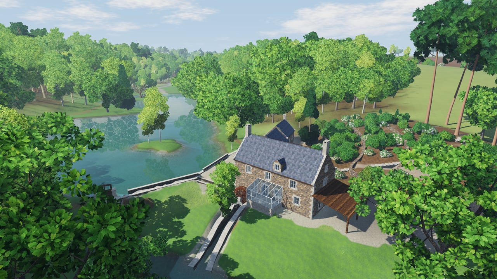
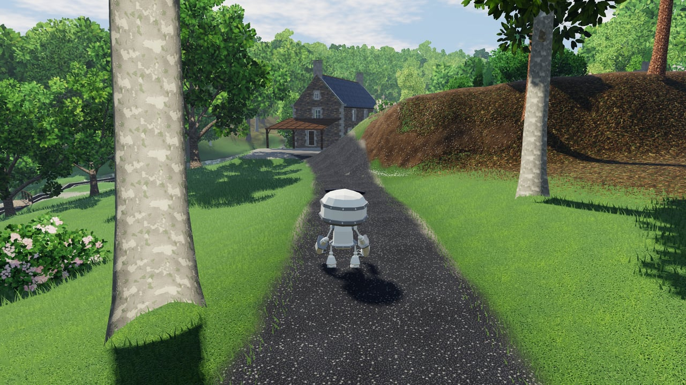
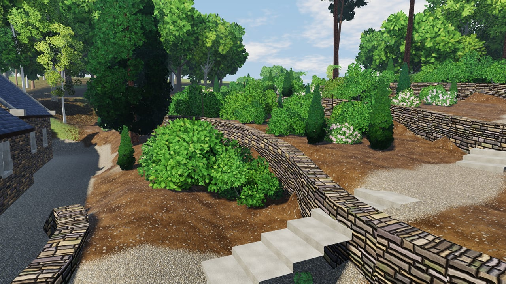
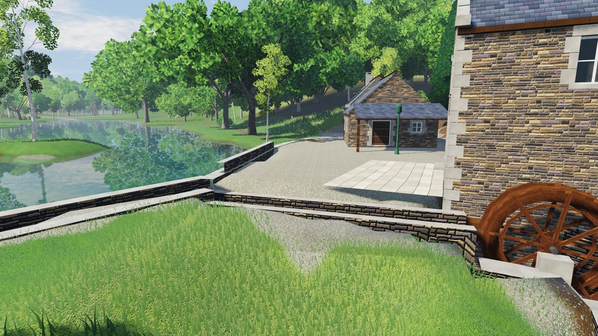
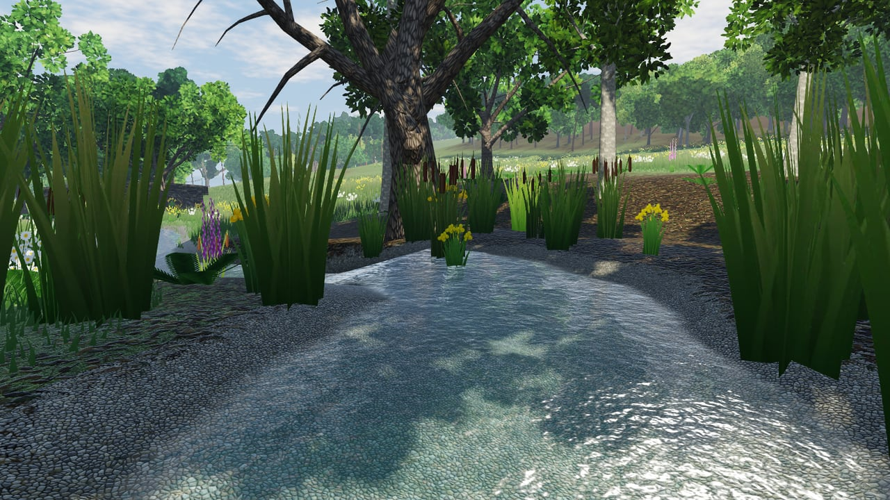
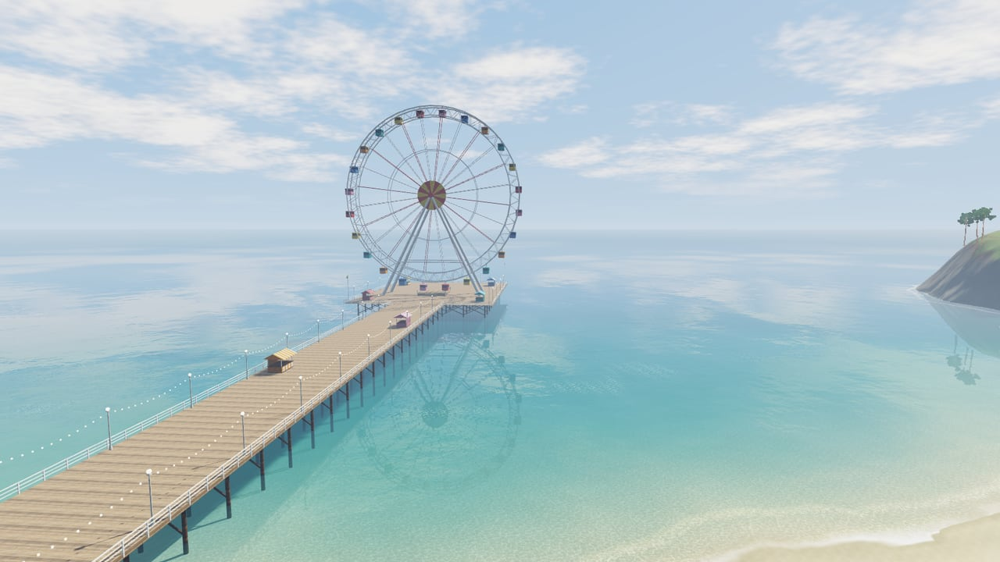
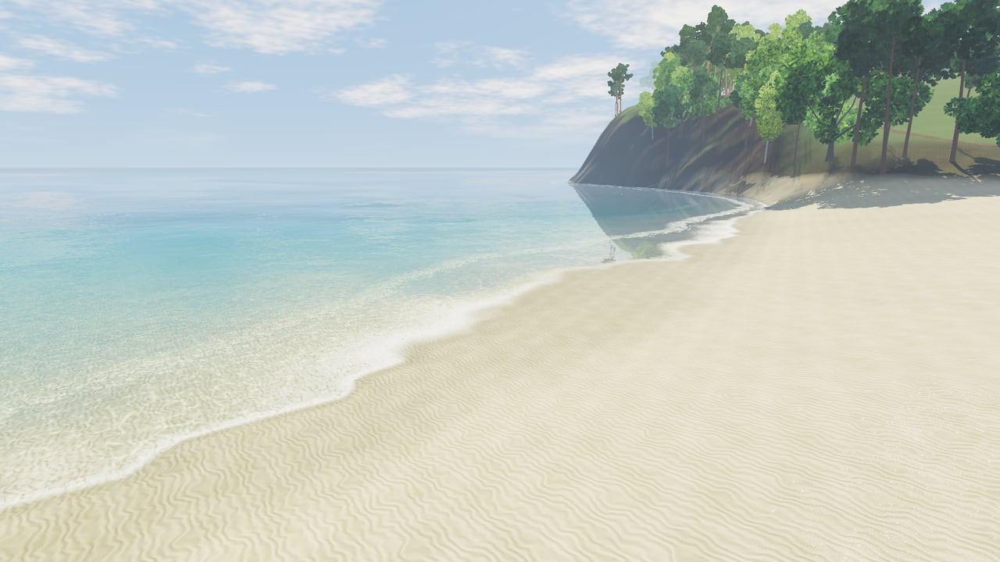

# Magic Mill Fair

Un monde 3D à explorer dans le navigateur : un vieux moulin, sa vallée, ses étangs, son bief et sa roue,
puis, au bout du ruisseau, un bord de mer imaginaire avec une grande jetée et sa grande roue.
Réalisme stylisé, ambiance de jeu d'aventure « cosy », jouable au clavier, à la manette ou au doigt,
seul ou à plusieurs.



| | |
|---|---|
|  |  |
|  |  |
|  |  |

## Démarrer

Node.js 22 ou plus récent.

```bash
npm install
```

```bash
npm run dev
```

Ouvre `http://localhost:5173`. Cette commande lance le site **et** le relais multijoueur : ouvre l'adresse
dans deux onglets (ou sur un téléphone du même réseau, avec l'adresse « Network » affichée) pour vous voir.

### Mettre en ligne sur Cloudflare (automatique)

Tout est décrit dans le dépôt (`wrangler.jsonc`) : il n'y a aucun réglage à faire.

1. Dans le tableau de bord Cloudflare, ouvrir **Workers & Pages**, créer une application en **important un
   dépôt Git**, autoriser GitHub et choisir ce dépôt.
2. Garder le nom proposé, `magicmillfair` (c'est celui inscrit dans `wrangler.jsonc` : les deux doivent être
   identiques), et la commande de déploiement par défaut, `npx wrangler deploy`. La commande de build peut
   rester vide.
3. Valider. Cloudflare installe les dépendances, construit le site puis publie le site, le Worker et les
   salons multijoueurs. L'adresse est de la forme `https://magicmillfair.<votre-compte>.workers.dev` ; un
   nom de domaine se branche ensuite depuis le tableau de bord.

Ensuite, chaque `git push` sur la branche de production du dépôt redéploie tout seul.

Ce qui tourne chez Cloudflare : les fichiers du site sont servis directement ; `cloudflare/worker.js` ne
répond qu'au multijoueur. Chaque salon est un *Durable Object* qui exécute exactement le même relais que le
serveur Node (`server/protocol.js`) et qui **s'endort dès que plus personne ne bouge** : les visiteurs restent
connectés, mais le salon ne consomme plus rien.

Coûts : les salons sont des Durable Objects à stockage SQLite, le type que l'offre gratuite de Cloudflare
acceptait quand ce projet a été écrit. Les quotas et tarifs changent : à vérifier sur les pages
[Workers](https://developers.cloudflare.com/workers/platform/pricing/) et
[Durable Objects](https://developers.cloudflare.com/durable-objects/platform/pricing/). Si votre offre
refusait les Durable Objects, retirez les blocs `durable_objects` et `migrations` de `wrangler.jsonc` : le
site se déploie quand même, sans multijoueur entre appareils.

Sans passer par Git, depuis un poste (demande une connexion à votre compte Cloudflare) :

```bash
npx wrangler login
```

```bash
npm run deploy
```

Pour essayer la version Cloudflare en local, dans le même moteur d'exécution : `npm run cf:dev`.

### Mettre en ligne ailleurs (Node)

```bash
npm run build
```

```bash
npm start
```

`npm start` sert le dossier `dist/` et la présence multijoueur (WebSocket sur `/ws`) depuis **un seul
processus**, sur le port `PORT` (8787 par défaut). Derrière un proxy (nginx, Caddy, un PaaS…), il suffit de
laisser passer l'upgrade WebSocket. Variables utiles : `PORT`, `HOST`, `TICK_HZ` (12), `MAX_PLAYERS` (48 par
salon), `ALLOWED_ORIGINS` (origines autorisées à ouvrir le multijoueur ; vide = le site lui-même).
Sur un serveur, `npm ci --omit=dev --omit=optional` suffit (les outils de cuisson ne sont pas nécessaires).

Hébergement 100 % statique (GitHub Pages, Netlify, un simple dossier) : `dist/` fonctionne tel quel depuis
n'importe quel sous-chemin. Sans serveur de présence, seuls les onglets d'un même navigateur se voient.
Pour brancher un relais hébergé ailleurs : construire avec `VITE_WS_URL=wss://exemple.org/ws`, ou ajouter
`?ws=wss://exemple.org/ws` à l'adresse, et déclarer l'origine du site dans `ALLOWED_ORIGINS` côté relais.

Les personnes qui ouvrent **la même adresse** partagent le même salon. `?room=nom` crée un salon privé.

## Commandes

| | Clavier / souris | Tactile | Manette |
|---|---|---|---|
| Se déplacer | ZQSD ou flèches (positions physiques : WASD fonctionne aussi) | manette virtuelle à gauche | stick gauche |
| Regarder | glisser la souris ; double-clic pour capturer le pointeur | glisser à droite | stick droit |
| Courir / sauter | Maj / Espace | boutons à droite | gâchette, bouton A |
| Zoom | molette | pincer | |
| Caméra libre | F (Espace / C pour monter et descendre, Maj pour accélérer) | bouton appareil photo | |
| Émotes | T, ou 1 à 6 | bouton sourire | |
| Mesures | P | Réglages → Mesures de performance | |
| Revenir au départ | R | | |

Le personnage marche, court, saute, nage dans les étangs et la mer, monte sur les ponts et la jetée.

## Qualité et performances

Quatre paliers (**Léger**, **Équilibré**, **Élevé**, **Ultra**) choisis automatiquement d'après l'appareil,
modifiables dans les réglages (ou `?q=low|medium|high|ultra`). En plus, la résolution de rendu s'ajuste en
continu pour tenir la cadence. Ce que chaque palier règle : résolution maximale, ombres dynamiques,
résolution des reflets, portée des arbres détaillés, densité de l'herbe et des fleurs, taille des textures.

Techniques employées :

- **Terrain** : un seul maillage instancié (CDLOD), niveaux de détail continus sans coutures.
- **Arbres** : 3 871 arbres et arbustes en trois niveaux de détail (maillage complet, maillage simplifié,
  imposteurs rééclairés cuits au chargement), tous instanciés, fondus sans à-coups.
- **Herbe et fleurs** : placées sur la carte graphique, générées par tuiles autour du joueur.
- **Ombres** : une carte d'ombres statique du monde entier cuite une fois (le soleil est fixe) et une cascade
  dynamique autour de la caméra.
- **Eau** : reflet planaire à résolution réduite, rendu seulement quand de l'eau est visible.
- **Décors** : maillages fusionnés par matériau, petits objets masqués avec la distance.

### Mesures

Parcours automatique à travers les deux zones (`?bench=1`), 1280×720 :

| Palier | Appels de dessin (moy. / max) | Triangles (moy. / max) | Temps de script par image |
|---|---|---|---|
| Léger | 66 / 123 | 208 000 / 366 000 | 2,8 à 3,8 ms |
| Équilibré | 108 / 165 | 419 000 / 723 000 | 3,8 à 4,8 ms |
| Élevé | 133 / 213 | 609 000 / 990 000 | 5,0 à 5,5 ms |
| Ultra | 149 / 246 | 816 000 / 1 537 000 | 4,5 à 4,7 ms |

Les appels de dessin et les triangles sont identiques d'un passage à l'autre ; le temps de script varie (deux
passages ici) et dépend de la machine. Avant optimisation, le palier Léger demandait 348 000 triangles en
moyenne et 564 000 au plus.

**Ces chiffres ne sont pas des images par seconde.** L'environnement de développement n'avait pas de carte
graphique : le rendu y est calculé par logiciel, ce qui ne dit rien de la cadence réelle. Les appels de
dessin et les triangles, eux, sont exacts ; le temps de script donne un ordre de grandeur (sur un budget de
16,7 ms par image à 60 images par seconde). Pour connaître la cadence sur un appareil :

- ouvrir le site avec `?bench=1` : le parcours dure environ 40 secondes et affiche la moyenne, le 1 % des
  images les plus lentes, les appels de dessin et les triangles ;
- ou afficher les mesures en direct (touche P).

## Organisation du projet

```
index.html
src/
  main.js                  démarrage, boucle de jeu, modes (accueil, marche, caméra libre, mesure)
  core/                    moteur (rendu, résolution adaptative), paliers de qualité, entrées, chargement
  render/                  uniformes et éclairage partagés, ciel et brume, ombres, matériau de surface
  world/
    layout/layout.js       LE plan du monde : niveaux d'eau, étangs, ruisseaux, chemins, bâtiments, jetée…
    World.js               assemble les systèmes, collisions, cuisson des ombres
    WorldData.js           cartes cuites (hauteur, eau, normales, sols) lues côté processeur et carte graphique
    terrain/  water/  vegetation/        terrain, eau, forêt, herbe, petites plantes
    props/                 constructeur de géométrie, matériaux, murs, ponts, fusion et masquage par distance
    zones/mill/            la maison, la dépendance, le bief, la roue, la rocaille
    zones/pier/            la promenade, la jetée, la grande roue
  player/                  avatar animé, contrôleur (marche, nage, saut), caméras
  net/                     présence multijoueur (transport WebSocket ou entre onglets, interpolation)
  ui/                      accueil, mini-carte, réglages, commandes tactiles
  app/Benchmark.js         parcours de mesure
server/index.js            serveur de production Node : fichiers statiques + relais de présence
server/protocol.js         le relais lui-même (protocole, validation, envois groupés), commun aux deux hébergements
cloudflare/worker.js       version Cloudflare : Worker + un Durable Object par salon
wrangler.jsonc             configuration du déploiement Cloudflare (construction comprise)
tools/                     cuisson du monde et des textures, tests, mesures (voir plus bas)
public/assets/             cartes du monde, textures, modèle de l'avatar
```

### Le monde est cuit à l'avance

`src/world/layout/layout.js` décrit le monde (en mètres, dans un repère local). `npm run bake:world` en tire
les cartes de 1024 × 1024 m lues par le jeu : relief, niveaux d'eau, normales, nature des sols, position des
arbres. `npm run bake:textures` génère toutes les textures (sols, pierres, écorces, feuillages, fleurs) : il
n'y a aucune photo dans le projet, tout est procédural.

Pour modifier le monde : changer `layout.js`, relancer `npm run bake:world`, recharger la page.

### Ajouter une zone (la suite : la fête foraine)

1. Décrire son emprise dans `layout.js` (plateformes `PADS`, chemins `PATHS`, entrée dans `ZONES`) et recuire.
2. Créer `src/world/zones/<nom>/<Nom>Zone.js` sur le modèle de `PierZone.js` : construire la géométrie avec
   `Parts` / `MeshBuilder`, exposer `group`, `colliders`, `update(dt, time, camera)`.
3. L'enregistrer dans `World.load()` et ses obstacles dans `World.buildCollision()`.

Les stands répétés gagnent à être instanciés (`THREE.InstancedMesh`, comme les nacelles de la grande roue),
les décors fixes à être fusionnés (`mergeStatic`) et les petits objets masqués au loin (`distanceCuller`).

### Multijoueur

Le serveur ne décide de rien : chaque visiteur envoie l'état de son avatar (position, orientation,
animation) dix à douze fois par seconde, le relais le redistribue par salon, et chaque client reconstruit un
mouvement fluide par interpolation. Sans relais joignable, la même interface fonctionne entre les onglets
d'un navigateur. Le protocole est décrit en tête de `server/protocol.js`, l'interface cliente dans
`src/net/Presence.js`. Le même relais tourne sous Node (`server/index.js`) et sur Cloudflare
(`cloudflare/worker.js`).

## Outils

| Commande | Rôle |
|---|---|
| `npm run bake` | recuit le monde et les textures |
| `npm test` | 100 vérifications du serveur Node, du protocole et de l'interpolation |
| `npm run test:cf` | les mêmes vérifications de protocole sur la version Cloudflare (dans son moteur local), plus les siennes : fichiers et en-têtes, mise en sommeil des salons, connexions fantômes (59 en tout) |
| `npm run test:smoke` | pilote le vrai site : accueil, marche, caméra libre, réglages (`-- --mobile` pour la mise en page tactile) |
| `npm run test:walk` | le personnage monte sur la jetée, bute sur le garde-corps, traverse un pont, nage, change de palier |
| `npm run test:duo` | deux visiteurs sur le serveur de production : ils doivent se voir bouger (`-- --cloudflare` pour la version Cloudflare) |
| `npm run bench` | parcours de mesure pour chaque palier |
| `npm run profile` | coût de chaque système (script, appels de dessin, triangles) en sept points de vue |
| `npm run shots -- nom=x,y,z,cap,inclinaison` | captures d'écran depuis un point de vue |

À partir de `test:smoke`, ils pilotent Chromium avec Playwright, qui n'est pas installé par défaut :

```bash
npm install --no-save playwright
```

```bash
npx playwright install chromium
```

## Limites connues

Fidélité au lieu

- **Relief** : il vient d'un modèle de terrain ouvert d'environ 25 à 30 m de résolution, pas d'un relevé au
  mètre (la source plus fine n'était pas accessible depuis l'environnement de travail). Le vallonnement
  d'ensemble est juste ; les berges, talus, terrasses et canaux sont dessinés à la main par-dessus.
- **Ressemblance, pas copie** : implantation, volumes, matériaux et grands arbres suivent les photos et la vue
  aérienne ; les dimensions exactes des bâtiments, le détail du jardin et la position de chaque arbre sont
  estimés. Les intérieurs ne sont pas modélisés.
- **Le bord de mer est inventé**, comme demandé : la côte, la plage, la jetée et la grande roue n'existent pas.

Performances

- **Aucune cadence mesurée sur une vraie carte graphique**, ni sur un vrai téléphone (voir « Mesures »).
  Le palier Léger est conçu pour les téléphones, mais c'est à vérifier sur les appareils visés.
- Testé uniquement dans Chromium (bureau et écran de téléphone simulé). Firefox et Safari ne l'ont pas été.
- Le monde est chargé d'un bloc au démarrage : environ 9 Mo aux paliers Léger et Équilibré, 14 Mo aux paliers
  Élevé et Ultra (plus 1 Mo de code). Les textures ne sont pas en format compressé pour carte graphique. Sur
  un téléphone d'entrée de gamme, le chargement et la mémoire peuvent être justes.
- Changer de palier recharge la page (au même endroit).

Rendu

- Un seul plan de reflet à la fois : quand deux plans d'eau à des hauteurs différentes sont visibles, le
  second reflète le ciel seulement. Pas de vue sous l'eau : la caméra reste au-dessus de la surface.
- Pas de post-traitement (halo lumineux, profondeur de champ). Soleil fixe : ni météo ni cycle jour-nuit,
  comme prévu pour cette version.
- Quelques transitions de niveau de détail restent visibles sur les arbres proches, surtout au palier Léger.
- Pas de son.

Jeu et multijoueur

- L'avatar est un robot libre de droits, en attendant un personnage sur mesure. La grande roue tourne mais on
  ne peut pas y monter. Les collisions sont simples (cylindres, boîtes, plateformes).
- Multijoueur : présence seulement (position, nom, couleur, émotes). Pas de discussion écrite, pas de
  sauvegarde, pas de contrôle anti-triche. 48 visiteurs par salon. Non testé avec une vraie latence, ni
  derrière HTTPS ou un proxy.
- Cloudflare : la version Cloudflare a été testée dans le moteur d'exécution officiel en local (protocole,
  mise en sommeil, deux navigateurs), et le déploiement a été validé à blanc — mais **jamais publié sur un
  vrai compte** : l'environnement de travail n'avait accès ni à Cloudflare ni à sa documentation. Le premier
  déploiement réel reste donc à observer, et les quotas à vérifier sur leur site.
- La fête foraine elle-même (stands, jeux) reste à faire : seule la jetée et sa grande roue existent.

Confidentialité

- Le dépôt ne contient ni nom de lieu, ni coordonnées géographiques, ni métadonnées d'image : tout est exprimé
  dans un repère local, avec des altitudes relatives. Le relief et la carte des arbres restent néanmoins tirés
  de données réelles : en théorie, quelqu'un de très déterminé pourrait les rapprocher de données publiques.
  Si ce risque compte, on peut retourner ou déformer la carte avant de recuire.

## Crédits

- [three.js](https://threejs.org) (licence MIT).
- Avatar : « RobotExpressive » de Tomás Laulhé, modifié par Don McCurdy, domaine public (CC0), issu des
  exemples de three.js.
- Tout le reste (relief retravaillé, textures, bâtiments, végétation, eau) est généré par le code du projet.
