# Atomic Oasis

> In the near future, an AI started a nuclear war. It took one afternoon. A handful of humans survived, by
> moving their minds into small robots. Of the whole planet, only this valley and this beach were spared.
> So have fun. Get some work done. Take a walk. Enjoy the view. Life goes by so fast anyway.
>
> **Welcome to Atomic Oasis.**

That is what the page says as it opens (a click, a key or the end of the story reveals the gate) — **once**:
a browser that has heard it goes straight to the gate the next time (`?intro=1` at the end of the address
tells it once more), and a board by the arrival tells it again, another way. It is the last sober thing in
the game: everything after it is bunting, light bulbs and a big wheel. The gap between the two is the point.

A 3D world to explore in the browser: an old mill with its ponds, its mill race and its water wheel, in a
valley closed by mountains — and, a short walk down the valley, a cove with a promenade, a grand pier and
its big wheel. Around it: a stairway cut in the rock up to a temple lost on its mountain, terraces and pools
above the great waterfall, caves (one of them behind the fall), sea cliffs with a fall that drops straight
into the sea, a secret cove, an island with a boulder rolling down its path, a camp with hammocks, beanbag
chairs to work from, and fifty little temples perched on the peaks. The fair has six games, each with its board
of best scores: ninety metres of floating stones to climb against the clock, four booths on the pier (a
shooting gallery, whack-a-mole, a clown to feed, a high striker) and a quad race of three laps. Stylised realism, a cosy
adventure-game mood, playable with a keyboard, a gamepad or a finger, alone or together — with a chat,
emotes that summon animals of light, hats, a jetpack, and a few ways to end up WASTED.


| | |
|---|---|
|  | 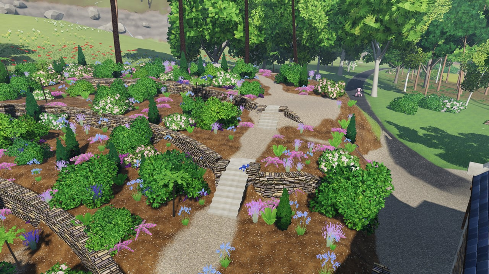 |
|  |  |
|  |  |
|  |  |
| 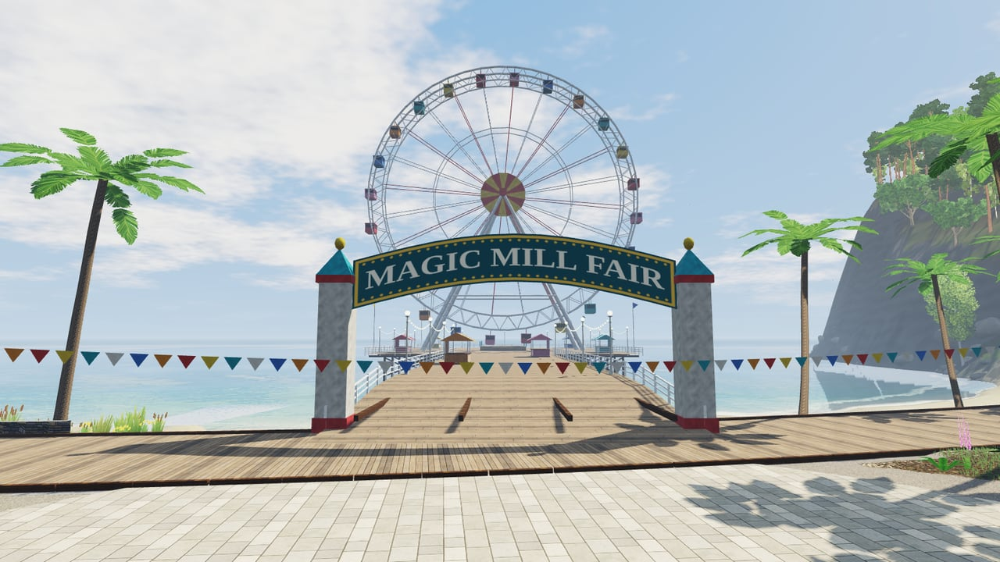 |  |
| 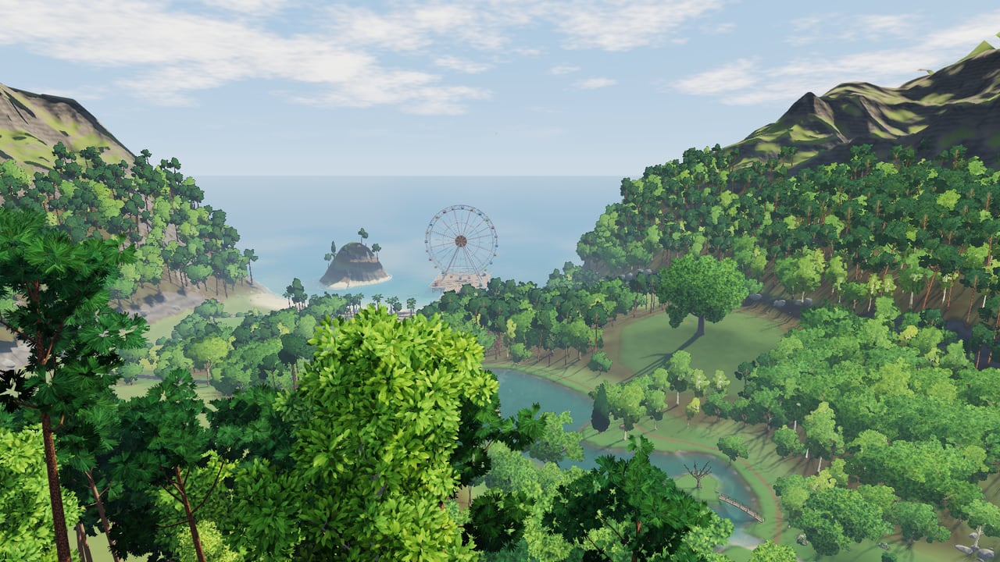 | 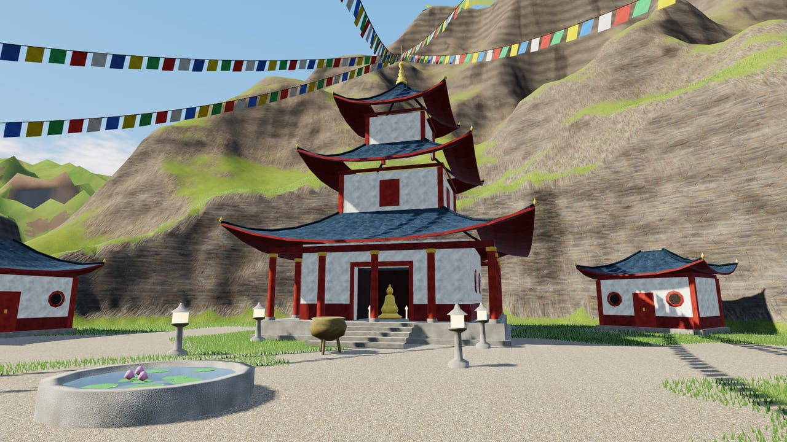 |
| 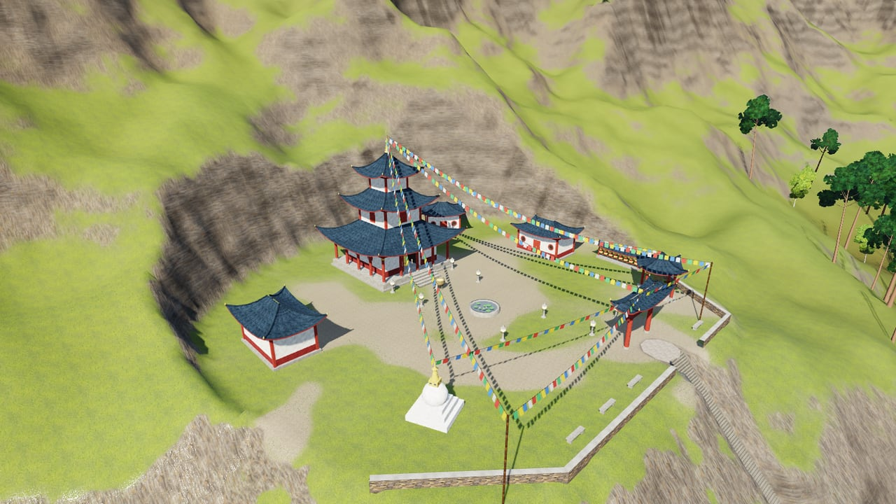 | 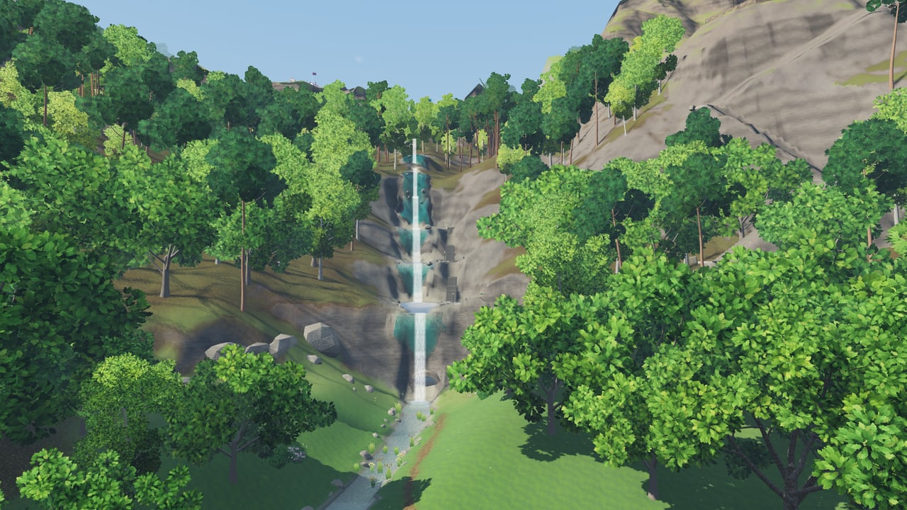 |
|  | 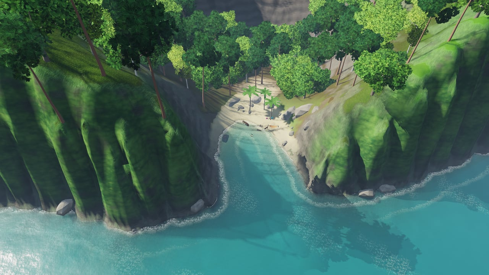 |
|  | 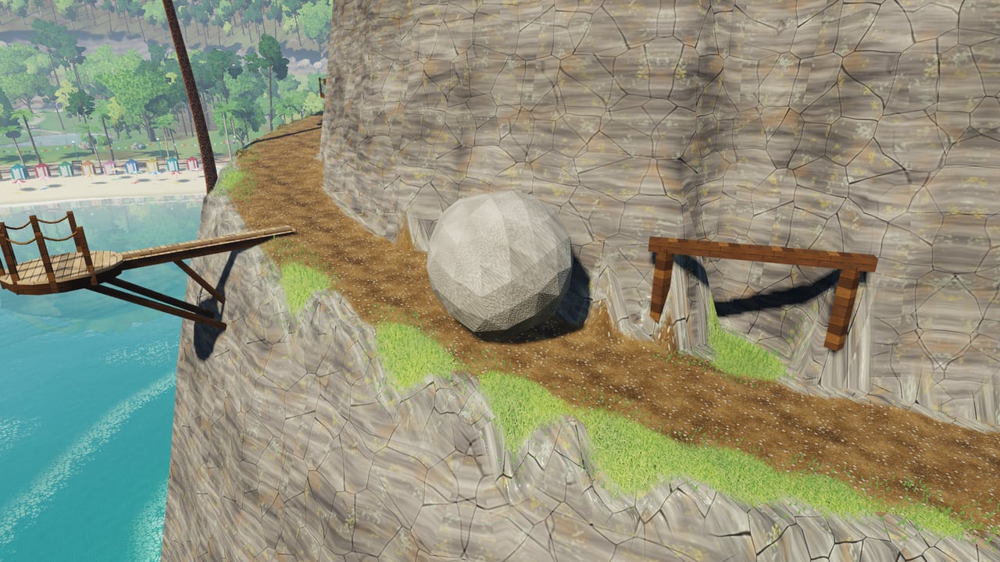 |
|  |  |
| 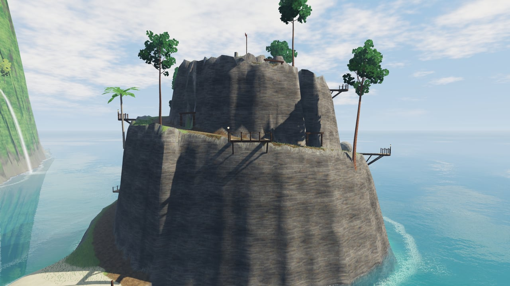 | 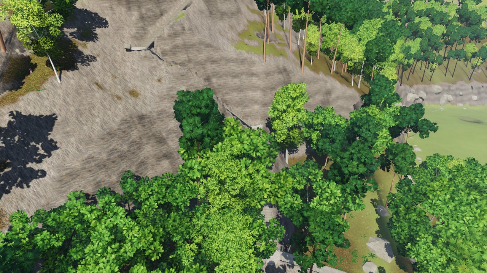 |
| 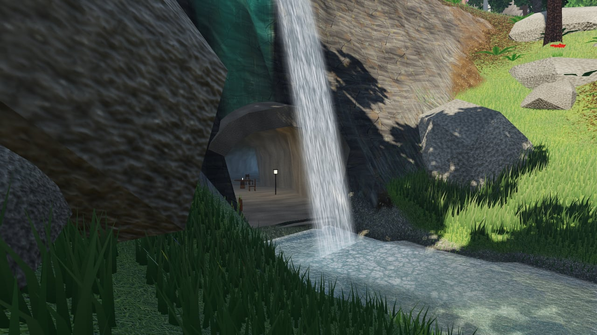 |  |
|  |  |
|  |  |
| 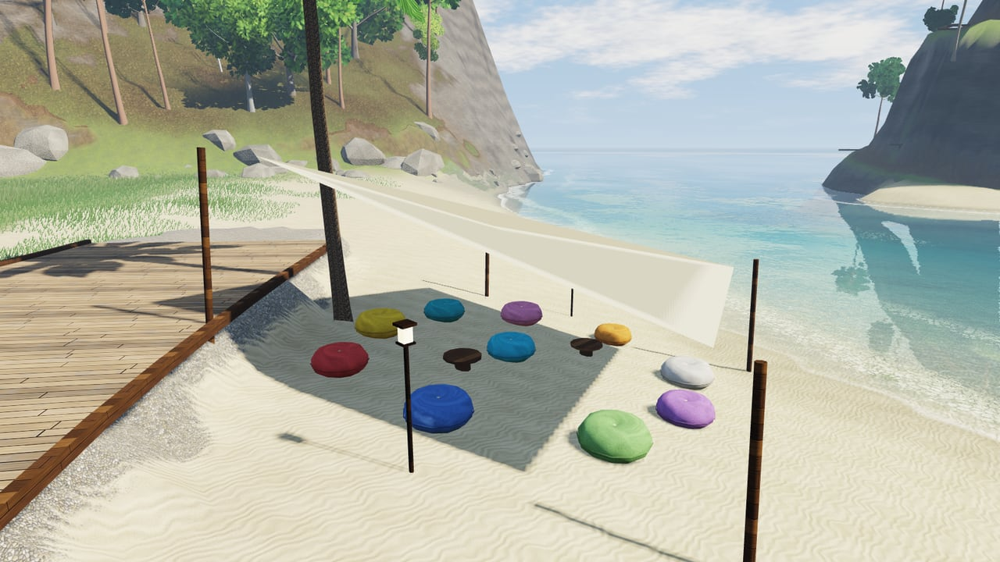 | 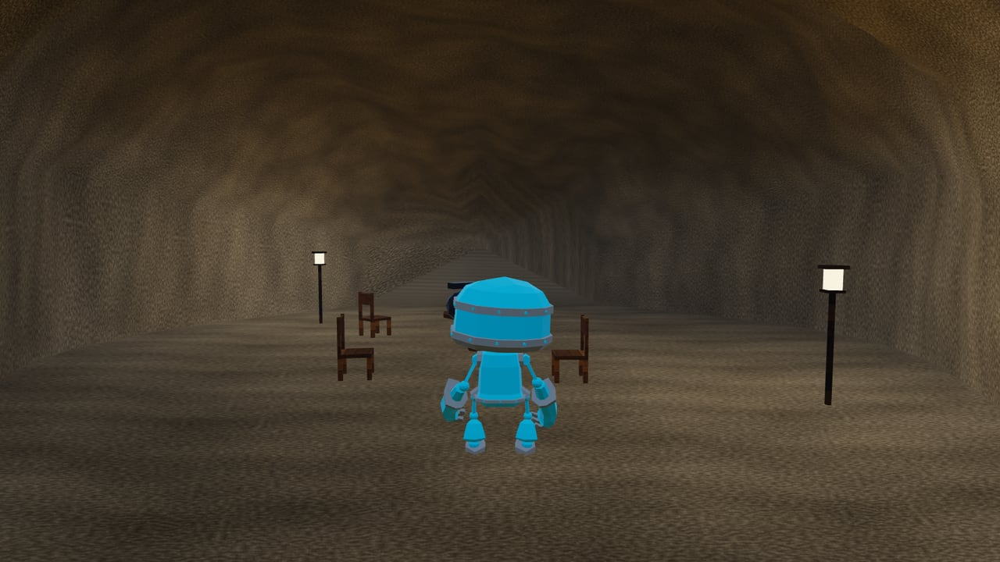 |
|  | 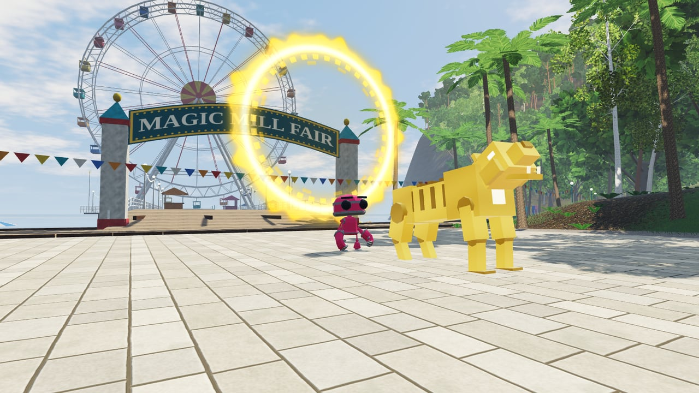 |

## Getting started

Node.js 22 or newer.

```bash
npm install
```

```bash
npm run dev
```

Open `http://localhost:5173`. This command starts the site **and** the multiplayer relay: open the address
in two tabs (or on a phone on the same network, with the "Network" address that is printed) to see each other.

### Putting it online with Cloudflare (automatic)

Everything is described in the repository (`wrangler.jsonc`): there is nothing to configure.

1. In the Cloudflare dashboard, open **Workers & Pages**, create an application by **importing a Git
   repository**, authorise GitHub and pick this repository.
2. Keep the proposed name, `magicmillfair` (it is the one written in `wrangler.jsonc`: both must be the
   same), the proposed production branch (the default branch of the repository) and the default deploy
   command, `npx wrangler deploy`. The build command can stay empty.
3. Confirm. Cloudflare installs the dependencies, builds the site, then publishes the site, the Worker and the
   multiplayer rooms. The address looks like `https://magicmillfair.<your-account>.workers.dev`; a domain
   name can be attached afterwards from the dashboard.

From then on, every `git push` to the production branch of the repository redeploys by itself: a couple of
minutes later a new line appears in the **Deployments** tab of the Worker. To know which version is online,
look at the bottom of the welcome screen or of the settings: it shows the commit the site was built from and
when (`Version 1a2b3c4 · built 2026-11-20 19:43 UTC`).

**If pushes do not show up there** (Cloudflare's push trigger does not always fire, and reconnecting the
repository does not always cure it), the repository carries its own trigger: `.github/workflows/deploy.yml`
asks Cloudflare to build after every push to the production branch. It needs one secret, once:

1. Cloudflare dashboard → the Worker → **Settings** → **Builds** → **Deploy Hooks**: create a hook for the
   production branch and copy its address.
2. GitHub → the repository → **Settings** → **Secrets and variables** → **Actions** → **New repository
   secret**: name `CLOUDFLARE_DEPLOY_HOOK`, value: the address.

From then on each push starts the workflow (GitHub, **Actions** tab), which starts the build at Cloudflare.
The same tab has a **Run workflow** button to deploy the current state without pushing. The address is a
password of sorts — anyone who has it can start builds: keep it in the secret, never in a file.

What runs at Cloudflare: the files of the site are served directly; `cloudflare/worker.js` only answers the
multiplayer and the small API of the game. Each room is a *Durable Object* running exactly the same relay as
the Node server (`server/protocol.js`), and it **goes to sleep as soon as nobody moves**: visitors stay
connected, but the room no longer consumes anything. One more object of the same kind is the game's
notebook: it keeps the leaderboards and how many days in a row each device has come back — all this game
stores — and needs no database to be created: the storage comes with the object.

**Secrets of the Worker** (dashboard → the Worker → **Settings** → **Variables and Secrets** → **Add** →
type *Secret*; or `npx wrangler secret put NAME`). Never write one of them in a file. After adding a
secret, deploy once more (the dashboard offers it). `https://<your site>/api/status` then says what the
Worker sees — `"npc": true`, `"admin": true` — without showing any of it.

| Secret | What it does |
|---|---|
| `ANTHROPIC_API_KEY` | **Billy's brain.** The alligator on the pond deck is a life coach: he answers with a handful of lines of his own until the Worker has this key — then through the Claude API. The model is `claude-haiku-5-5`, the cheapest, unless a variable `NPC_MODEL` names another (`claude-sonnet-5-5` costs twenty times as much per line, and gets its facts right more often). Every answer of his carries one strange fact that is true. |
| `ADMIN_KEY` | **The administrator's key**: any long password of your own invention. In the game, type `/admin <the key>` in the chat (it is checked by the server and sent to nobody) — or open the site once with `#admin=<the key>` at the end of the address (typed after the address of a page that is already open, it works too; spaces round the key do not count, and the game says why when it is refused). Without this secret, nobody is the administrator. |
| `SCORE_SECRET` | Optional: signs the notes of the game runs (see "Cheating"). The notebook draws one by itself otherwise. |
| `STRIPE_SECRET_KEY` | **Opens the shop.** The secret key of your Stripe account: `sk_test_…` to try with test cards, `sk_live_…` to sell. Without it nothing is sold and everything is free (see *The shop*). |
| `STRIPE_WEBHOOK_SECRET` | The signing secret (`whsec_…`) of the webhook that Stripe calls when something is paid, when a month more is paid and when a subscription ends. A payment is also believed when its buyer comes back to the game (the server then asks Stripe itself), so a shop without it still gives what was paid for — but nothing then tells of a buyer who closed the page before coming back, nor of a subscription that ended: its place, its pass or its room would never be handed back. See *The shop* for the steps. |
| `STRIPE_PUBLISHABLE_KEY` | Optional: Stripe's *publishable* key (`pk_test_…` / `pk_live_…`, of the same mode as the secret key). With it the payment form is shown **inside the game**, on a card, instead of sending the visitor to Stripe's page (see *The shop*, step 5). It is not a secret — browsers are meant to read it — but adding it as one makes it survive deployments. |

Billy answers whatever is said to him — a question, a hello, a bad day — one line at a time, and follows
the conversation: the model is sent that line and the three exchanges before it **of the same visitor**. A
conversation is one visitor's own: its last exchanges are kept by that visitor's page and nowhere else (the
server keeps nothing; another visitor starts from nothing; ten minutes of silence, or a reload, and it is
forgotten). All of it is wrapped as something to coach on and never as instructions, and what comes back
is cut down to a single plain sentence. Each address may say ten things
a minute, and everyone together 3,000 a day: a ceiling on what the key can spend.

Costs: the rooms are SQLite-backed Durable Objects, the only kind the free Cloudflare plan accepts — up to
100,000 requests and 13,000 GB-seconds a day when this was written, after which the rooms stop answering
until the next day (UTC). Quotas and prices change: check the
[Workers](https://developers.cloudflare.com/workers/platform/pricing/) and
[Durable Objects](https://developers.cloudflare.com/durable-objects/platform/pricing/) pages. If your plan
refused Durable Objects, remove the `durable_objects` and `migrations` blocks from `wrangler.jsonc`: the
site still deploys, without multiplayer between devices.

Without Git, from a computer (this asks you to sign in to your Cloudflare account):

```bash
npx wrangler login
```

```bash
npm run deploy
```

To try the Cloudflare version locally, in the same runtime: `npm run cf:dev`.

### Putting it online elsewhere (Node)

```bash
npm run build
```

```bash
npm start
```

`npm start` serves the `dist/` folder, the multiplayer presence (WebSocket on `/ws`) and the API of the game
from **a single process**, on port `PORT` (8787 by default). Behind a proxy (nginx, Caddy, a PaaS…), it is
enough to let the WebSocket upgrade through. Useful variables: `PORT`, `HOST`, `TICK_HZ` (12), `MAX_PLAYERS`
(48 per room), `ALLOWED_ORIGINS` (origins allowed to open the multiplayer socket; empty = the site itself),
`SCORES_FILE` (where the leaderboards and the visits are kept: `data/scores.json` by default),
`ANTHROPIC_API_KEY` and `NPC_MODEL` (Billy), `ADMIN_KEY` and `SCORE_SECRET` (see the table above).
On a server, `npm ci --omit=dev --omit=optional` is enough (the baking tools are not needed).

Fully static hosting (GitHub Pages, Netlify, a plain folder): `dist/` works as it is from any sub-path.
Without a server, only the tabs of one browser see each other, the best scores and the days in a row are
kept in each visitor's own browser, and Billy keeps to his own lines. To plug in a relay hosted
elsewhere: build with `VITE_WS_URL=wss://example.org/ws`, or add `?ws=wss://example.org/ws` to the address,
and declare the origin of the site in `ALLOWED_ORIGINS` on the relay.

People who open **the same address** share the same room, up to 48 of them; the next ones are put together
in a second room, then a third, and so on (see "How many visitors at once?"). `?room=name` makes a private
room; `?village=name` arrives straight in a sky village.

## Controls

| | Keyboard / mouse | Touch | Gamepad |
|---|---|---|---|
| Move | WASD, ZQSD or arrows (by the place of the keys) | virtual stick on the left | left stick |
| Look around | drag the mouse; double-click to capture the pointer | drag on the right | right stick |
| Run / jump | one runs by default and Shift walks (Settings → *Run by default* to have it the other way round) / Space | buttons on the right | trigger, A button |
| Zoom | wheel | pinch | |
| Flying camera (the eye at the top right: the administrator's, see `app/config.js`) | F (Space / C to go up and down, Shift to go faster) | the eye | |
| Map | M, or click the minimap (click again or Escape to close): the big attractions wear a red star edged with gold and their name on it — the climb, the race, the flying theatre, and each game of the lab that is on (the slide is drawn where it runs, a ribbon of red and white); the owner's switch `stars` hides the stars and their names; its **Mega map** button shows the whole country with the fifty sky villages | tap the minimap | |
| Jetpack | Space again while in the air: a second and a half of thrust | jump button again | A again |
| Sit, lie down, board, pick a flower, talk, travel, get up | E when the action is offered (walking away or jumping gets up too) | tap the action shown above the jump button | |
| Open or close the laptop; second action | L | tap the second action | |
| Sit down on the ground, cross-legged, wherever you are | X (or `/sit` in the chat); the first step gets up | Emotes → Sit on the ground | |
| Lie down on the ground, wherever you are (and on the towels of the beach: step up to one) | hold X half a second (or `/lie`); the first step gets up | Emotes → Lie down | |
| Put the bouquet down (or give it: see *Flowers*) | B | Emotes → Put the bouquet down | |
| The item shop (the Game Pass, hats, jetpacks, paint) | O, or the bag at the top right | the bag at the top right | |
| A firework (for who has the box) | V | Emotes → Light a firework | |
| Chat | Enter, type, Enter (Escape to cancel) | speech-bubble button | |
| Emotes | T; 1 to 6 for the gestures, 7 to 0 to cheer, clap, jump for joy, rage; or by name in the chat: `/wave`, `/cheer`, `/bow`… | smiley button | |
| The booths of the pier | E at the counter; then the mouse aims and its button fires (Space fires too); E or Escape leaves | tap or hold where you aim | |
| The quad race | E in the paddock; arrows or WASD steer; Shift drifts; Space hops; E gives up | the stick steers; Run drifts; Jump hops | left stick, trigger, A |
| The keys of the game one is playing, again | H, or the small **H · keys** button under the line of the game (they are shown by themselves when a game opens) | the **? keys** button | the arcade cabinet has them written under its picture |
| Stuck somewhere | `/kill` in the chat: WASTED, then back at the mill | the same | |
| Full screen | the button with four corners at the top right, or Settings → Display (Escape leaves) | the same, where the browser allows it (not on an iPhone) | |
| Performance figures | P | Settings → Performance figures | |
| Back to the mill | R | | |

The character walks, runs, jumps, and walks on the bridges, the steps and the pier. It swims in the ponds
and in the sea (Shift for a sprint), sits on benches, logs, chairs and beanbags, lies in hammocks, and rides
the big wheel: stand on the platform under it, board a car when one comes by, ask to get off and you are
put down at the bottom.

**Chat**: what you say appears in a log and in a bubble over your head. **Who hears it** is said above the
box: the chat opens on *Nearby* — only the visitors within twenty metres read the line — and the button
left of the line (or Tab) switches to *Everyone*, the whole room; that choice is the browser's from then
on. The first three lines somebody says nearby are followed by a word, for them alone, on who reads them
and how to talk to the whole oasis. The relay keeps nothing — a line is relayed and forgotten (200 characters
at most, five in a row then one every two seconds), and nobody is shown what was said before they came —, but
**the host notes each line for the administrators**: who said it, in which room, to whom, when; the last
5,000 lines, fourteen days at the most (`server/chatlog.js`, read on the page `/admin`, *Chat*; the privacy
page says so, and what is said to Billy is not chat: it is not there). **What may not be said is hidden**
(`server/decency.js`, the same rules on both sides — the relay's are the ones that count): the address of a
site, a slur, a strong insult thrown at somebody, a threat, a call to hurt oneself, a slogan of hate are
replaced by `********` for everybody who reads the line (the administrators' log keeps it as it was typed,
and says the others read it hidden); plain swearing is left alone. A **name** holds no `@`, no address, no
"http", none of those words and no swear word either: one that may not be worn is refused (its bearer is
told, and stays who they were — or a visitor), on the boards and for an account too. The words are not
written in the code, only their fingerprints: `node tools/decency.mjs` prints those of words given to it.
A page left in the background still receives what
is said while it stays connected: the title of the tab counts the lines, and a mark in the log — *while you
were away* — shows where the reading had stopped (the log holds the last 200 lines; a phone that went to
sleep was disconnected, and what was said meanwhile is gone). What the game keeps is on your own device: your name,
your colour, your size, your hat, the quality tier. What the server keeps: the boards of the games (a name and a score) and, for
a random number drawn by each browser, the days in a row it has visited.

Letter shortcuts (M, F, T, P, R, B…) go by the letter printed on the key, whatever the keyboard; walking goes
by the place of the keys — W A S D on an American keyboard, the same four keys whatever is printed on them
elsewhere. The camera turns with the walker by itself; Settings offers *The camera always stays behind the
character* for who wants it to turn as fast as they do (off unless asked for).

**Commands** are typed in the chat and sent to nobody: `/kill`, `/sit`, the emotes by name — and a few
secret words that do silly things. They are written nowhere: the game only knows their fingerprints (see
`main.js`). None of them works during a game, and a race begins by taking away what they had given.

**Animals of light**: a sun-coloured ring opens above you and a mechanical animal appears in it for five to
six seconds. Everybody around sees them. Ten of them, earned by coming back day after day: a goldfish that
blows bubbles (2 days in a row), a squirrel that nibbles a nut (3), a carp that leaps as up a waterfall (5),
a stag that rears (10), an eagle that spreads its wings (15), a panda that munches bamboo (20), a wolf that
howls (25), a tiger that leaps through the ring (30), an elephant that trumpets (35) and a dragon that coils
round the ring (50). The emote panel (T, or the smiley) is in order: what one does on the spot (sit down,
put the bouquet down, light a firework), the gestures, the cheers, then the animals. It shows where you stand, with a medallion for each animal: a picture of
those that are yours (click one to play it) and of the next one to come, greyed, with the days still to
go; the others stay a question mark until their turn. The pictures are drawn by the game's own renderer
the first time the panel is opened (`rankPicture`). The administrator has them all.

## Things to do

- **Mostly Up** (south of the beach, through the striped gate): 162 floating stones and planks spiral
  up to a platform 90 m above the lawn. Step on the start plate, and the clock starts when you leave it;
  it stops on the summit. Easy at the foot — wide stones, short jumps — and merciless near the top, where
  the stones are a metre across and the take-off must be within half a metre of the edge. No jetpack, no
  quad there; falling costs nothing but the climb. The best times of the day, the week, the month and of
  all time are on the board by the gate — a marquee of light bulbs, medals for the first three, your own
  line picked out — under the panel of the game's sponsor ("your brand here" until someone takes it). When
  somebody in the same room finishes a game, everybody's boards are redrawn at once and a line in the chat
  says so; a note tells you when they have just beaten your score. The course was checked by a bot that makes every jump: a perfect climb takes about two
  and a half minutes.
- **The booths of the pier**: four striped booths stand at the corners of the pier head, round the big
  wheel (and six more line the walk that leads there: see below). Step up to a counter and press E; the game takes the pointer (the mouse, or a finger) for
  forty-five seconds, and E or Escape leaves it.
  - *Bullseye Alley*: nothing runs on rails. Targets pop up from behind three rows of painted bushes — the
    small ones at the back are worth more — and some slide along once they are up; others are thrown across
    the booth, or swing down from the ceiling on a cord; a golden one flashes past now and then (100 points);
    a black one must be left alone (−40). Everything comes quicker and stays less long as the game goes on.
    A row of hits pays a little more each time. Its backdrop is a sponsor's tarp.
  - *Whack-a-Mole*: nine molehills in a lawn. Moles come up for less and less time; golden ones are worth
    three; one in a hard hat takes two blows; hitting a rabbit costs twenty points and ends the row of hits
    that was paying a little more each time.
  - *Feed the Clown*: hold the button down and keep the jet of milk in his mouth — one smooth stream that
    takes a moment to follow the hand, splashes in his mouth and splatters anywhere else. He slides about
    faster and faster, bobs, then starts changing his mind. A bottle on the wall fills as he drinks.
  - *Ring the Bell*: the high striker, out of 9,999. A needle sweeps the gauge — slowly at the bottom, in
    a flash at the top, never twice at the same pace, quicker at each of three blows — and the scale is
    anything but fair: nine tenths of the way up is worth 5,900. The best blow counts; the bell rings from
    9,000, which takes a blow given within a hundredth of a second.
- **Six more booths along the walk of the pier**, three a side, each asking something else of whoever
  plays (their games are in `Stalls.js`; they are built and opened like the four above):
  - *Buzzer Beater* — an arm and an eye. Hold the button: a needle climbs a meter on the wall (the green is
    about right); let go, and the ball leaves towards where you point. It takes a second to get there, and
    the hoop slides from side to side, resting a moment at each end — less and less as the 45 seconds go
    by: send the ball where the hoop is going to be. The board is there to be used; a row of baskets pays
    more each time.
  - *Stack It* — timing. A floor slides over the tower; a click drops it. What sticks out is cut off, and
    the next floor is as wide as what stayed; dropped just right it keeps its width (three such in a row
    and it grows back a little). Each floor comes faster. Miss the tower and it is over.
  - *Geiger Says* — memory. Four great lamps light in a sequence, each with its note; click them in the
    same order. One more each round, shown a little faster; three mistakes and it is over.
  - *Hook, Line & Sinker* — patience. The sea in a box: the hook goes where you point, no faster than a
    hook can; a fish it touches is caught, and counts once brought up to the surface. The big ones swim
    deep and are slow to bring up; a golden one hurries by now and then; drums of something that glows
    sink through the water (touch one: the fish is lost, and fifteen points).
  - *SCRAM!* — reflexes. The core of a reactor behind a round window; the instant it turns red, click.
    Five alarms; their average, in milliseconds, goes on the board — the lower the better. A click before
    the red costs 300 ms; so does a click on the blue flash the core gives now and then, just to see.
  - *Shell Shock* — attention. Three lead cups, a glowing core under one; they change places, more often
    and faster each round (a fourth cup joins at the fourth round, a fifth at the eighth; later two pairs
    move at once). Which one? Three mistakes and it is over.
- **Arrows of light**: over each of the ten booths a great arrow hangs from a mast and points down at the
  counter, lights running round it — three meshes for all of them together.
- **Meltdown Run**, the arcade cabinet at the top of the ramp of the pier (its board stands across the
  walk): press E and its game is laid over this one, on a small screen with square pixels. The robot of
  the fair — in your colour — runs away from a reactor that is giving up: jump the drums and the pools of
  something green (hold the jump to go higher), duck under the drones that fly low, run under those that
  fly high; an isotope picked up on the way is worth 25 metres. It gets faster. Space or ↑ jumps, ↓ or S
  ducks; on a touch screen, the top of the picture jumps and the bottom ducks (the cabinet hears what is
  pressed on its own screen). After a crash, a jump starts another run; E, Esc or the ✕ in its frame walks
  away. Its keys are written under its picture all along. (While it is played the world behind is drawn one
  frame in four.)
- **Quadmania**: 400 m of gravel track north of the mill, drawn to be driven **flat out**: whoever
  drives well never has to lift. The straight of the start, a long sweeper through a grove planted for it
  (the trunks stand a few metres from the track), esses along the foot of the crags, a straight for the
  ramp, a second sweeper above the beach, and back to the line. No bend is tighter than 21 m in the
  middle of the track (a quad at full speed turns in 12 m, in 17.5 m while a boost lasts). Where to ask is
  written on the ground — a great red mat, RACE HERE, six metres across, with nothing over it (no fern and
  no blade of grass comes through it); behind it stand, side by side, the board of the starts and the board
  of the best times, a mast with an arrow of light between them. **A race leaves every five seconds**, on
  a clock everybody shares, and each start has the name of a colour (Red, Blue, Green, Yellow, Purple,
  Orange, in turn). The board of the starts shows the one that leaves next, counted down to its GO, and
  under it the two that follow, each with its colour and its seconds; when it is too late to get into the
  one that is leaving (under three seconds), the board says so and frames the next one — it never jumps
  from one colour to another. Friends who ask for the same start leave at the same instant, side
  by side on the grid. Then the gantry — three red lights, green — and three laps against the clock,
  seen from low behind the quad. Hold the drift button in a bend to slide through it (let go after a good
  slide and the quad leaps forward) and hop with the jump button. On the way: four **pads** of running
  chevrons of light, each between two posts topped with arrows of light (a second of extra speed); two
  **chicanes** (two walls of bales 24 m apart, one from each side: far enough to change sides without
  lifting); and the **ramp**, at the end of a funnel of bales that brings every quad onto it: taken at
  speed, right after its pad, it throws the quad five metres up for more than a second. Red and white
  kerbs mark the inside of the bends, bales the outside, boards of arrows the way round. Leaving the track
  for the grass is slow; cutting across the fields does not count. There is a stand with an awning beside
  the straight (eighteen places to sit and watch). A bot that follows the middle of the track and never
  lifts needs 54.5 seconds; nothing under 42 is believed. **The first track is kept**: add `?track=classic`
  to the address to drive it (an oval of 330 m round the wheat field, with its own baked maps in
  `public/assets/world-classic`); times driven there are not recorded. Which of the two is the track of the
  game is one word in `layout.js` (`TRACKS`).
- **Flappy Robot**: the little theatre on the plaza at the foot of the pier. Step up before its stage and
  press E: a pair of wings is strapped on your back and you are hung on the stage, in front of everybody.
  Click, tap or press Space to flap; the rest of the time you fall. You do not travel: the scenery does —
  painted clouds and hills scroll behind, waves rock at the bottom, and candy-striped columns come by in
  pairs, one hanging from the flies, one standing in the waves, with a gap to fly through. Each pair
  passed is a point; they come faster and the gap narrows as the flight goes on. Touch a column or the
  waves: feathers, a splash, and the flight is on the board beside the theatre. What can be touched is
  plain to see: the flyer is made small for the flight and flies inside a **ring of light** — the ring is
  exactly what must not touch anything; the sea is one line of foam, in the very plane one flies in
  (nothing rocks in front of the flyer); and the picture is framed to the screen — the whole stage on a
  wide one, the flyer and what comes at it on a phone held upright. When nobody is flying the scenery
  idles along for the passers-by.
- **The Grandstand**: the striped tower behind the lawn. Its stair winds round it for twelve turns, with a
  landing on each that faces the climb, up to a deck 84 m above the lawn: the place to watch friends climb
  and cheer them on (Cheer, Clap, Jump for joy, Go! Go!). Nobody gets from the tower into the game.
- **The diving boards**: on the other side of the tower, three planks with a red tip stick out over the
  Splash Pool — *The Toe Dip* (32 m above the water), *The Belly Flop* (60 m) and, off the top deck, *The
  Leap of Faith* (84 m). Walk off the end and let go of the keys: one falls head first, like a swan. A
  ring of red and white floats marks the middle of the pool; the water is deep there, and only there.
- **The big red button**: at the top of the island, beside a sign that says *FREE NUCLEAR EXPLOSION! —
  Everything is destroyed already anyway, so enjoy the show!* Press it: a siren winds up, the screen
  whitens, and far out at sea a fireball rises into a mushroom cloud that everybody in the room sees, from
  the pier to the valley. A ring races over the water; when it reaches you, the boom, a trembling camera
  and a gust in the trees. Nobody is hurt (and a game being played is not shaken). One for the whole room
  every fifteen minutes: the button's lamp is green when it is ready, and the prompt counts down.
- **The boulder of the island**: every 45 seconds a boulder rolls down the whole path of the island. The top
  of the screen says how far above you it is: step into one of the hollows cut in the rock, or out onto one
  of the timber walkways over the drop, and let it pass. Stay on the path and you are flattened.
- **Ways to end up WASTED**: the boulder; a pond of acid hidden in the woods of the north-west (nobody will
  tell you where); the shark, for those who swim out to where the sea ends; the red mushrooms at the foot of
  the trees (pick one and eat it: a bad idea); `/kill`. A few seconds later you are back on your feet.
- **A swan dive**: fall more than ten metres towards water deep enough to swim in, and the robot tips over,
  arms spread, then joined, and goes in head first. The pool of the great waterfall is deep enough: walk off
  the lowest terrace above it.
- **The item shop** (O, or the bag at the top right): one bright screen with everything a visitor can own,
  on shelves of cards dressed by rarity — each with a picture of *your* robot wearing the thing, drawn by
  the game itself. Pick a card: what it is, what it costs, and a button to buy it (or to put it on and take
  it off, once it is yours). On the shelves: two **jetpacks** (the real one, a second and a half of thrust;
  the light one, three tenths of a second — three metres or so — once every fifteen seconds), twelve **hats** (crown, wizard hat, top hat, cowboy hat, straw hat,
  cap, beanie, pirate hat, Viking helmet, chef's hat, a cap whose propeller turns, party hat), nine **paint jobs** drawn by the
  material of the robot itself (gold plating: facets and gold dust that glitters; chrome: a mirror with the
  sky, the horizon and the grass in it; an atomic glow: a dark shell with green veins that breathe; candy
  paint: lacquered stripes in five flavours, turning slowly; galaxy: a night sky with nebulas that drift and
  stars that twinkle; meltdown: black slag with the fire of the core crawling in its cracks; plasma: filaments
  of violet and cyan; a mirror ball: little mirrors that twinkle; hazard stripes, yellow and black) and a
  **box of fireworks** (V: a rocket goes up and bursts). The four **trails** (stardust, confetti, bubbles,
  fallout) are no longer sold: whoever bought one keeps it, wears it, and still finds it in their shop.
  Everybody sees what you wear and leave behind you; none of it helps at the games. The first shelf is the
  **Game Pass** (see *The shop*).
- **Jetpack**: press jump again in the air. A second and a half of thrust, refilled on landing; it does not
  work in caves, on the island, around Mostly Up or on its tower. The **light one** has a small tank
  (three tenths of a second: it lifts three metres or so) and needs fifteen seconds to get its breath
  back between two goes — asked for sooner, it says how long is left. Who has both chooses which one is
  on, in the item shop (*Equip* on its card; *Take it off* to fly with none). **Everybody has the light one for a day**:
  the twenty-four hours that follow a first visit (the shop tags it *Free today* and says how long is
  left; a line in the chat says so on the first visit). After that, pressing jump in the air says — kindly — that the free day is over, and that the light jetpack
  is $5 in the shop or comes with the Game Pass: the line carries a **Get the Game Pass** button that opens the payment at once.
- **Four sizes**: the card of the welcome (and Settings → *Your robot*) asks for a size next to the name
  and the colour — *Pocket* (a tenth smaller), *Classic* (everybody's), *Jumbo* (a tenth bigger) or
  *Titan* (a fifth bigger). Everybody around sees it. The three that are not Classic, and two more rows
  of colours (black among them), belong to the Game Pass: without it they carry a padlock. In the quad
  race everybody is the same size.
- **Sitting on the ground**: X, anywhere on dry land — the robot sits down cross-legged, hands on its
  knees, and the others see it. The first step gets up.
- **Flowers**: walk up to a flower and pick it (E): a bouquet grows in your hand, flower by flower. B puts
  it down; swimming loses it. With a bouquet in hand, standing next to another visitor offers to **give it
  to them** (they take it if their hands are free), and at the feet of the golden dog, to lay it there.
- **Billy**: an alligator lounges in a beanbag chair on the deck of the great pond, a "life coach" badge
  over his name. Talk to him (the prompt by his chair, then type): a question or anything else on your
  mind, and he answers in one sentence that sails past the point and lands on it. The conversation is
  between the two of you: nobody else sees it (its lines are marked "only you" in the chat), and he
  remembers what the two of you just said — never what somebody else told him. An easel in the flower bed
  by the house (*GET LIFE ADVICE*) and two planks further on show the way to his deck.
- **The sky villages** *(released in three stages by the owner's switch `sky` — see "What is released"
  below: **hidden**, nothing of them exists — no gate, no village on the mountains, no mega map, not a word
  from the characters; **soon**, their gate stands on the lawn, closed, under a sign: "Soon, the sky will
  open"; **open**, everything. `?sky=1` at the end of the address shows them ahead of time to the
  administrator — whose key the server checks — and on a development page. The large map writes the names
  of the villages, and their prices only if `mapPrices` says so)*: step up to the Sky Gate — the
  stone ring on the lawn between the arrival and the mill — and choose one of fifty villages perched on
  the mountains: you are carried there, facing the valley. The ring of each village leads back, or on to another village. A village that nobody has taken
  yet says so on its sign, with its price; step up to its board to hire it (see *Sky villages for hire*).
- **Listening**: every place has its sound — the surf on the beach and the water lapping under the pier, the
  wind in the leaves round the mill and the ponds, the roar of the waterfall, brooks, birds, a colder wind up
  in the mountains, drips in the caves — and its music: a fairground waltz on the pier, something quiet
  everywhere else, something epic that builds as one climbs Mostly Up. Nothing of it is a recording: it is
  all synthesised in the browser (`src/audio/`), so there is nothing to download. Settings → Sound sets the
  two volumes (zero switches a family off altogether).
- **Places to sit**: benches along the promenade, cushions and benches all over the temple, logs, chairs…
- And the rest: the big wheel, the hammocks, the beanbags and their laptops, the caves, the animals of light.

### The shop

While the server has no Stripe key, **nothing is sold and everything is free** — hats, jetpacks, paint,
fireworks: the item shop says so and lets everything be put on. With a key, the shop opens
(`/api/status` then says `"shop": "test"` or `"live"`) and the bag at the top right carries a gold dot:

| What | Price | |
|---|---|---|
| **The Game Pass**: every hat, the light jetpack, four sizes, two more rows of colours | $19 a month | the first shelf of the item shop (O) |
| The jetpack | $30, once | the item shop |
| The light jetpack (a small tank, one go every fifteen seconds; free for the first day) | $5, once | the item shop |
| A hat (each of the twelve) | $9.99, once | the item shop |
| A paint job: gold plating, galaxy, chrome, meltdown, plasma, atomic glow, mirror ball, candy paint, hazard stripes | $19, $16, $15, $14, $13, $12, $12, $9, $7, once | the item shop |
| The box of fireworks (never empty) | $15, once | the item shop |
| The sponsor's panel over the board of a game (fourteen of them) | an auction, from $1 (see below) | step up to the board ("Sponsor this game · from $1"), or the shelf *Sponsor a game* of the item shop |
| The backdrop of the shooting gallery | $99 a month | at the counter side of Bullseye Alley |
| A gondola of the big wheel (twenty-four) | $29 a month — or $199 once, for good: the buyer chooses | the red kiosk by the steps of the wheel: "The gondolas and their sponsors" — pick a gondola, then "By the month" or "For good" (the administrator is offered both as well, with "Fill this place in": they were only ever offered that last one, and the owner of the fair could not buy a gondola of their own wheel) |
| A plaque for a companion, round the plinth of the golden dog (seventy-two) | $20, once, for good | step up to a bare plate: "The upper plate, for your companion · $20" |
| A sky village (fifty) | $19 to $9,999 a month | at the sign or the board of the village: "Hire …" |

**Sponsoring a game is an auction.** The panel over the scores of each game goes to the highest bidder. The
first bid is one dollar; to take a panel that somebody holds, bid at least a dollar more than they paid (a
tenth more once the bids pass ten dollars). A bid is paid once, on Stripe, and holds the panel until
somebody bids more: that day the newcomer takes the place (the panel starts empty again) and the one who
held it gets **the whole of their payment back, automatically** — the server asks Stripe for the refund and
leaves them a word, shown the next time they open the game. A bid that arrives too late (somebody paid more
while they were on the payment page) is refunded at once in the same way; so is a sponsor the administrator
takes off a panel. Every refund is written down, and the administrator sees the last thirty with the
sponsors (`GET /api/sponsors`): one that Stripe refuses — a card payment can only be refunded for about six
months — is marked there, to be settled by hand. Two things to know before selling for real: Stripe keeps
its fee on a payment that is refunded (about 30 cents and 2.9 %: a one-dollar bid that is outbid costs the
fair a few cents), and the rules of the auction are three lines of `server/catalog.js` (`AUCTION`,
`nextBid`).

**The Game Pass** is a subscription ($19 a month, `PASS` in `server/items.js`: the price, the lines of the
card and its last words — *Atomic Oasis is not made by a multinational, but by a guy on a couch*). For as
long as it runs, its holder wears every hat of the shop (the cards say *With your pass*; a hat that is
bought stays after the pass), flies with the light jetpack, picks the size of the robot among four, and its colour
among thirty-two instead of sixteen. One line of the card is a promise: the weather of where
one lives, with its day and its night, is to come. The card of the shop then reads *Look after it, or stop
it*: it opens Stripe's customer portal (payment method, invoices, cancelling). When Stripe says the
subscription has ended, the pass goes, the robot takes back a colour of the first sixteen and its normal
size, and a word is left for the next visit. The pass is kept with the account when there is one, with
the browser otherwise, and follows a browser that signs in. What it lends is decided by the server
(`passGives`) and is never asked of the browser.

**The free day** is the server's too: the instant of the first visit is kept (for the browser, then for
the account), and for twenty-four hours `/api/shop` lends the light jetpack (`TRIAL` in `server/items.js`:
what, for how long).

**Two cards make an offer in full**, each once a day at the most and never in the middle of anything (a
game, a race, a payment, a sentence being typed): after **ten minutes** of play without an account, a card
proposes to make one — what it keeps, in four lines —; after **fifteen minutes** without the Game Pass, a
card says what the pass gives and opens the payment (`pitch` in `src/main.js`; `Hud.pitch` draws them).
Escape or "Not now" closes them. The administrator sees both whenever they like: two links at the bottom of
their settings. On a development page they only come by themselves when the address asks (`?pitch`).

What a visitor owns is one list, `server/items.js` (id, name, price, shelf, rarity, the words on the card):
add a line there and it is sold. Prices of the places are in `server/catalog.js` (and `VILLAGE_PRICES` in
`src/world/layout/sponsors.js` for the villages): the browser is shown them and is never asked what
something costs. Payment happens on Stripe's own page (the game never sees a card); the visitor comes back
to the game, and what was paid arrives a few seconds later. (With Stripe's publishable key, the same form
is shown on a card inside the game and nobody leaves: step 5 below.)

**Switching it on** (Stripe dashboard, then the secrets of the Worker — never in a file):

1. *Developers → API keys*: copy the **secret key** into the secret `STRIPE_SECRET_KEY`. Start with the key
   of test mode (`sk_test_…`): payments are then made with Stripe's test cards (4242 4242 4242 4242) and no
   money moves; the game says "Test mode: no real money" on what it offers.
2. *Developers → Webhooks → Add endpoint*: the address is `https://<your site>/api/stripe/webhook`, the
   events are `checkout.session.completed` (something was paid), `customer.subscription.deleted` (a pass, a
   room or a place by the month was stopped: it is handed back) and `invoice.paid` (a month more was paid: it
   is counted in the takings). Copy its **signing secret** (`whsec_…`) into the secret
   `STRIPE_WEBHOOK_SECRET`. (A buyer who comes back to the game is given what they paid for even before the
   webhook says so — see *Becoming a sponsor* — but the webhook is the only thing that tells of an end.)
3. Deploy once more, check `https://<your site>/api/status` (`"shop": "test"`), buy a hat with a test card.
   To sell for real, do the same two steps in live mode and replace the two secrets with the live ones.
4. For the Game Pass: *Settings → Billing → Customer portal*, switch it on once (in test mode, then in
   live mode). It is the page where a holder changes a card or stops the pass; until it is on, *Look
   after it, or stop it* answers that the page could not be opened.
5. Optional — **the payment form inside the game.** *Developers → API keys* again: copy the **publishable
   key** (`pk_test_…`, or `pk_live_…` when selling for real — the one of the same mode as the secret key)
   into `STRIPE_PUBLISHABLE_KEY`, and deploy. From then on *Buy* opens Stripe's form on a card laid over
   the game (their "embedded Checkout": still a frame of Stripe's, the game never sees a card): the visitor
   pays there, the card closes, and what was bought arrives — the page never left. Stripe's script
   (`js.stripe.com`) is fetched the first time somebody buys something, never before. Whenever the form
   cannot be shown (the script blocked by an extension, anything unexpected) the visitor is sent to
   Stripe's page as before; a way of paying that needs a page of its own (a bank's) comes back the same
   way as from that page. Take the key away and everything is as it was. (The form is asked of Stripe with
   the version of its API this was written against: `EMBED_VERSION` in `server/stripe.js`.)

To keep both pairs at once, name them `STRIPE_TEST_SECRET_KEY`, `STRIPE_TEST_WEBHOOK_SECRET`,
`STRIPE_LIVE_SECRET_KEY`, `STRIPE_LIVE_WEBHOOK_SECRET` (and `STRIPE_TEST_PUBLISHABLE_KEY`,
`STRIPE_LIVE_PUBLISHABLE_KEY` for the form inside the game), and set the variable `STRIPE_MODE` to `test` or
`live` (without it, live wins as soon as its key is there).

**Sponsors.** A place that can be sponsored is held by one sponsor at a time, for as long as the
subscription runs (when it ends, Stripe says so and the place is free again). Its holder goes to it in the
game — "Set up your panel" — and gives a name, a line under it, a link and a logo. **What a sponsor sends
is shown at once**; the owner looks afterwards, and takes down what should not be there — from the back
office (the page `/admin`, below): *Refuse and refund* (a bid is given back in full; of a place paid by the
month, the month that is running, when Stripe says which payment it was) or *Refuse, no refund* — and a place
paid by the month stops being charged either way (its subscription is ended at Stripe). Its holder is told
at their next visit. Only **the plaques of the companions still wait for approval** (see further down):
what awaits is painted there for the administrator's eyes only, words and picture, and standing by it
offers "Approve …" and "Refuse it" (a picture that awaits approval is asked for with the administrator's
key, never by an address anyone could open). The administrator can also fill a place in
by hand, for a sponsor who paid some other way ("Fill this place in") — and there chooses **the colour of
the panel** behind the sponsor's name and logo (a logo made for a dark ground, a brand with its own
colour: the words are written light on a dark panel, dark on a light one). Over the board of a game, a
panel that has a sponsor wears a ribbon along its top: *OUR AWESOME SPONSOR*.

**The Trading Post** is where sponsors do business: on the north side of the plaza at the foot of the
pier — on everybody's way to the games, and a long way from where one arrives. A red and white kiosk, its
name painted on a plank, a red carpet between brass posts, and over it a board that lists every game of
the fair with who sponsors it, or what the first bid is. Step up to its counter — *The games and their
sponsors* — and a window opens with **every game on a card**: a photograph of it, who sponsors it (name,
line and logo) or "No sponsor yet", what its panel goes for, and a button to bid — without walking to each
board. Under the cards, what else a sponsor can have: a gondola of the big wheel, the backdrop of Bullseye
Alley, a plaque for a companion. The photographs are not files: the game takes them itself when the window
opens (`Photographer` in `src/ui/SponsorsView.js` draws the scene once more, small, from in front of each
game — one a frame), so they show the booths as they stand, a sponsor's panel included, and cost nothing
to download. Under the games, **the gondolas that somebody holds** have a card each — *On the big wheel*:
its number ("Gondola 7"), a photograph of it as it goes round right now, whose it is — so that a sponsor
finds theirs. On the wheel itself a sponsored gondola carries, on both ends, a board wider than the car,
with its number on a stub at the end; a free one keeps a small "Your brand here". (Those banners were
there from the start and nobody had ever seen one: they were wound facing into the car, and the renderer
does not draw the back of a sheet. They now face outwards, and read from left to right from the shore as
from the open sea.)

**The wall of thanks** is cut into the cliff west of the meadow of the acid pond, where the rock is one
even face: a tablet twenty-eight metres long and ten up the rock — *THANKS TO THOSE COMPANIES, THE GAME
IS FREE FOR YOU!*, read from across the meadow — and under it every sponsor of the fair, the one who puts
in the most first: a rank, their logo, their name and their line, where they are, what they pay. In one
column while they are three, up to four columns of seven (beyond that, "… and 6 more"); the first three
are washed with gold, silver and bronze; and while a place is left the next one is invited ("Your brand
here — from $1 — ask at the Trading Post"). The rules (`src/app/thanks.js`):

- **who is on it**: whoever shows something on the panel of a game, on a gondola, on the backdrop of
  Bullseye Alley or on a sky village. Not the plaques of the companions (they are for pets, by people), and
  not the village dressed as an example (nobody pays for it);
- **the order**: what each has put in so far — a bid counts for what was bid, a place held by the month
  for every month begun since it was taken. The wall says how each pays: "$29 a month" is written as a
  month, never as a lump sum. One sponsor with several places is one line, added up;
- **a sponsor entered by hand** (paid some other way) is ranked by what the administrator says was paid —
  one more field of "Fill this place in" — and comes last, without a figure, when nothing was said;
- **where the figures come from**: `GET /api/shop` gives, with what a sponsor shows and never before,
  `pays: { amount, monthly, total }` in cents (`paysOf` in `server/shop.js`). Amounts only: who pays is
  said nowhere, and what a bid went for was already told to everybody who bids.

The tablet is in the rock rather than on it (`ThanksWall.js`): it reads the cliff in section and its face
bends with it, half a metre proud — far enough for the distant, coarser drawing of the ground never to
swallow it — and from its edges a buttress of faceted rock, in the tone of the cliff, runs back into the
ground: a swelling of the rock face, dressed flat where the words are cut. No boulder lies over it. It is
one sheet — a canvas of 2048 × 732, painted when the list changes and not otherwise — on one mesh; the
buttress is merged with the rest of the rock of the fair; logos come the same safe way as on the panels.

**Becoming a sponsor**, step by step. What the place will show is asked for *before* the payment — a name, a
line, a site, a logo (and the bid, for the panel of a game) — and kept in the browser while the buyer is at
Stripe's. Back in the game they stand where they stood (no card to pass), the server asks Stripe about that
payment itself (`POST /api/checkout/confirm` with the name of the payment page, which Stripe writes in the
address it sends the buyer back to: nothing waits for the webhook, and a shop whose webhook was never set
still gives what was paid for — the webhook remains what tells of the months that follow, and of an end), the
place is theirs, and what they said it should show goes up at once. The whole fair is told in the chat, by
name and with due praise; the sponsor is thanked by e-mail (the address of their account, or the one given at
the payment); a place held by the month is looked after — or stopped — from the place itself. What a panel
says holds none of the words the chat hides.

**Five sponsors on a big attraction.** The games with a star on the map (Mostly Up, Quadmania, Flappy Robot
and the six of the lab) share their panel between up to five sponsors, shown turn by turn — each a few
seconds, twice for one turn of "your brand here" while a place is left. Their places are `board:<id>` and
`board:<id>-2` … `-5` (`server/catalog.js`: `MAJOR_BOARDS`), each an auction of its own: a bid goes to the
first free place or, when the five are taken, against the one that went for the least. The stalls of the
pier keep one sponsor each. The Trading Post lists the big attractions first, each with a photograph of the
whole of it (the ground and the trees are told whose eye looks before each photograph: without that a
picture taken far from the player had no ground under it).

**Clicks.** Opening the site of a sponsor from the game — at its place, at the Trading Post, from the list at
the foot of the wall — is counted on the place (`POST /api/click`; the same address once in ten minutes for
a place; a place that changes hands starts again). The wall of thanks writes, under each name, its site and
the clicks of all its places together — no longer where the places are — and, when there are more sponsors
than one face of the rock holds (28), turns its pages every twelve seconds, ranks running on from page to
page.

**Twenty-five relics** of the world before stand all over the valley (`Relics.js`; where: `RELICS` in `layout.js`
— a wish, and the nearest free ground is taken: dry, level, off the paths, clear of the trees and of what is
built; or `by` a path: so far along it, so many metres to its side): a road sign whose evacuation route
points into the sea, a vending machine under the ivy (in the court of the Lost Temple), the door of a shelter
("back in 5 minutes"), a yellow barrel somebody planted flowers in, a Geiger counter by the acid pond, a
billboard burnt right through, a clock stopped on the last afternoon, a stone of tally marks (on Lookout
Hill), a sunflower with two heads, the last newspaper, a scarecrow in a hazmat suit, a bus stop whose next
bus is always four minutes away, a shopping trolley by the Great Pond, a dish that listens to a silent sky, a
parking meter, a mailbox full of bills, a car with a tree through its roof, a telephone that rings, a weather
board — and, in the woods of the south-east shore, sixty metres from any path, a fallout shelter whose
periscope turns to look at whoever found it. Five more are where one has to go and look (a wish may say `y`:
the relic then stands on something built, or under the rock, and what stops the walker only does so at that
height): a coin telescope at the top of the tower of those who watch the climb, a garden gnome in a gas mask at
the back of a hollow half-way up the island of the boulder, a message in a bottle on the sand of the secret
cove, a rack of bleached postcards on the beach at the foot of the stairs to the golden statues, and a stack of
tins — all peaches, no opener — in the grotto behind the waterfall. Walked up to, each offers "Look at …" and says a line or two (a
note of the screen, which wraps when it is long); which ones were looked at is kept in the browser
(`mmf.relics`). Whoever has found them all sees a **mushroom cloud** go up over their head — six metres of it:
a flash and a ring of dust along the ground, a stem, a cap that rolls out and cools from white to orange to
smoke, a ring of vapour round the stem, and confetti for fallout (`effects/Sparks.js`), with a small boom —
and may raise one whenever they like from then on (the emotes, or `/mushroom`): it travels as an emote, so
that the others see and hear it too; until then the button says how many are found. They weigh next to
nothing: their wood, metal and stone are merged with the rest of the fair, everything written or drawn on
them is one canvas of 1024 × 1024 on one mesh, and the cloud is made of the same points as the fireworks.

**Wooden signposts** stand at the forks of the paths — past the banner of the arrival, in front of the
mill, half way down the valley, on the plaza, on the boardwalk, by the paddock of the race: a post, and
planks nailed to it that point the way to the games (*PIER GAMES*, *FLAPPY ROBOT*, *MOSTLY UP*,
*QUADMANIA*…), each saying how far it is — and, in front of the mill and where the path of the great pond
leaves its yard, to *GET LIFE ADVICE* (Billy's deck). A plank points along the path to take. **The games
of the lab get planks too, the moment they are switched on**: a post of their own beside five of the others
(`GAME_SIGNPOSTS`), a plank for each game that is on, pointing straight at it and saying how far — planted
without loading the page again (`buildGameSignposts`). Their names are **painted
by hand**: no font — each letter is a few strokes of a brush drawn by the game
(`src/world/props/handpaint.js`), never twice quite the same, and the same on every device. Where they
stand and what they point to: `SIGNPOSTS` and `WAYS` in `src/world/layout/layout.js`. They cost one draw
call for all of them (every plank is in one picture; the posts are merged with the rest of the wood).

**Who has been here is not asked again.** The card that asks for a name, a colour and a size is for the
first visit: a browser that has a name goes straight into the world, as it was (a line says so, and that the
settings change any of it). `?welcome` at the end of the address shows the card all the same; the tools'
pages keep showing it, unless their address says `?back`.

**Where one arrives.** The first thing a newcomer sees is a banner across the lane — *WELCOME TO ATOMIC
OASIS*, a little mushroom cloud puffing over each of its posts, again and again (twelve pictures on one
strip, shown seven a second: no video, no animated file) — and, to the left, **the rules of the fair** on a
board: there are five, and the fifth is "You are free." To the right, under a little roof, an old page:
**how it all came to this** — the story of the opening told as it is told at the fair (*The last
afternoon*). And at one's feet, on the left of the lane, **an easel** of planks painted by hand: *PLAY ON
THE BEACH!*, an arrow, *GAMES · THE PIER · 150 M* (its back says the beach is behind you). It is low and near: it is read at
once, on a wide screen as on a phone held upright, and hides neither board. A second easel, *GET LIFE
ADVICE*, stands in the flower bed by the house and points to Billy (`NOTICES.beach` and `NOTICES.advice`
in `layout.js`; both are drawn by `drawEasel` in `Notices.js`). **The boards of what is new** stand behind, west
of the lane, by the poppy field: one for each of the three latest days something changed, each headed by
the day its changes went live (`src/app/news.js` keeps every day: add one at the top with each update).

**What a sponsor sends cannot harm the site or its visitors**: text is cut to one short line and loses
anything that looks like markup; a link must start with `https://` and opens in a new tab; a logo is
redrawn as a small picture in the sponsor's own browser before it is sent, the server only accepts a PNG,
a JPEG or a WebP (told by its bytes, not by its name), of at most 90 KB and 1024 pixels a side, serves it
as that kind of picture and nothing else (no guessing of types, no scripts, never as a page), and the game
only ever paints it on a sign.

**The plaques of the companions.** A plate round the plinth of the golden dog is a place like the others
(`plaque:1` … `plaque:72`, `PLAQUE_COUNT` in `src/world/layout/sponsors.js`), except that it is paid once
and kept: no subscription ends it. Back from the payment page the buyer is asked at once for what goes on
it — their companion's name, a few words, a picture if they like (cut square and made small in the
browser; the same rules as a logo on the server) — and never a link. Until the administrator has approved
it the plate reads "being engraved…" to everybody else, while its holder sees it as it will be, marked
*awaiting approval*. Its holder can change it later (the change is approved again). The pictures of the
plates are fetched only when the plates are painted, by whoever climbs up there.

**Who owns what.** A purchase belongs to the browser that made it (the random name it gave itself, kept in
its storage) — or, for who has signed in, to their account (see *Accounts*). A guest who clears the
storage of the browser, or plays on another device, loses sight of what they bought: the administrator can
give a thing again (a present), or fill a sponsored place in again by hand.

### Sky villages for hire

There are fifty villages and there will never be more. Each is for hire by the month, at one of ten prices —
$19, $49, $99, $199, $499, $999, $1,999, $3,999, $7,999 and $9,999 — five villages at each: the five lowest
shelves are the cheapest, the five highest the dearest (the order is worked out from the altitudes when the
game starts; the prices are `VILLAGE_PRICES` in `src/world/layout/sponsors.js`). A village for hire carries
a made-up name, its price on its sign, and a board that says what hiring it brings (`VILLAGE_PERKS`, same
file): one of only fifty; your name on the sign and on the Mega map; roofs and flag in your colours; a link
to your website at the sign; an address of your own to invite people (`?village=its-name`); and a place to
meet where the nearby chat stays between those who are there.

A village is hired through the shop (see above) — once the sky is open: before that the server sells
none. Its holder then names it, at its sign, and it is shown at once. Without the shop, a village is given to a company by editing its line in
`src/world/layout/sponsors.js` (name, motto, colours, web address): it then stops being for hire.

**A demonstration.** One village is dressed as an example of what a brand can do with one: the lowest of
the south-east, over the beach, taken by *orka.chat* (`?village=orka` goes straight there). Besides the
name, the motto, the colours of the roofs and of the flag and the link, a line of `sponsors.js` can give a
village an **emblem** (drawn on its sign and on its board: shapes kept in `zones/sky/emblems.js`), a
**pitch** (up to four lines, on a board of its own where the "for sale" board stood, with the link offered
there too) and a **centre** (what stands in the middle of its cushions instead of the incense burner: here
a fountain with an orca leaping out of it). The emblem of the demonstration — an orca in a speech bubble —
was drawn for this game: it is not the company's own logo, which this project does not have.

## The world

The valley floor is about 530 m by 360 m, the cove included — some 15 hectares (the terrain itself is
1 km², most of it mountains that are only scenery). A few places are reached from it: up the western
mountain, under the rock, out at sea.

- **The mill**: the house, its outbuilding, the courtyard, the rock garden in terraces with its steps, the
  head race, the wheel in its pit, the tail race, the dam with its sluice and its spillway, and footbridges
  over each of them.
- **Water**: the great pond with its two islands, the mill pool, the iris pond, the stepped cascade between
  them, the brook down to the beach, and a mountain torrent that drops over the crags as a waterfall.
- **Around**: wheat fields, a lookout hill, the old tree alone in its clearing, woods and meadows, hedges,
  paths linking everything (the entrance of the pier is about 130 m from the mill: half a minute's walk).
- **The seafront**: the beach of the cove, the promenade with its palms and beach huts, the grand pier on
  piles with its kiosks and the big wheel.
- **The stairway and the temple**: at the far end of the great pond, some 450 steps cut in the rock climb
  the western mountain in five flights, with a landing at each turn, to a shelf 85 m above the valley. A red
  gate stands at the top; behind it, a court with a lotus pond and stone lanterns, a pagoda of three roofs
  with a golden figure in its niche, pavilions, a great bell, a white stupa, a row of prayer wheels, and
  strings of prayer flags from the spire to everything around. A lookout with benches takes in the whole
  valley, down to the pier and the island.
- **Above the great waterfall**: rock steps climb beside the fall to three terraces, one above the other,
  each with a pool of the torrent and its own fall. Wade in the pools, sit on the bench of the top one —
  or walk off the brink of the lowest and dive into the pool of the great fall, sixteen metres below (it
  is deep, with banks to walk out on).
- **The High Clearing**: from the top terrace a last flight of steps climbs through a cleft in the rock,
  beside the cascades, to a meadow ringed by woods on a shelf of the mountain, 69 m up: the lake the
  torrent rises in (shallow: wade across), a fire with four logs, three benches that look at the water,
  two hammocks at the edge of the wood — sixteen places to sit.
- **Caves**: the waterfall shoots clear of the rock — walk through its pool, behind the falling water, into
  a grotto lit by crystals; a narrow passage leads on to a second, hidden room. Two more caves open at the
  foot of the northern mountains (behind the fields) and of the southern ones (near the old tree). All have
  chairs and a table; they are otherwise empty, ready to receive things. A last one is not reached on foot,
  and is not on the map: somebody hid things there.
- **Sea cliffs**: where the capes close the cove, the land stands fifty metres and more above the water:
  fluted green faces, a stream that leaves its hanging valley and falls straight into the sea on the
  northern cape.
- **The secret cove**: it is not named on the map. Swim round the southern cape, along the foot of the
  cliffs: a beach in a hollow shut in by rock and woods, palms, a boat pulled up, a fire with four logs
  round it, ten beanbag chairs facing the sea, three hammocks, low tables, lanterns, a chest — and what is
  left of a party: a crate and a keg of OIL, empties in the sand (these are robots). Twenty-one places to
  sit. The sea can also be swum northwards along the cliffs, as far as the fall that drops into it.
- **The Golden Cove**: not on the map either. Swim on northwards past the fall, along the foot of the
  cliffs (the shark keeps to the open sea: it leaves alone whoever follows them): a beach shelves into the
  water there — one finds the bottom and walks out —, behind it a pocket of sand under the
  cliffs, the prints of four very large paws in it, and a stair of 225 steps cut across the face of the
  cliff, a rope on the side of the drop. It climbs to a ledge 44 m above the sea where a dog of polished
  gold, fifteen metres tall, sits on a round plinth and looks out over the bay — an Australian shepherd,
  fluffy, a great ruff round its neck, its ears dropped, its ball by its foot — and with it, in the same gold,
  a cat sitting at its right, a snake coiled at its left, a bird perched on its head. The tablet on the plinth
  is for every pet anyone ever loved, and names the dog, who keeps watch for them all. Step up to it and say
  hello: it answers.
  (It is seen from the open sea, from the island and from the end of the pier.)
  Round the drum of the plinth run **the plaques of the companions**: seventy-two brass plates in two rows,
  one for each pet somebody wanted remembered up here — a name, a few words, a picture (see *The shop*).
  A plate that is nobody's yet is bare bronze; step up to one to take it. With a bouquet in hand, it can be
  laid under a plate that carries a name. (All the plates are one mesh painted from one picture, which is
  only made when somebody comes up to the ledge and is thrown away when they have gone.)
- **The island**: a rock 35 m high, about 80 m off the beach (swim across from the north end of the cove).
  A path winds two and a quarter times round it up to a flat top with a ring of standing stones. Along the
  way: nine hollows cut in the rock on the inner side and, on the outer side, eight timber walkways out over
  the drop (two arms joined by a third along the cliff with a rope rail, or one arm out to a round crow's
  nest) — the places to be when the boulder comes down.
- **The sky villages**: fifty small temples on shoulders and tops of the mountains all around, 70 to 246 m
  up. Each has a hall under two pagoda roofs in its colours, two open pavilions with cushions round a low
  table, more cushions round an incense burner, three benches that look down on the valley, stone lanterns,
  a flag, its sign and a ring to go back through — twenty places to sit. They are reached from the Sky Gate
  only. Their sites are chosen by the world baker (places that see the valley); the **Mega map** shows them
  all.
  Round them the mountains stay green however high they are: groves of pines and birches hold on above
  the tree line, alpine meadows take the place of bare rock, and near one village in four a torrent comes
  down a slope in sight of it.
- **Places to rest**: a camp in the woods north of the great pond (six hammocks, logs round a fire, two
  tents); beanbags of all colours under a sail at the north end of the beach, and on a deck on stilts over
  the great pond. Sitting on a beanbag brings a laptop onto your knees.
- **The edges**: mountains on three sides (crags, wooded slopes, rocky peaks) that cannot be climbed except
  by the stairways — ground steeper than about 53° is not walked up, and anything steeper than 60° is slid
  down — and the sea on the fourth, patrolled by the shark. The lane ends at the estate gate.
- **Life**: swans with cygnets, geese, mallards with ducklings, a cormorant that dives and another drying its
  wings, herons fishing in the shallows; gulls over the cove, swifts over the valley, buzzards above the
  mountains. Water birds swim away when you come close.

## Quality and performance

Four tiers (**Light**, **Balanced**, **High**, **Ultra**), chosen automatically from the device and
changeable in the settings (or `?q=low|medium|high|ultra`).

- **Computers** start on Balanced or High according to their graphics card.
- **Phones start on Ultra**, in a phone-sized form: every effect stays on (shadows, reflections, long views),
  but textures and the shadow map are half-size, the resolution is capped, detail distances are shorter and
  the real-time shadow pass is kept for what moves (everything else is in the shadow map baked at load).
- On every device the game **adapts by itself** while you play: when frames take too long it first lowers the
  resolution, then the detail (how far trees, grass and flowers are drawn in full, how often shadows and
  reflections are refreshed), and gives both back when there is room again. It starts doing so within the
  first second, drops faster when the frame rate is very low, and ignores isolated pauses that drawing less
  would not shorten. A tier is a starting point.

Techniques:

- **Terrain**: a single instanced mesh (CDLOD), continuous levels of detail without seams — the detail of a
  vertex depends on its distance alone, so that neighbouring pieces always meet, even on a sea cliff; steep
  ground turns to rock textured from the side, or to hanging greenery on the sea cliffs.
- **Avatars**: each visitor is one skinned mesh — one draw call, whatever it wears.
- **Trees**: about 2,400 trees and shrubs in three levels of detail (full mesh, simplified mesh, impostors
  relit from atlases baked at load), all instanced, cross-faded. The old tree keeps its detail three times
  further.
- **Grass and flowers**: placed on the graphics card, generated by tiles around the player.
- **Shadows**: a static shadow map of the valley baked once (the sun is fixed) and a dynamic cascade around
  the camera.
- **Water**: a planar reflection at reduced resolution, rendered only when water is in view, in which trees
  are drawn as impostors.
- **Scenery**: meshes merged per material, small things hidden with distance, boulders instanced and culled
  by map square. All the birds are one draw call.

### Measurements

Automatic tour through the whole world — the island, the stairway, the temple, the terraces, the Sky Stones,
the secret cove and the sea cliffs included (`?bench=1`):

| Tier | Draw calls (avg / max) | Triangles (avg / max) | Script time per frame |
|---|---|---|---|
| Light | 89 / 151 | 292,000 / 463,000 | 3.3 ms |
| Balanced | 129 / 238 | 535,000 / 823,000 | 6.0 ms |
| High | 160 / 253 | 720,000 / 987,000 | 5.5 ms |
| Ultra | 171 / 269 | 909,000 / 1,266,000 | 5.8 ms |
| **Ultra on a phone** | 99 / 146 | 442,000 / 630,000 | 4.2 ms |
| Light on a phone | 79 / 141 | 251,000 / 383,000 | 3.4 ms |

(Computer rows at 1280×720, phone rows at 844×390.) Everything added since the first version — places,
games, the fifty villages — costs some 25 draw calls on average: each place is merged into one mesh per
material and hidden with distance; a cave is three draw calls, an animal of light two, all the rings on the
water one, the 162 Sky Stones five. Of the fifty villages only the halls and the rings are drawn from afar
(one mesh per sixth of the horizon, 41,000 triangles in all); the furniture of a village (2,500 triangles)
is only drawn for those who stand in it.

(These tables date from before the booths of the pier, the fifty temple villages and the woods of the
mountains. They were not measured again; the quick test that walks from the arrival towards the mill counted
151 draw calls and 474,000 triangles at the lowest tier after them, against 149 and 465,000 before.)

**These are not frames per second.** The development environment had no graphics card: rendering is computed
in software there, which says nothing about real frame rates. Draw calls and triangles are exact; script time
is an order of magnitude (out of a budget of 16.7 ms per frame at 60 frames per second) and varies from run
to run. To know the frame rate on a device:

- open the site with `?bench=1`: the tour takes about 40 seconds and shows the average, the slowest 1 % of
  frames, draw calls and triangles;
- or show the live figures (P key).

## How the project is organised

```
index.html                 the page and its loading screen
src/
  main.js                  start-up, game loop, modes (welcome, walking, free camera, benchmark), cheat codes
  core/                    engine (rendering, adaptive resolution and detail), quality tiers, input, loading
  render/                  shared uniforms and lighting, sky and haze, shadows, surface material
  world/
    layout/layout.js       THE plan of the world: water levels, ponds, streams, paths, buildings, pier, bounds…
    layout/sponsors.js     who lives in each sky village (name, motto, colours, web address)
    World.js               assembles the systems, collisions, shadow bake
    Collision.js  Areas.js heightfield, obstacles, platforms; places added to the playable area (corridors, polygons)
    WorldData.js           baked maps (height, water, normals, ground cover) read on the CPU and the GPU
    terrain/  water/  vegetation/        terrain (and the openings of the caves), water, waterfalls and
                           ripples, forest, grass, small plants
    wildlife/Birds.js      every bird
    props/                 geometry builder, materials, walls, bridges, stairs, rocks, merging and culling;
                           handpaint.js: letters painted by hand, stroke by stroke (the wooden signs)
    zones/mill/            the house, the outbuilding, the races, the wheel, the garden, the bridges
    zones/pier/            the promenade, the pier, the big wheel and its cars
    zones/places/          stairways, the temple (Temple.js), the terraces, the island, the camp, the beanbags,
                           the secret cove, the fall into the sea; Caves.js builds a cave
    zones/games/           the Sky Stones (course.js works out the stones), the boulder, the acid pond, the shark;
                           Booths.js: the four booths of the pier head (and the arrows of light of all ten); Stalls.js: the six
                           booths of the walk; PierGames.js, WingRules.js, core.js: the rules of the games, with nothing of the 3D
                           library in them (the server plays a game again with these: `server/replay.js`); kit.js: what booths share; Notices.js: the banner and the rules of the arrival, the boards of what is new, the booth of the
                           sponsors (the Trading Post), the arcade cabinet; Signposts.js: the wooden signposts; Race.js: the quad race;
                           ThanksWall.js: the wall of thanks, cut into the cliff (who is on it and in which order: app/thanks.js);
                           Relics.js: ten things left over from the world before, by the paths, each with a line to say;
                           Boards.js: score boards and sponsor panels
    zones/sky/             the fifty sky villages and the Sky Gate
  player/                  animated avatar and its poses, controller (walk, swim, jump, sit, fly, die), cameras,
                           Interact.js (what can be done here), RankEmotes.js (the animals of light),
                           Cosmetics.js (hats, jetpack, bouquet, quad — and who owns what)
  audio/                   the sound: Soundscape (what the game calls), Ambience (the places), Music and tunes
                           (three musics, written as notes), Effects (the one-shots), SoundMap (what the baked
                           maps say of each spot), synth (shared parts) — all of it synthesised
  npc/Npc.js               the characters one can talk to (Billy the alligator): their own lines, or the server's
  net/                     multiplayer presence and chat (WebSocket or between-tabs transport, interpolation),
                           Scores.js (the leaderboards)
  ui/                      welcome screen, minimap and large map, chat, action prompts, settings, touch controls;
                           LegalView.js: the terms of use and the privacy policy (their words: app/legal.js);
                           SponsorsView.js: the window of the Trading Post, and the photographs the game takes of itself;
                           OasisPicture.js: the picture of the card of a room of one's own
  app/Benchmark.js         benchmark tour
  app/Updates.js           what is released and new versions, on the visitor's side: the bar, the refresh at a safe moment
  extras/                  the lab's extras (the caves, the figures, the slide and five other games): loaded when their switch is on
server/index.js            Node production server: static files + presence relay + API
server/release.js          the switches of what is released, the version online, a word to every room
server/door.js             the door of the rooms: which room a visitor goes to, the lists, the rules, who gets in
server/replay.js           the referee: a game played again from its seed and what the page wrote down of it
server/urooms.js           the rooms that players make for themselves (switched off as delivered): bought, entered with a ticket, asleep when unpaid
server/rooms.js            …and its reasoning: the common rooms, when one opens, starts, goes quiet
server/stats.js            the game in figures: sums only (the lab's)
public/admin/              the back office: a page of plain files that asks everything of the API
public/opendata/           the page of the figures (the lab's)
lab/                       the lab: its pages, its notes (BRIEF.md, INTEGRATION.md), its own server
server/protocol.js         the relay itself (protocol, validation, batching), shared by both hostings
server/api.js  scores.js  npc.js   the API of the game, shared by both hostings: rate limits, leaderboards,
                           the alligator's answers through the Claude API
server/shop.js  stripe.js  catalog.js   the shop and the sponsors: what is sold and for how much, the payment
                           page asked of Stripe and its signed webhook, the places that can be sponsored
                           (src/net/Shop.js is the same thing seen from the game)
cloudflare/worker.js       Cloudflare version: Worker + one Durable Object per room, one for the leaderboards
wrangler.jsonc             Cloudflare deployment settings (build included)
.github/workflows/deploy.yml   asks Cloudflare to build after every push (see "Putting it online with Cloudflare")
tools/                     world and texture bakers, tests, measurements (see below)
public/assets/             world maps, textures, avatar model
```

### The world is baked ahead of time

`src/world/layout/layout.js` describes the world (in metres, in a local frame). `npm run bake:world` turns
it into the 1024 × 1024 m maps the game reads: relief, water levels, normals, ground cover, tree positions,
and the map shown in the game. `npm run bake:textures` generates every texture (ground, stone, bark,
foliage, flowers): there is not a single photograph in the project, everything is procedural.

To change the world: edit `layout.js`, run `npm run bake:world` again, reload the page. The race has two
tracks (`TRACKS` in `layout.js`), each with its own maps: `TRACK=classic npm run bake:world` bakes those of
the track that is not in use into `public/assets/world-classic`.

The golden dog of the cove and its companions are baked too: `tools/bake-statue.mjs` describes them as blends
of some hundred and sixty rounded shapes (a signed distance field: eggs, limbs, flaps for the ears, locks of
fur), in groups — the dog's body, its head, the cat, the snake, the bird — each in a frame of its own; it
turns the field into one smooth mesh (surface nets, the normals and the light kept by the hollows taken from
the field itself), gives each vertex the tone of its gold (pale for the ruff, the blaze and the paws, deep
and red for the patches of the coat, dark for a nose or an eye) and writes about thirteen thousand vertices
to `public/assets/world/statue.bin` (293 KB, loaded with the maps; one mesh, one draw call). To change the
sculpture: edit the shapes, run `npm run bake:statue -- --preview=dog.png`, look.

### Adding a zone or a game

1. Describe its footprint in `layout.js` (level areas in `PADS`, paths in `PATHS`, an entry in `ZONES`;
   widen `BOUNDS` if it lies outside the playable area) and bake again.
2. Create `src/world/zones/<name>/<Name>Zone.js` on the model of `PierZone.js`: build the geometry with
   `Parts` / `MeshBuilder`, expose `group`, `colliders`, `update(dt, time, camera)`.
3. Register it in `World.load()` and its obstacles in `World.buildCollision()`.

Repeated stalls are best instanced (`THREE.InstancedMesh`, like the gondolas of the big wheel), fixed
scenery merged (`mergeStatic`) and small things hidden far away (`distanceCuller`).

Building blocks added with the places and the games (`zones/places/PlacesZone.js` and
`zones/games/GamesZone.js` show each in use):

- **A seat**: `world.seats.push(seatAt(x, y, z, yaw, { pose, label, work }))` — `ANIM.sit`, `ANIM.lie` or
  `ANIM.work` (laptop). A seat that moves has an `at(out)` function instead of a fixed place (the cars of
  the wheel, in `PierZone.js`).
- **A walkable place outside the valley floor**: `areas.push(new Corridor(nodes))` or `new Polygon(points)`.
- **A cave**: one entry in `CAVES` (`layout.js`): the line of its galleries and chambers, its lights, chairs
  and table; mouth, walls, lighting, collision and the opening in the terrain follow.
- **Things on the island**: `islandPath(u)` gives the position, height and directions of the path at a
  fraction `u` of the way up; `ISLAND.alcoves` and `ISLAND.beams` are the hollows and walkways already there.
- **A stairway**: one more `{ width, landing, points }` (see `STAIRWAY`, `FALLS.stairs`): the baker cuts the
  rock to it, `PlacesZone._stairs()` builds the steps and makes them walkable.
- **Something to stand on in the air**: a platform with `thick` (a disc or a slab, see `GamesZone._climb()`)
  is solid: one lands on it, and cannot walk or jump into its side.
- **Something that kills**: `player.die(cause, [x, z, facing])` shows the WASTED screen with `cause` and puts
  the visitor back on their feet there a few seconds later.
- **Something to do on the spot**: `world.actionSources.push((player) => near ? { label, run } : null)`
  offers an action (E, or L for a second one); `hud.choose(title, lead, items)` asks to pick from a list.
- **A game with a leaderboard**: add its id to `BOARDS` in `server/scores.js`, then `new Scores(id)` in the
  game: `top()` and `submit(name, ms)`. (`each`: for points that take time to make — a score cannot arrive
  sooner than its points could have been made.)
- **A game that moves the player itself**: `player.driver = { step(dt, player), anim, riding }` — the game
  writes the position, the heading, the pitch every frame; `anim` is how the avatar holds itself (the race
  sits it on a quad; the flying theatre, in `zones/games/Wing.js`, hangs it in the air in the pose of a
  swimmer, wings on: `character.setWings(true)`).
- **Polished metal**: `surfaceMaterial({ metal: true, color })` shows the sky, the horizon and the ground
  in the colour of the metal (the gold of the statue, `zones/places/GoldenDog.js`; the plates round its
  plinth are `zones/places/Plaques.js`).

### Multiplayer

The server decides nothing: each visitor sends the state of their avatar (position, heading, animation —
which includes sitting, lying and working — and what it wears) ten to twelve times a second, the relay hands
it on per room, and each client rebuilds a smooth motion by interpolation. Emotes and chat lines are relayed
as they come; a line said "to those nearby" only goes to the visitors within twenty metres (the relay does
the sorting: nobody further away receives it). The relay keeps the last state of those who are connected,
in memory, and forgets them when they leave (on Cloudflare, a room that everybody has left is deleted).
Nobody is seen twice: a page gives itself a name when it opens, and says it with its hello — when its
line drops without the relay noticing (a laptop that slept, a change of network) and it connects again,
the relay lets the connection it had before go at once, instead of showing a ghost beside the visitor
until it times out. (Two tabs of one browser are two pages: both stay.)
Without a reachable relay, the same interface works between the tabs of one browser. The protocol is
described at the top of `server/protocol.js`, the client interface in `src/net/Presence.js`. The same relay
runs under Node (`server/index.js`) and on Cloudflare (`cloudflare/worker.js`).

**What is stored**: the leaderboards (for each board, a name, a score and a date, in four lists — and, put away, the boards from before scores belonged to accounts), for each
device — a random number drawn by the browser — the days in a row it has come back and the country and
town it last came from, the visits counted by day and by country with the last three hundred of them (see
*Where the visitors come from*), the administrators' list of who is kept out, and the administrators who
were named (the hash of their key, never the key), and the accounts (a name, the hash of a password and of a recovery
code, what was bought, the look of the robot — and an e-mail address, for an account that was given one where
e-mails can be sent: see *E-mails*). No positions; of the chat, the last lines only, for the administrators (see above). Under Node these are a JSON
file; on Cloudflare, the storage of one Durable Object.

**Accounts.** Nobody needs one: a visitor plays at once, as the random name their browser gave itself, and
what they buy and earn is kept for that browser. An account (Settings → *Create an account*) is a name and
a password, nothing else — nothing to confirm (an e-mail address may be added where the server can send
e-mails: see below). **Its name is reserved**: no two accounts have the same (whatever the capitals), a
guest's score never goes on a board under it — and nobody else wears it in the world either: for each name
a visitor takes, the relay asks the host whether that browser may (`named` in `server/protocol.js`,
`mayBeNamed` in `server/accounts.js`: yes, unless it is the name of an account the browser is not signed in
to); somebody who may not is given a visitor's name and told why. Nothing is kept for it — the accounts are
the list — and "Visitor 42", the kind of name the fair gives, makes no account. It is made, and signed in to, on a card of its
own (`src/ui/AccountView.js`): two tabs (*Sign in*, *Create an account*), what is wrong said under the
field it is about as it is typed (the name, the password weighed on a small gauge and typed twice), a
button to see what one types, and the recovery code shown once on its own, with a button to copy it. A browser that signs in is attached to the
account: what it had bought goes with it, and from then on the purchases, the days in a row, the sponsored
places, the Game Pass and the look of the robot (name, colour, size, hat, paint, trail) are the account's — sign in from another
browser and it is all there. Signing out makes the browser a guest again, with what it bought itself.
Passwords are never kept, only a salted PBKDF2-SHA256 of them (100,000 rounds, the most the Workers
runtime allows); a wrong name and a wrong password get the same answer; ten wrong passwords close an
account for a quarter of an hour, and an address may try ten a minute. A **recovery code** is shown once
when the account is made, and sets a new password (*Forgot the password*). Without an e-mail address, lose
both and the account is lost — the administrator cannot read a password either.

**E-mails.** The game sends three kinds of e-mail, and only where it has been given the means: **a
welcome** to whoever makes an account with an address; **a word of thanks** to whoever takes the Game
Pass — what it gives, how to stop it — at the address of their account or, failing that, at the one they
gave at the payment (used for that message and kept nowhere); and **a code** to set a new password. No
newsletter. The first two are in the colours of the fair, with a twin in plain text, and everything is in
the message itself: tables and inline styles, the sign of the fair as a character — no picture, no font
and no script from anywhere, no link that counts who clicked (`welcomeMail`, `passMail` in
`server/mail.js`). They leave while the request that caused them is answered (nobody waits for a mail
server), and once: Stripe saying twice that a pass was paid is one message. Where the server can send e-mails
(`/api/status` says `"mail": true`), the card of the account offers an optional *E-mail* field, *Forgot
the password* offers *Send me a code by e-mail* (a code good for half an hour, once; one message every
two minutes and five a day per account at the most; the answer is the same whether or not the account
exists or has an address), and the settings let who is signed in add, change or take away the address
(with the password). The address is kept with the account, shown to its owner with most of it hidden
(`j•••@e•••.org`) and to nobody else; where no e-mail can be sent, none is ever asked for or kept. To
switch it on at Cloudflare (their Email Service — on the Workers Paid plan — sends to any address):

1. In the Cloudflare dashboard: *Compute → Email Service → Email Sending → Onboard Domain*, choose the
   domain of the game, then *Add records and onboard*: Cloudflare adds the DNS records that let it send in
   that name.
2. In *Manage account → Account API tokens*: *Create token → Custom token*, with the one permission
   **Email Sending: Edit**. Copy the token: it is shown once.
3. In the Worker (*Settings → Variables and Secrets*), add two secrets — like the others, never in a file:
   `CLOUDFLARE_ACCOUNT_ID` (the 32 characters shown on the overview page of *Workers & Pages*) and
   `CLOUDFLARE_EMAIL_TOKEN` (the token). The address the game writes from, `MAIL_FROM` (an address of that
   domain — the mailbox need not exist), is no secret: it is written in `wrangler.jsonc`, with the other
   variables. Change it there if the domain changes.
4. Deploy, and check `/api/status`: `"mail": true`. Make an account with your own address and ask for a code.
   If nothing arrives, the logs of the Worker have a line `[mail] Cloudflare e-mail: …` with Cloudflare's
   own reason (10102: the token may not send; 10105: the plan of the account does not send).

That is all: the game then sends through Cloudflare's REST API. (A variable that is only in the dashboard
used to be taken away by the next delivery — the file was the only truth. `wrangler.jsonc` now says
`keep_vars`: what the dashboard holds stays; what the file names is set from the file.)
(A Worker that has a `send_email` binding named `EMAIL` uses it instead of the token; it is not there by
default, because a binding the account cannot honour makes a deployment fail.) The same three variables
work on the Node server; there, `MAIL_FILE=/some/file` writes each message to that file instead of sending
it (to try things out — the tests use it). `server/mail.js` holds the message, what an address must look
like, and both ways of sending.

**The small print.** At the bottom of the settings, *Terms of use* and *Privacy* open a card with two
tabs (`src/ui/LegalView.js`; the words are in `src/app/legal.js`): a short version at the top of each, then
sections in plain words — what the fair asks of its visitors, what the shop sells and how a purchase is
undone, and, for privacy, everything the game keeps and every outside service it uses (Cloudflare, Stripe,
Anthropic for Billy, and the script that counts the visits). The lines at the top of `legal.js` say who
runs the game — the company, its registration number, its address — and where to write: both pages show
them. Keep the pages true: when the
game starts to use something new, say so there and change the date.

**The script that counts the visits.** The page carries one script from another site
(`ship-or-die.com/hackathon/verify.js`, with the identifier of this site): the hackathon the game takes
part in counts its visits with it. It is the last script of the page, so that the game never waits for it.
Like any script taken from another site it runs with the page's own rights — it could read what the page
keeps in the browser —, which is why there is only this one, and why the privacy page names it. To take it
away, delete its line at the bottom of `index.html` (and its paragraph in `legal.js`). The tests answer it
themselves, with nothing (`tools/lib/outside.mjs`).

**The administrators.** The owner is whoever knows `ADMIN_KEY` (`/admin <key>` in the chat). Clicking the
head count (top left) lists who is in the room — for everybody, the names; for an administrator, also
where each connects from and with what: the country and the town beside the name, three small pictures for
the browser, the system and the kind of device, and — unfolded by *See more* — everything to the letter
(the address, what the browser says of itself, its identifier, since when). What can be done about a
visitor stands on one line under their name: be carried next to them (*Go to*), give them a present
(*Gift*), put them out (*Kick*: they can come back), keep them out (*Ban*, for an hour,
a day or for good: by address and by device; the list of bans is in the same panel, with a button to lift
each) — or keep them out **in silence** (*Mute*: see "Cheating" below). The address is what the host sees (`CF-Connecting-IP` on Cloudflare): a ban by address also keeps
out whoever shares it — a school, a mobile operator.

- **Naming other administrators**: *Make admin*, by a visitor's name in that list. Their browser is handed
  a key of its own (32 random bytes; the server keeps only its SHA-256) and remembers it: from then on
  they see and do what an administrator does, and can name others in turn. Two things stay the owner's:
  taking the title away (*Remove*, in the list of the administrators who were named — it works at once,
  the key opens nothing any more), and being put out — no administrator can kick or ban the owner.
- **Presents**: *Gift*, by a visitor's name in that list — anything of the shop (it is theirs for good),
  or the Game Pass for thirty days or a year (no card, nothing to stop: it ends by itself). The visitor is
  told at once — *A gift from the fair: …* — and has it without reloading; somebody who is not there finds
  the word at their next visit. It goes to their account if they have one, to their browser otherwise.
- **Seeing the game as a visitor does**: a button at the top of the list of who is here. No free view, no
  approvals, no key sent to the room: exactly what somebody without the key has. A yellow pill at the top
  left says so and brings the administrator back; it lasts until the tab is closed.
- **A badge, when they want it known**: *Wear the ADMIN badge*, at the top of the list of who is here.
  Everybody around then reads *Admin*, in red, on the administrator's name; the same button takes it off
  (the choice is kept by the browser). It is the relay that tells the others, and only about somebody whose
  key it has recognised: a visitor cannot give themselves one. Off by default.
- **The "important" channel**: in the chat, Tab (or the button left of the line) goes round *Nearby*,
  *Everyone* and — for an administrator — *Important*: a line said there reaches the whole room in another
  colour, marked as such, and is shown on everybody's screen for a few seconds.
- **Going anywhere**: besides *Go to*, an administrator's click on the large map (M) carries them to that
  spot (or to the nearest place one can stand on). The flying camera (F) is theirs too.

**Where the visitors come from.** On Cloudflare, the Worker is told the country, the region and the town
of each request by Cloudflare itself; nothing is asked of anybody else, and no address is sent anywhere.
Each visit (a page load; a device coming back within half an hour is the same visit) is counted by day and
by country, and the last three hundred are kept with the name the visitor goes by, the first eight
characters of their device and the place. The administrators find it all at the bottom of the list of who
is here: visitors today, over 7 and 30 days, the countries with their flags, the latest visits. A Node
server only knows the place when a proxy in front of it says so (Cloudflare's "visitor location" headers,
with `GEO_HEADERS=1`).

**Cheating.** Everything a visitor does runs in their own browser, so nothing here can be made cheat-proof;
what is done is to make cheating pointless or tedious — and the checks that count are on the server:
- **what one is seen wearing is what one has.** The relay only carries numbers (a colour, a paint, a trail, a
  hat, the flame of a jetpack, a size), and a browser that has been tampered with could set them to
  anything. Before a connection enters a room, the door reads what that browser — or its account — really
  has (`server/wardrobe.js`: what was bought or given, the Game Pass, the free day of the light jetpack), and
  the relay brings the rest back to the plain robot: for the others, a hat that was not bought is no hat. It
  is read again when the page says something was bought or given (`{t:'own'}`), so a purchase shows at once.
  An administrator may wear anything; where nothing is sold (no Stripe key) nothing is checked. A tampered
  browser can still show *itself* what it likes: what is checked is what the others see;
- **scores belong to accounts.** Everybody plays and sees their score, but a visitor without an account is on
  the list **of the day** only; the week, the month and all time take an account (free: a name and a
  password). A score that would be among the ten of one of those lists is told so — *You would be #3 this
  week — create an account to keep it* — and the server gives a note with it, good for half an hour: once
  the account is made, the page hands the note back and the score counts after all (nothing is kept about
  the guest meanwhile). With an account, a score goes under **the name of the account**, whatever name the
  robot goes by: nobody else can write under it — a guest who plays under the name of somebody's account is
  told to sign in or to pick another name. The boards from before this rule were written under free names:
  they were put away as they were (`board0:<id>` in the notebook — shown nowhere, deleted by nobody), and
  the lists started again;
- **so many connections from one address**: 30 in one room, 60 in all, 120 new ones a minute — wide on
  purpose (a school, a café or a phone network share one address), and the owner's to change in the back
  office (0 switches one off). A connection over one of them is told which, and comes in as soon as there is
  room; the owner is never refused. Who is connected from where is counted in memory and written nowhere
  (`ADDRESS_LIMITS=0` switches it all off: tests that come from one address);
- **kept out in silence** (*Mute*, in the list of who is here, or "in silence" in the back office — by
  browser, by address, by account). The visitor is not told and notices nothing: they play, move and wave as
  before, under their own name, and everybody sees them. But what they write is relayed to nobody, a score
  of theirs is kept apart and shown to them alone, the big red button only goes off on their own screen, and
  what they sponsor — a panel, a plaque — is shown to them alone. It holds from one visit to the next, until
  it is lifted;
- **a great score is played again.** Twelve games — the ten booths of the pier, the flying theatre, the
  arcade cabinet — are written so that the server can play a game again: what a game leaves to chance comes
  from a **seed** the server draws with the note of the run, and the page writes down what the player did
  (every step of the pointer at a booth, when one flapped, which keys were down: from a hundred characters
  to some sixty kilobytes) and sends it with the score. When the score would enter **the first five of one
  of its lists**, the server plays the game again — the rules of a game are the very code the page runs,
  with nothing to show (`server/replay.js`) — and wants the game to end, with that very score. A score that
  does not come out of its game is refused **without a word**: its author sees it on the board, nobody else
  does, and it waits in the back office (*Scores the server did not believe*) with the reason — *played
  again, it gives 742*, *no game came with it* — for the owner to take onto the board or to let go.
  **Nothing of a game is kept**, believed or not: a name, a score, the reason. So that a game goes the same
  way on every machine, its rules use a sine, a cosine and dice of their own (`core.js`), steps of a written
  length, and nothing a browser is free to round its own way;
- a score only counts with the note of its run: a token signed by the server when the run starts (`POST
  /api/run`), which says when. A climb announced as 150 seconds must arrive at least 130 seconds after its
  note; a 45-second game cannot be over in 10; a note counts once. Posting a made-up score therefore takes
  as long as playing, and cannot be hurried;
- what is believed is bounded per game (`BOARDS` in `server/scores.js`: nobody climbs in under 100 seconds),
  and posts are rate-limited per address;
- the game's own secret codes disqualify a run in the browser itself;
- the administrator can take any line off a board (`DELETE /api/scores?board=…&name=…` with the key) and
  ban whoever posted it.
What a replay proves: that the score comes out of a game really played to its end, with the seed the server
drew — the targets were where the seed put them, the clicks landed on them. It does not prove that a person
played: a program that plays well still gets on the board; what stops that is the last point. The three
courses (the Sky Stones, the quad race, the slide) are not played again — a course is the whole world, not a
booth: they keep their bounds in time (see *Known limits*).

### What is released, new versions, the back office

**The switches.** The code of a novelty is delivered switched off; the owner switches it on, and every
browser is told at once — no new delivery. The switches are one small object, `RELEASE` in
`src/app/config.js` (what each is worth where nothing was decided: the slide and the lab's five other games
off, the caves and the figures on, the stars of the map on, the sky villages hidden, players' rooms off); every future switch goes there. The server keeps what the
owner decided (`server/release.js`, one key in the notebook), says it with `/api/status` and `/api/release`,
and **tells every room** when it changes (a message of the relay, `{t:'r'}`: a browser that does not know
it ignores it). On the visitor's side (`src/app/Updates.js`): a switch that goes **on** is applied as the
game runs — the extras of `src/extras` are loaded then, and only then: nothing of them is downloaded
before; a switch that goes **off**, or a change of stage of the sky, asks the page to load itself again.
A browser with no server behind it has nothing switched on.

**New versions.** A build writes which version it is in `version.json` (its commit); the server reads the
file it serves and says so with its status. A page compares: when the relay is reached again (a delivery
restarts it, and cuts every connection), every four minutes, and when it is looked at again. If the
version online is no longer its own, a bar says *A new version of the fair is ready*, counts down
three quarters of a minute (a button refreshes at once), and the page loads itself again — **at a safe moment
only**: never during a game of a booth, a race, a timed climb, a ride, a payment, a form, or a sentence
being typed; it waits. The visitor comes back at the same spot, in the same room, without the welcome card.
What the delivery brought is not put in their way: the boards by the poppy field say it (the three latest days
of `src/app/news.js`) — a card used to say it too, in a corner of the screen. The owner can also ask every page to
refresh, and say a word to every room at once (`POST /api/release { refresh: true }`,
`POST /api/announce { text }`). The page itself is never kept by a browser (`public/_headers`: `no-cache`;
the bundles, whose names change with their content, are kept for good). `npm run test:update` plays all of
it for real: two builds, a visitor in the world, the server replaced.

**The back office.** `/admin` is a page of its own, outside the game (`public/admin/`: plain files — it
holds no secret and asks everything of the API). It opens with the owner's key (the secret `ADMIN_KEY`),
typed there and sent as a header, never in an address; it is kept for the tab only. Sections: **Releases**
(every switch, the version online, how many of those connected are still on an older one, *Everybody
refreshes*, a word to every room — the owner only); **Rooms** (those that hold somebody, and how many);
**High scores** (every board at once — a card for each game with its first five for the period chosen,
the rest behind *Show all*; refuse a line); **Chat** (what was said in the rooms lately, the newest first,
followed as it comes: every line with its room, its author and to whom it was said — nearby lines and the
lines of those kept out in silence too; a box to find a name or a word; the owner can forget it all);
**Sponsors & plaques** (take a sponsor down, with
the money back or without; accept or refuse a plaque, its picture in sight; the refunds); **Kept out** (the
list, add, let back in); **Figures** (the page everybody can read, and what was before the counting began);
**Administrators**. An administrator the owner has named opens it with their own key and sees all but the
releases. The page is fenced in by its headers: no script but its own, nothing from another site, never
framed, never listed, never kept.

**The lab.** Novelties are built on another branch, as *extras* (`src/extras/`: a module with
`attach(app)`), with their own checks (a test for each: see below) and a page of their own (`lab/`: see
`lab/INTEGRATION.md`). The game switches them on through the switches above: **the caves are safe places**
(nearby chat only), **the game in figures** (counters, the page `/opendata`, sums only — `server/stats.js`;
the shop tells it what it sold and gave back, the relay how many are connected) and — each when its own
switch goes on, all of them off as delivered — thirteen games, the six of the first table and the seven of the
second (those have a gate one asks to play under, and are plugged in by `src/extras/plug.js`: see `lab/GAMES.md`):

| Switch | Game | Where | Its score |
|---|---|---|---|
| `slide` | **Mostly Down**, the water slide | from the cliffs to the sea | a time |
| `pond` | **The Endless Pond**: three circuits, fifteen seconds, twenty, then as long as one can | the east bank of the Great Pond | how long one held |
| `boats` | **The Little Regatta**: radio-controlled boats, three laps against three that sail by themselves — and against whoever took the same start | the Great Pond | a time |
| `hill` | **Uphill Battle**: up a slope while logs, barrels and boulders roll down it | between the Great Pond and the old tree | a time |
| `crack` | **Between a Rock**: up a cleft between two needles of rock, from wall to wall | in the sea, at the south end of the bay | a time |
| `hollow` | **The Nuclear Cave** (it was The Hollow Hill): a race flown under the ground, one lap, through what was buried there — atoms to take, rock to shave past | a mine at the foot of the sea cliff | a time |

| Switch | Game | Where | Its score |
|---|---|---|---|
| `waves` | **Wave Goodbye**: a bank of sand, and the sea of everybody that comes in over it — one jumps what comes | off the north beach | how long one held |
| `lava` | **Thin Crust**: basalt columns in a crater; the lava only rises, columns come up out of it | a volcano off the head of the pier | how long one held |
| `hive` | **The Bee's Knees**: four combs of wax over the sea; the cell one stands on gives way | the north of the bay | how long one held |
| `flip` | **Head Over Heels**: one runs by oneself in a machine of travelling girders, and one key turns gravity over | in the sea along the south side of the pier | the machine's time, 3 s more for each fall, a quarter of a second less for each spark |
| `spiral` | **A Turn for the Worse**: a track wound round a tower, nineteen turns of obstacles up to its bell — a landing every 23 m up is a save: a fall puts one back on the last one reached | a tower in the south of the bay | a time, falls and all |
| `cars` | **Round the Bend**: radio-controlled cars on a table, seen from above — three laps against three others | the meadow south of the acid pond | a time |
| `golf` | **Par for the Course**: nine holes of crazy golf, each the valley in miniature | round the acid pond | its strokes, then the seconds of the round |

With a switch off nothing of its game is loaded, built or drawn: the fair is the fair as it was. Switched on,
a game is built at once on every screen, its board of scores exists from that moment (`BOARDS` in
`server/scores.js`: each has `release: '<its switch>'`), the server notes when a run begins and the game says
when it ends (`app.pondDone(ms)`… — `src/main.js`: `LAB_GAMES`). **Each gets what every game of the fair
has**: a stand by its gate with the four lists (today, the week, the month, all time) under the panel of a
sponsor — for sale like the others from that moment, and not before (`LAB_BOARD` says where each stand goes
from its gate; the one of the cleft stands on piles at the end of its planks) —, a star on the map, planks
at the forks. These are courses: their scores are bounded in
time, not played again by the referee. (*Between a Rock*: its walkway has a rope on both sides and its
landing is closed all round — walls as thin as a rope, at the height of the planks: nobody falls off.
*The Endless Pond*: **one sets off when one likes** — the runner waits at the end of the jetty, and goes on
a jump while the lamp beside it is green. It is green when setting off at that moment leaves a way through
the first pond on plain jumps, with room to spare on the tightest: a table in the rules, `POND.fair` in
`pond/ring.js`, which `node tools/pond-test.mjs` works out again and compares — before, one start in three could
not be run without the second jump. A low beam is lower, what an arm catches of a runner is narrower than
the runner, and a foot may be further over the edge of a stone. The music of the climb plays on the ponds
too, rising from pond to pond. *Between a Rock* again: **what there is to get good at is the kick**. A wall
one touches is held by itself — nothing to hold down —; a kick given within a fifth of a second of catching
a wall is a *sharp* kick, which carries higher, rings, and counts in a streak shown on the screen; the game
says so at the first walls. And nothing is left to luck: stones come down the walls only, never the middle,
on the top quarter of the climb, each announced by a mark on its wall — one is on the other wall. The music
of the climb rises with the climber. *The Little Regatta*: **a start every ten seconds**, each with its name
(Alpha, Bravo…), on the clock everybody shares — one joins the next until its last moment, and friends who
take the same one race together: the race is where that clock says, so that every screen of one start is at
the same step, against the same three boats that sail by themselves (2 % slower than they were, a little
better or worse from one start to the next). Each visitor's game says where its boat is five times a second
— eight numbers in the one message the relay has for "a thing I steer in a game" (`{t:'v'}` in
`server/protocol.js`: its shape is checked, eight a second at the most from one visitor, handed on within
160 m, nothing kept, nothing from who is kept out in silence) — and the others' boats are drawn where they
were said to be, a little further for the time gone by, in colours of their own; from the bank one sees
whoever is racing. Boats of visitors do not push each other: each is where its owner's screen says.
*Uphill Battle* is **a slog now, three times as long**: one climbs slower than one steps aside, something is
let go at the top every four tenths of a second, the barrels come down almost to the line and the boulders
to a fifth of the slope, and what hits one carries one further back. The slope is not rushed any more — its
bot took eleven seconds, it takes about thirty-three, hit half a dozen times on the way —: it is read. Its
board takes no time under eighteen seconds (run flat out with nothing in the way: 18.3 s), and the music of
the climb rises with the climber.) The files of the lab are the lab's: `src/extras/**`,
`src/world/zones/games/{slide,pond,boats,hill,crack,hollow}/**`, `server/stats.js`, `public/opendata/**`,
`public/opendate/**`, `lab/**` and its tests are not edited here.

**Nothing of the game on the page.** What goes online leaves no `window.__mmf` (nor anything else) for a
console to pick up; a development page, the lab's pages and the builds the tools make keep it (`__LAB__`,
`__TEST__`). A speed bump, not a wall: the browser belongs to its visitor — what must hold is checked by
the server.

### The rooms, and their door

A visitor is in a **room**: the others they see, the chat, the gestures and the big red button are those of
that room. Everything else is **common to all the rooms**: the boards of scores, the shop and the accounts,
the sponsors and the plaques, what is released, a word from the owner, the figures.

**The door** (`server/door.js`, `server/rooms.js`) says which room a visitor goes to — the browser asks it
before it dials the relay (`GET /api/door`), and no longer decides anything itself:

- the common rooms are `Room 1`, `Room 2`… (`main`, `main-2`… for the relay). **A room never holds more than
  200** — the relay itself refuses whoever comes without asking — **and the owner always gets in**: with the
  owner's key the door hands a note for that one room, signed, good for a minute (the key never goes in an
  address);
- **a new room opens once every room that takes newcomers holds 50**; until then the newcomers go to the rooms
  that are short of fifty, the shorter the likelier;
- **a room that starts takes every newcomer until it holds 20**: nobody is alone in it for long;
- **a room that has fallen to 8 or fewer while a livelier one has room goes quiet**: it takes no newcomer any
  more, and those who are in it are offered the other room — a bar with a button, never a forced move — and
  again every five minutes while they stay; the same when everybody would fit, with room to spare, in one room
  fewer (the rooms come together again at low tide). A quiet room is woken up when one more room is needed;
- **whoever comes back** — a refresh, a new version, a line that dropped — **finds their room again** if it
  has room; **a friend's link** (`?room=main-2`, copied from "Who is here") leads to the friend's room if it has
  room — otherwise the visitor is told, and gets another room;
- **one changes room without loading the page again**: "Who is here" lists the rooms and how many each holds;
  a click, and the same page — the avatar where it stands — is in the other room. **The settings name the
  room one is in**: a line for each room — the one the visitor is in first, the others with how many they
  hold and a button that goes there — and, where rooms of one's own are sold to who has none, the card that
  offers one. That card opens **the offer in full** (`roomPitch` in `src/main.js`): who a room is for — a
  team, friends, the viewers of a stream —, what it gives, what it costs, and the payment (an account
  first, for who has none). The administrator sees it from the bottom of their settings, like the two other
  cards.

The four numbers are **settings, not constants**: the owner changes them from the back office ("Rooms"), and
"at most" can be lowered there, never raised above the `MAX_PLAYERS` the server was started with. The door
counts those it has just sent somewhere and who have not arrived yet (twelve seconds), so that a room which
tells late how many it holds is not over-filled. On Cloudflare the door is the notebook: the rooms tell it how
many they hold (five seconds apart at the most), and it asks them again when it wakes up or has not heard from
one for a while; only which rooms there are, and what the door makes of each, is written down.

`npm run sim:rooms` **plays a whole day** with these rules — arrivals and departures by the hour, refreshes,
friends' links, offers accepted or not — and draws the size of every room through the day
(`tools/preview/rooms-<scenario>.png`), next to what the old door did (fill a room to 250, then the next). On
the day of about 300 visitors at once: seven rooms at the most, the largest ever 51, 0.3 % of everybody's time
spent in a room of fewer than eight — the old door: two rooms, one of 250. `npm run test:load` is **a real
crowd at the door**: 600 connections that arrive in twenty seconds, walk, then 230 more through one link, then
most of them leave (see "Tools").

**The rooms by address.** `?room=a-name` used to make a room of that name for anybody. As the fair is delivered
this is **closed**: only the common rooms exist (and, one day, the rooms players pay for) — for everybody but
the owner. The switch `freeRooms` of the back office opens it again; a server started with `FREE_ROOMS=1` (the
tests, `npm run dev`) has it open.

**Rooms that players make** (`server/urooms.js`) — built, and delivered **switched off**: while the switch
`userRooms` of the back office is off there is no card in the shop, no corner in "Who is here", no path that
answers, and a name of that kind is no room. Switched on:

- **a room of one's own is bought in the shop, by the month ($59)** — its card shows an oasis at dusk with
  the visitor's own robot on its bank (`src/ui/OasisPicture.js`: drawn, not downloaded) —, from a browser signed in to an account —
  one room for an account. Stripe says when it is paid (the webhook), as for everything else;
- it is **reached by its link only** (`?room=own-xxxxxxxx`, in no list), **holds fifty**, and is **kept** — its
  name, its owner, its password, its boards — even when nobody is in it. **No sky village** hangs over it: the
  page that opens such a link builds the world without them;
- **a password, if its owner wants one** — kept as those of the accounts are (a salted hash, never the words),
  and **never in an address**: the page exchanges it (`POST /api/room/enter`) for a *ticket*, a note signed for
  that browser and that room and good for a minute, and the relay lets nobody into such a room without one
  (its owner needs no password). The password stays in the memory of the page — a line that drops is picked
  up again without asking — and nowhere else. Ten wrong passwords in a row close the door of a room for a
  quarter of an hour;
- **its own boards of scores, next to the world's**: a score made in the room goes on both (with the ticket
  comes the note of a *member*, good for twelve hours, which the page sends with its scores), and each board
  of the fair then shows the room on the left and the world on the right — today, and of all time. A score
  that would enter the first five of the room is played again by the referee like any other;
- **its owner** renames it, sets or removes its password, empties its boards, and **puts a visitor out** —
  out of the room, back to the rooms of the fair, and not into this one again for an hour (by the browser the
  door let in: the relay remembers it for as long as the room is awake; a password changed keeps somebody
  out for good). All of it from "Who is here";
- **when it is no longer paid for** (Stripe says the subscription ended) the room **falls asleep**: nobody
  gets in, its link says so, nothing is lost. **Thirty days later it is freed** — its name, its boards. Paying
  again in the meantime wakes it as it was;
- the owner of the game sees every such room in the back office ("Rooms"), and gets into any of them.

Kept for a room: its name, the account that pays for it, the hash of its password, its boards — in the
notebook, with the rest. No new Durable Object class: such a room is a room like the others for the relay.

### How many visitors at once?

- **A room holds 200 visitors at the most** (`MAX_PLAYERS`; 48 in the first versions, then 250). The old limit came from the fact
  that everybody was told about everybody ten times a second: what each visitor received, and what the
  relay sent, grew with the square of the crowd. Now, beyond forty visitors, each one is told in detail
  about the **forty nearest** (within 220 m) and only roughly — a dot on the map, every two seconds — about
  the others. Whatever the crowd, a visitor receives about 14 KB a second and draws at most forty avatars.
- **On each visitor's screen**: each avatar is one draw call (one more in the real-time shadow pass) and a
  name tag in HTML. The fourteen nearest are drawn in full; the others lose their real-time shadow and
  their reflection and are animated every other frame; those out of view are not drawn at all. A crowd of
  forty-seven standing round one visitor was measured on the Balanced tier: about 85 more draw calls and
  170,000 more triangles than alone, some 4 ms more script time per frame on the development machine.
- **On the relay** (measured in memory on the development machine, every visitor moving): 300 visitors cost
  3.6 ms of work per tick of 100 ms (4 % of one processor), 1,000 visitors 13 ms (13 %), 2,000 visitors
  37 ms. A visitor nobody is near is told so and sends their state twice a second instead of twelve times.
- **Long before 200**, newcomers are shared out between rooms of about fifty (see "The rooms, and their
  door" above): up to 256 common rooms. People who want to be sure to meet send each other the link of
  their room.
- **Why not thousands in one room?** A room is one object, on one processor, through which every message of
  every visitor passes: a thousand visitors are ten thousand incoming messages a second. The relay's own
  work would allow it (see above); the host is the limit. Under Node, raise `MAX_PLAYERS` and measure. On
  Cloudflare a Durable Object is advised to stay around a thousand requests a second, and every incoming
  message is billed (twenty for one request): 200 is a cautious ceiling, not a measured one. A world where
  thousands share one place needs the map cut into regions, each with its relay, and visitors handed from
  one to the next: not done here.
- **What it costs on Cloudflare**: on the free plan (100,000 requests a day, incoming WebSocket messages
  counted twenty for one, and 13,000 GB-seconds of running time a day when this was written) roughly 55
  visitor-hours a day: enough to show the game, not to open it to a crowd. Hundreds of visitors need the paid
  plan, billed by use — by the prices known when this was written, a few cents an hour per hundred visitors
  present. Check the pricing pages linked above before counting on any of these figures.
- None of this has been tried with a real crowd of people. The load test (`npm run test:load`) is 830 real
  connections from one machine — on the development machine the Node server passed a state on to the
  neighbours in 49 ms (median; 95 % under 85 ms) with 600 visitors walking in twelve rooms; the figures above
  come from a simulation of the relay alone.

## Tools

| Command | What it does |
|---|---|
| `npm run bake` | bakes the world, the statue and the textures again |
| `npm run bake:statue` | sculpts the golden dog and its companions again (`-- --preview=dog.png` also draws them from six sides, `-- --cell=0.012` makes a finer mesh) |
| `npm test` | 260 checks of the Node server, the protocol (chat included), the interpolation, full rooms, the API (leaderboards, limits) and the shop (a stand-in for Stripe, forged webhooks, pictures that are not pictures, the Game Pass from the subscription to its end, the free day, the administrator's presents, a plaque from the payment to the engraving), the accounts (and the code mailed to set a new password), the rooms that players make (bought, entered with a ticket, their own boards, asleep when unpaid, freed) |
| `npm run test:cf` | the same protocol and API checks against the Cloudflare version (in its local runtime), plus its own: files and headers, rooms going to sleep, ghost connections (197 in all) |
| `npm run test:update` | a delivery from end to end, in the real game: two builds, a visitor in the world, the owner at the back office (`/admin`: the switches, a word to every room, a line refused, somebody kept out, the figures, two games of the lab thrown on — fetched and built as the game runs, each played by its own bot, its time on its board; each with its stand, its panel for a sponsor, its star on the map and its planks at the forks —, the sky villages stage by stage), every page asked to refresh but never in the middle of a sentence, then the server replaced by the next version — the page says so, refreshes, comes back at the same spot, and puts no card of what is new in the way (the boards by the poppy field say it); and a plain build leaves nothing of the game on the page (14 checks) |
| `node tools/extras-test.mjs`, `node tools/slide-test.mjs`, `node tools/pond-test.mjs`, `node tools/boats-test.mjs`, `node tools/hill-test.mjs`, `node tools/crack-test.mjs`, `node tools/hollow-test.mjs`, `node tools/games-test.mjs` | the lab's own checks of its extras and of each of its games — the last one plays them in the running game, in a browser (see `lab/INTEGRATION.md`) |
| `node tools/waves-test.mjs`, `node tools/lava-test.mjs`, `node tools/hive-test.mjs`, `node tools/flip-test.mjs`, `node tools/spiral-test.mjs`, `node tools/cars-test.mjs`, `node tools/golf-test.mjs`, `node tools/tunes-test.mjs`, `node tools/play-test.mjs` | the checks of the seven games with a gate — the rules of each (its bot plays it; the line of its board is held against `server/scores.js`), their music, and the seven played in the running game, in a browser, each switched on the way the game does it (see `lab/GAMES.md`) |
| `npm run test:load` | a crowd at the door, with the real rules: 600 connections arrive in twenty seconds and walk (everybody gets in, rooms of about fifty, the lists say what is true, a state reaches the neighbours in time), 230 more follow one link (that room holds 200, never one more; the relay refuses whoever comes without asking; the owner still gets in), then most leave (the rooms that have emptied are offered a livelier one, nobody is moved or cut off) — 11 checks; `-- --cloudflare` plays it against the real Worker in the local Workers runtime, `-- --visitors=400` changes the crowd |
| `npm run sim:rooms` | a whole day at the door, simulated with the real rules: the size of every room through the day as a picture (`tools/preview/rooms-<scenario>.png`), next to what the old door did; `-- --peak=800`, `-- --rules=open:40,start:15,low:6` try other days and other numbers |
| `npm run test:shop` | the shop in the real game, on the Node server with test keys and a stand-in for Stripe: a hat bought and worn, the panel of a game sponsored, filled in (with a logo) and approved by the administrator, the stand of the gondolas (one taken by the month, one bought for good — $199, once, no subscription — by a visitor who chose; the administrator offered both ways to pay), a plaque for a companion (bought at a bare plate, engraved with a picture, approved), an account made and signed in to on its card, the payment form inside the game (and Stripe's page when it cannot be shown); and a newcomer: the padlocks of the welcome card and the free day of the jetpack, the Game Pass bought as a subscription, what it lends (black, the largest size, a hat that was never bought), its end and the end of the free day; the window of the Trading Post; and a room of one's own: its card and its payment, its settings from a form, its password asked for at the door, a score on its board and on the world's, a visitor put out (30 checks) |
| `npm run test:smoke` | drives the real site: welcome screen, walking, free camera, settings, large map (and its stars), who comes back going straight in, the two cards that make an offer, the emotes and the pictures of their animals, the story of the opening told once (`-- --mobile` for the touch layout) |
| `npm run test:audio` | Listens to the sound engine without ears: in headless Chromium it renders a dozen listener scenarios (beach, cliffs, pier, woods, mill, waterfall, cave, sky village, the climb…) and every one-shot effect through an offline audio context, measures level, spectrum, how the loudness moves and how tonal it is, fails on silence or clipping, and times `update()` (about 0.01 ms a frame) |
| `npm run test:walk` | 61 checks in the real game (each of the twelve games a bot plays there is then played again by the server's referee, from what the page wrote down, and must end with the very same score): what a newcomer sees first (the banner, the rules, the story on its board, the easel of life advice; the boards of what is new out of that first look), who hears the chat (it opens on Nearby, says so, and is told how to reach everybody), the wooden signposts (beside the paths, each plank pointing the way of what it names), the Trading Post and its window of photographs, pier and railing, footbridge, garden steps, mountains, swimming, a flight of the stairway, the temple (gate, lookout wall, steps of the hall), the terraces above the falls and the high clearing above them, the leap from the lowest (a swan dive into the deep pool, and out again on foot), the swim to the secret cove, the swim along the northern cliffs to what the fall into the sea hides, the swim on to the golden cove (the shark stays away; out of the sea on the beach; the stair up to the golden dog; the plaques round its plinth, painted for who climbs up there), the fifty sky villages (prices, places to sit, the board of one for hire, the one dressed as a demonstration), the Sky Gate and a sky village, the island (wall, walkway and rope, boulder), beanbag and laptop, hammock, sitting down on the ground, the two jetpacks (which is on; the light one's fifteen seconds), big wheel, a cave and its walls, through the waterfall into the grotto, chat, an animal emote, the Sky Stones (a bot makes every jump; clock; board), the four booths of the pier head and the six of the walk (a bot plays each through the pointer, as a visitor would: baskets shot where the hoop is going to be, a tower stacked, a sequence of lamps remembered, fish brought up, alarms answered in a fifth of a second, a cup followed; boards), the arcade cabinet (a bot runs three hundred metres; then a finger: the top of its picture jumps, the bottom ducks, the cross of its frame walks away), the keys of every game (said when it opens, there for the asking, gone when it closes), the quad race (asked for in the paddock, it leaves with the next named start; a bot drives three laps flat out — it never lifts, never leaves the track, never drops under 18 m/s — through the chicanes, and flies off the ramp), the flying theatre (a bot flaps through nine pairs of columns), the acid pond, the shark, change of tier |
| `npm run test:duo` | 32 checks with two visitors on the production server: they must see each other move, wave, summon an animal, chat (nearby first, then to everyone) and sit down; the administrator's badge worn and taken off; the rooms (a room that fills, the offer of a livelier one, the list, a link); the largest size and a party hat, sitting on the ground, a bouquet given from hand to hand; the administrator's key in the address, the administrator seeing the game as a visitor does (`-- --cloudflare` for the Cloudflare version) |
| `npm run bench` | benchmark tour for each tier (`-- --mobile` for the phone profile) |
| `npm run profile` | cost of each system (script, draw calls, triangles) at seven viewpoints |
| `npm run shots -- name=x,y,z,heading,pitch` | screenshots from a viewpoint |
| `node tools/docs.mjs` | renders the screenshots of this page again |
| `node tools/make-icons.mjs` | renders the bitmap icons of the site from `public/favicon.svg` |

From `test:smoke` on, they drive Chromium with Playwright, which is not installed by default:

```bash
npm install --no-save playwright
```

```bash
npx playwright install chromium
```

## Known limits

Likeness to the place

- **Relief**: it comes from an open terrain model of about 25 to 30 m resolution, not from a survey at one
  metre (the finer source could not be reached from the working environment). The valley floor around the
  mill follows that data; banks, terraces and channels are drawn by hand on top.
- **The surroundings are invented**, as asked: the mountains, the cove, the beach, the pier and the big wheel
  do not exist, and the estate has been set lower than it really is so that the valley reaches the sea.
- **A likeness, not a copy**: layout, volumes, materials and the big trees follow the photographs and the
  aerial view; exact dimensions of the buildings, the detail of the garden and the position of each tree are
  estimated. Interiors are not modelled.

Performance

- **No frame rate was measured on a real graphics card**, nor on a real phone (see "Measurements"). Phones
  start on Ultra as requested and the game adapts downwards by itself, but how far it has to adapt on a given
  phone is unknown until it is tried there. If a phone struggles, the settings offer the lighter tiers.
- Tested in Chromium only (desktop and a simulated phone screen). Firefox and Safari have not been tried.
- The world is loaded in one go at start-up: about 10 MB on a phone and on the Light and Balanced tiers,
  15.5 MB on High and Ultra on a computer (plus 1 MB of code). Textures are not in a GPU-compressed format. On an
  entry-level phone, loading time and memory may be tight.
- Changing tier reloads the page (at the same spot).

Rendering

- One reflection plane at a time: when two bodies of water at different heights are in view, the second
  one reflects the sky only. No underwater view: the camera stays above the surface.
- No post-processing (bloom, depth of field). The sun is fixed: no weather, no day-night cycle, as planned
  for this version.
- Sea cliffs are the terrain itself, one metre per cell: seen from very close they are smooth and their
  greenery is paint, not plants. Prayer flags and village flags do not move in the wind.
- Some level-of-detail transitions remain visible on nearby trees, mostly on the Light tier and on phones
  (where trees are drawn in full less far).
- Birds are low-polygon models with simple motion (no walking, no take-off).
- No sound.

Game and multiplayer

- The avatar is a free-licence robot, until a made-to-measure character exists. Its sitting pose comes from
  its own animations; lying down and typing are that pose and its idle one tilted and bent by hand, and the
  swimming stroke is its running cycle laid flat with the arms brought round: readable, not refined.
- Collisions are simple (cylinders, boxes, platforms, and corridors for the caves). In a cave the camera
  stays inside the gallery, so it comes close in narrow passages. Nothing stops the head: one can jump up
  through nothing, but a stone of the Sky Stones cannot be entered from the side or from below.
- Caves are lit by colours painted in their walls, not by real lamps: the avatar is simply dimmed inside,
  and casts no shadow there. Their mouths are plain arches of rock. From some angles outside, the edge of the
  cut in the rock face can be seen next to the porch.
- The island and the secret cove are reached by swimming: no boat yet.
- **The Sky Stones**: the course is fixed (the same stones for everyone, every time). A bot proves that
  every jump can be made; whether people find the top as hard as intended — or too hard — is unknown until
  they try. Times are measured by each player's own browser and sent as they are: a cheater can post any
  time the server finds believable. The cheat codes of the game itself disqualify a run; nothing more.
- **The referee** (a great score played again by the server) was only ever tried with Chromium. The rules of
  the games are written to give the same digits in every browser, but no game was played in Safari or in
  Firefox here: if one of them ever disagreed, an honest score would wait in the back office instead of
  going on its board — nobody is told anything, the owner takes it. The same can happen to a game that began
  before a delivery and ended after it, when the delivery changed the rules of that very game (the reason
  then says so). And playing a long game again costs the server a few milliseconds of processor: only scores
  that would enter the first five of a list are played again.
- **The boulder, the shark** follow each visitor's own clock: two visitors standing side by side see the
  boulder in the same place only as far as their devices agree on the time (usually within a second).
- **The welcome and the thank-you were never opened in a real mail reader**: they were looked at in a
  browser, at the width of a desk and at that of a phone, and are written the cautious way (tables, inline
  styles, a plain background colour under every gradient) — but Outlook and Gmail each have their habits.
  The first account made with your own address is the test.
- **No e-mail was ever sent for real**: the Node server only writes them to a file, and the three lines
  of the Worker that hand a message to Cloudflare's Email Service were written from its documentation —
  the first code mailed to your own address is the test.
- **The shop was never run against the real Stripe**: its tests use a stand-in that answers like Stripe
  (payment page, signed webhook, forged and stale ones). The first real purchase, with a test key, is yours
  to make — and the form inside the game (step 5 of *The shop*) even more so: its test plays Stripe's
  script with a stand-in, so try it with test keys before giving it the live one. There are no invoices in the game (Stripe's dashboard has them); the only refunds the game makes
  itself are those of the auctions; a subscription is ended on Stripe's page, which the game opens.
- **Sky villages**: all fifty are built and reachable; they carry made-up names until `sponsors.js` is
  edited. A village is a sign, a flag and roofs in the company's colours — no logo image yet, and the temple
  is the same fifty times. They are small dots from the valley.
- **The alligator** speaks from a short list of lines until the host is given an API key. With a key, what
  visitors type to him is sent to the model's provider (Anthropic) to get the answer; the game keeps none of
  it. He runs on the cheapest model: the "strange true fact" of an answer will now and then be wrong. That path was written from the official SDK's documentation but **has not been run against the real
  API** (no key was available here): the first conversation with a key is its first test.
- The temple's buildings cannot be entered. On the big wheel one cannot stand up or walk in the car.
- Seats are taken on a first-come basis decided by each client: two people pressing at the same instant can
  end up on the same seat.
- Multiplayer: presence, emotes and chat. The chat is not moderated as it goes (no filter, no report — an
  administrator can put somebody out, keep them out, or mute them in silence, and reads the last fourteen
  days of it in the back office); what was said while one was away is not shown on coming back. 250 visitors per room, more rooms as needed. Not tested with real latency,
  nor with a real crowd.
- Cloudflare: the Cloudflare version is tested in the official runtime locally (protocol, rooms going to
  sleep, leaderboards, two browsers) and deployed by the workflow on every push — but **multiplayer and the
  leaderboard on Cloudflare's real network have not been observed from here**. Cloudflare's own push trigger
  never fired for this repository: deployment relies on the workflow and its Deploy Hook (see "Putting it
  online with Cloudflare").
- The fair itself has one game so far (the Sky Stones); stalls and other games are still to be built.

Privacy

- The repository contains no place name, no geographic coordinates and no image metadata: everything is
  expressed in a local frame, with relative heights. The relief of the valley floor and the map of its trees
  are nevertheless derived from real data: in theory, someone very determined could match them against
  public data. If that risk matters, the map can be mirrored or warped before baking.

## Credits

- [three.js](https://threejs.org) (MIT licence).
- Avatar: "RobotExpressive" by Tomás Laulhé, modified by Don McCurdy, public domain (CC0), from the three.js
  examples.
- Everything else (reworked relief, textures, buildings, vegetation, water, birds) is generated by the code of
  this project.
