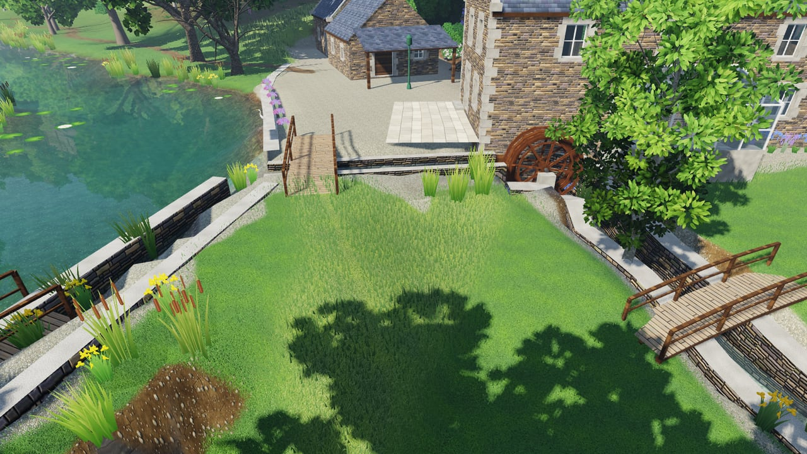
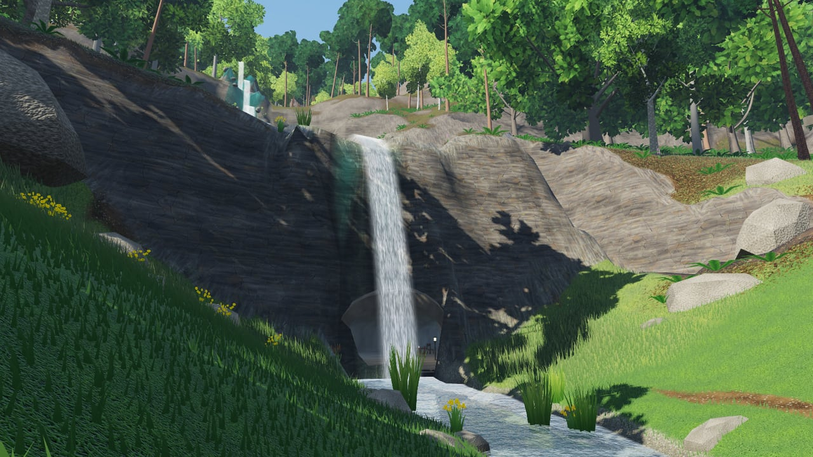
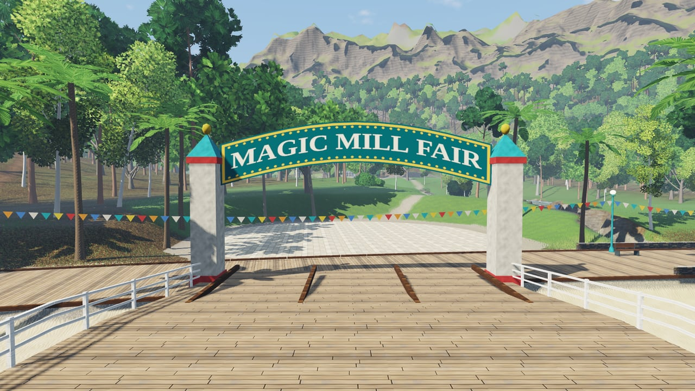

# Magic Mill Fair

A 3D world to explore in the browser: an old mill with its ponds, its mill race and its water wheel, in a
valley closed by mountains — and, a short walk down the valley, a cove with a promenade, a grand pier and
its big wheel. Stylised realism, a cosy adventure-game mood, playable with a keyboard, a gamepad or a
finger, alone or together.


| | |
|---|---|
|  |  |
|  |  |
|  |  |
|  |  |
|  |  |

## Getting started

Node.js 22 or newer.

```bash
npm install
```

```bash
npm run dev
```

Open `http://localhost:5173`. This command starts the site **and** the multiplayer relay: open the address
in two tabs (or on a phone on the same network, with the "Network" address that is printed) to see each other.

### Putting it online with Cloudflare (automatic)

Everything is described in the repository (`wrangler.jsonc`): there is nothing to configure.

1. In the Cloudflare dashboard, open **Workers & Pages**, create an application by **importing a Git
   repository**, authorise GitHub and pick this repository.
2. Keep the proposed name, `magicmillfair` (it is the one written in `wrangler.jsonc`: both must be the
   same), the proposed production branch (the default branch of the repository) and the default deploy
   command, `npx wrangler deploy`. The build command can stay empty.
3. Confirm. Cloudflare installs the dependencies, builds the site, then publishes the site, the Worker and the
   multiplayer rooms. The address looks like `https://magicmillfair.<your-account>.workers.dev`; a domain
   name can be attached afterwards from the dashboard.

From then on, every `git push` to the production branch of the repository redeploys by itself: a couple of
minutes later a new line appears in the **Deployments** tab of the Worker.

If a push does not show up there:

- on GitHub, look at the mark next to the commit: a red cross means the build ran and failed (its "Details"
  link opens the log);
- no mark at all means Cloudflare never started a build: in the Worker, open **Settings**, then the build
  settings, check that the production branch is the one you push to, then disconnect the repository and
  connect it again;
- to start a build without pushing, create a **Deploy Hook** in the same build settings and send a `POST`
  request to its address (`curl -X POST "<address>"`).

What runs at Cloudflare: the files of the site are served directly; `cloudflare/worker.js` only answers the
multiplayer. Each room is a *Durable Object* running exactly the same relay as the Node server
(`server/protocol.js`), and it **goes to sleep as soon as nobody moves**: visitors stay connected, but the
room no longer consumes anything.

Costs: the rooms are SQLite-backed Durable Objects, the only kind the free Cloudflare plan accepts — up to
100,000 requests and 13,000 GB-seconds a day when this was written, after which the rooms stop answering
until the next day (UTC). Quotas and prices change: check the
[Workers](https://developers.cloudflare.com/workers/platform/pricing/) and
[Durable Objects](https://developers.cloudflare.com/durable-objects/platform/pricing/) pages. If your plan
refused Durable Objects, remove the `durable_objects` and `migrations` blocks from `wrangler.jsonc`: the
site still deploys, without multiplayer between devices.

Without Git, from a computer (this asks you to sign in to your Cloudflare account):

```bash
npx wrangler login
```

```bash
npm run deploy
```

To try the Cloudflare version locally, in the same runtime: `npm run cf:dev`.

### Putting it online elsewhere (Node)

```bash
npm run build
```

```bash
npm start
```

`npm start` serves the `dist/` folder and the multiplayer presence (WebSocket on `/ws`) from **a single
process**, on port `PORT` (8787 by default). Behind a proxy (nginx, Caddy, a PaaS…), it is enough to let the
WebSocket upgrade through. Useful variables: `PORT`, `HOST`, `TICK_HZ` (12), `MAX_PLAYERS` (48 per room),
`ALLOWED_ORIGINS` (origins allowed to open the multiplayer socket; empty = the site itself).
On a server, `npm ci --omit=dev --omit=optional` is enough (the baking tools are not needed).

Fully static hosting (GitHub Pages, Netlify, a plain folder): `dist/` works as it is from any sub-path.
Without a presence server, only the tabs of one browser see each other. To plug in a relay hosted
elsewhere: build with `VITE_WS_URL=wss://example.org/ws`, or add `?ws=wss://example.org/ws` to the address,
and declare the origin of the site in `ALLOWED_ORIGINS` on the relay.

People who open **the same address** share the same room. `?room=name` makes a private room.

## Controls

| | Keyboard / mouse | Touch | Gamepad |
|---|---|---|---|
| Move | WASD, ZQSD or arrows (physical key positions) | virtual stick on the left | left stick |
| Look around | drag the mouse; double-click to capture the pointer | drag on the right | right stick |
| Run / jump | Shift / Space | buttons on the right | trigger, A button |
| Zoom | wheel | pinch | |
| Free camera | F (Space / C to go up and down, Shift to go faster) | camera button | |
| Map | M, or click the minimap (click again or Escape to close) | tap the minimap | |
| Emotes | T, or 1 to 6 | smiley button | |
| Performance figures | P | Settings → Performance figures | |
| Back to the mill | R | | |

The character walks, runs, jumps, swims in the ponds and in the sea, and walks on the bridges, the garden
steps and the pier.

## The world

The playable area is about 530 m by 360 m, the cove included — some 15 hectares (the terrain itself is
1 km², most of it mountains that are only scenery).

- **The mill**: the house, its outbuilding, the courtyard, the rock garden in terraces with its steps, the
  head race, the wheel in its pit, the tail race, the dam with its sluice and its spillway, and footbridges
  over each of them.
- **Water**: the great pond with its two islands, the mill pool, the iris pond, the stepped cascade between
  them, the brook down to the beach, and a mountain torrent that drops over the crags as a waterfall.
- **Around**: wheat fields, a lookout hill, the old tree alone in its clearing, woods and meadows, hedges,
  paths linking everything (the entrance of the pier is about 130 m from the mill: half a minute's walk).
- **The seafront**: the beach of the cove, the promenade with its palms and beach huts, the grand pier on
  piles with its kiosks and the big wheel.
- **The edges**: mountains on three sides (crags, wooded slopes, rocky peaks) that cannot be climbed, the sea
  on the fourth. The lane ends at the estate gate.
- **Life**: swans with cygnets, geese, mallards with ducklings, a cormorant that dives and another drying its
  wings, herons fishing in the shallows; gulls over the cove, swifts over the valley, buzzards above the
  mountains. Water birds swim away when you come close.

## Quality and performance

Four tiers (**Light**, **Balanced**, **High**, **Ultra**), chosen automatically from the device and
changeable in the settings (or `?q=low|medium|high|ultra`).

- **Computers** start on Balanced or High according to their graphics card.
- **Phones start on Ultra**, in a phone-sized form: every effect stays on (shadows, reflections, long views),
  but textures and the shadow map are half-size, the resolution is capped, detail distances are shorter and
  the real-time shadow pass is kept for what moves (everything else is in the shadow map baked at load).
- On every device the game **adapts by itself** while you play: when frames take too long it first lowers the
  resolution, then the detail (how far trees, grass and flowers are drawn in full, how often shadows and
  reflections are refreshed), and gives both back when there is room again. It starts doing so within the
  first second, drops faster when the frame rate is very low, and ignores isolated pauses that drawing less
  would not shorten. A tier is a starting point.

Techniques:

- **Terrain**: a single instanced mesh (CDLOD), continuous levels of detail without seams; steep ground turns
  to rock textured from the side.
- **Trees**: about 2,400 trees and shrubs in three levels of detail (full mesh, simplified mesh, impostors
  relit from atlases baked at load), all instanced, cross-faded. The old tree keeps its detail three times
  further.
- **Grass and flowers**: placed on the graphics card, generated by tiles around the player.
- **Shadows**: a static shadow map of the valley baked once (the sun is fixed) and a dynamic cascade around
  the camera.
- **Water**: a planar reflection at reduced resolution, rendered only when water is in view, in which trees
  are drawn as impostors.
- **Scenery**: meshes merged per material, small things hidden with distance, boulders instanced and culled
  by map square. All the birds are one draw call.

### Measurements

Automatic tour through the whole valley (`?bench=1`):

| Tier | Draw calls (avg / max) | Triangles (avg / max) | Script time per frame |
|---|---|---|---|
| Light | 67 / 100 | 266,000 / 385,000 | 4.7 ms |
| Balanced | 103 / 153 | 505,000 / 703,000 | 5.3 ms |
| High | 133 / 179 | 690,000 / 919,000 | 5.8 ms |
| Ultra | 146 / 203 | 911,000 / 1,182,000 | 6.5 ms |
| **Ultra on a phone** | 75 / 125 | 423,000 / 664,000 | 4.8 ms |
| Light on a phone | 59 / 108 | 228,000 / 313,000 | 2.7 ms |

(Computer rows at 1280×720, phone rows at 844×390.) Before this round of optimisation, Ultra on a phone took
119 draw calls and 874,000 triangles on average, 182 and 1,290,000 at most.

**These are not frames per second.** The development environment had no graphics card: rendering is computed
in software there, which says nothing about real frame rates. Draw calls and triangles are exact; script time
is an order of magnitude (out of a budget of 16.7 ms per frame at 60 frames per second) and varies from run
to run. To know the frame rate on a device:

- open the site with `?bench=1`: the tour takes about 40 seconds and shows the average, the slowest 1 % of
  frames, draw calls and triangles;
- or show the live figures (P key).

## How the project is organised

```
index.html
src/
  main.js                  start-up, game loop, modes (welcome, walking, free camera, benchmark)
  core/                    engine (rendering, adaptive resolution and detail), quality tiers, input, loading
  render/                  shared uniforms and lighting, sky and haze, shadows, surface material
  world/
    layout/layout.js       THE plan of the world: water levels, ponds, streams, paths, buildings, pier, bounds…
    World.js               assembles the systems, collisions, shadow bake
    WorldData.js           baked maps (height, water, normals, ground cover) read on the CPU and the GPU
    terrain/  water/  vegetation/        terrain, water and waterfalls, forest, grass, small plants
    wildlife/Birds.js      every bird
    props/                 geometry builder, materials, walls, bridges, stairs, rocks, merging and culling
    zones/mill/            the house, the outbuilding, the races, the wheel, the garden, the bridges
    zones/pier/            the promenade, the pier, the big wheel
  player/                  animated avatar, controller (walk, swim, jump), cameras
  net/                     multiplayer presence (WebSocket or between-tabs transport, interpolation)
  ui/                      welcome screen, minimap and large map, settings, touch controls
  app/Benchmark.js         benchmark tour
server/index.js            Node production server: static files + presence relay
server/protocol.js         the relay itself (protocol, validation, batching), shared by both hostings
cloudflare/worker.js       Cloudflare version: Worker + one Durable Object per room
wrangler.jsonc             Cloudflare deployment settings (build included)
tools/                     world and texture bakers, tests, measurements (see below)
public/assets/             world maps, textures, avatar model
```

### The world is baked ahead of time

`src/world/layout/layout.js` describes the world (in metres, in a local frame). `npm run bake:world` turns
it into the 1024 × 1024 m maps the game reads: relief, water levels, normals, ground cover, tree positions,
and the map shown in the game. `npm run bake:textures` generates every texture (ground, stone, bark,
foliage, flowers): there is not a single photograph in the project, everything is procedural.

To change the world: edit `layout.js`, run `npm run bake:world` again, reload the page.

### Adding a zone (next: the fair itself)

1. Describe its footprint in `layout.js` (level areas in `PADS`, paths in `PATHS`, an entry in `ZONES`;
   widen `BOUNDS` if it lies outside the playable area) and bake again.
2. Create `src/world/zones/<name>/<Name>Zone.js` on the model of `PierZone.js`: build the geometry with
   `Parts` / `MeshBuilder`, expose `group`, `colliders`, `update(dt, time, camera)`.
3. Register it in `World.load()` and its obstacles in `World.buildCollision()`.

Repeated stalls are best instanced (`THREE.InstancedMesh`, like the gondolas of the big wheel), fixed
scenery merged (`mergeStatic`) and small things hidden far away (`distanceCuller`).

### Multiplayer

The server decides nothing: each visitor sends the state of their avatar (position, heading, animation) ten
to twelve times a second, the relay hands it on per room, and each client rebuilds a smooth motion by
interpolation. Without a reachable relay, the same interface works between the tabs of one browser. The
protocol is described at the top of `server/protocol.js`, the client interface in `src/net/Presence.js`.
The same relay runs under Node (`server/index.js`) and on Cloudflare (`cloudflare/worker.js`).

## Tools

| Command | What it does |
|---|---|
| `npm run bake` | bakes the world and the textures again |
| `npm test` | 100 checks of the Node server, the protocol and the interpolation |
| `npm run test:cf` | the same protocol checks against the Cloudflare version (in its local runtime), plus its own: files and headers, rooms going to sleep, ghost connections (59 in all) |
| `npm run test:smoke` | drives the real site: welcome screen, walking, free camera, settings, large map (`-- --mobile` for the touch layout) |
| `npm run test:walk` | the character walks onto the pier, is stopped by its railing, crosses a footbridge, climbs the garden steps, cannot cross the mountains, swims, changes tier |
| `npm run test:duo` | two visitors on the production server: they must see each other move (`-- --cloudflare` for the Cloudflare version) |
| `npm run bench` | benchmark tour for each tier (`-- --mobile` for the phone profile) |
| `npm run profile` | cost of each system (script, draw calls, triangles) at seven viewpoints |
| `npm run shots -- name=x,y,z,heading,pitch` | screenshots from a viewpoint |
| `node tools/docs.mjs` | renders the screenshots of this page again |

From `test:smoke` on, they drive Chromium with Playwright, which is not installed by default:

```bash
npm install --no-save playwright
```

```bash
npx playwright install chromium
```

## Known limits

Likeness to the place

- **Relief**: it comes from an open terrain model of about 25 to 30 m resolution, not from a survey at one
  metre (the finer source could not be reached from the working environment). The valley floor around the
  mill follows that data; banks, terraces and channels are drawn by hand on top.
- **The surroundings are invented**, as asked: the mountains, the cove, the beach, the pier and the big wheel
  do not exist, and the estate has been set lower than it really is so that the valley reaches the sea.
- **A likeness, not a copy**: layout, volumes, materials and the big trees follow the photographs and the
  aerial view; exact dimensions of the buildings, the detail of the garden and the position of each tree are
  estimated. Interiors are not modelled.

Performance

- **No frame rate was measured on a real graphics card**, nor on a real phone (see "Measurements"). Phones
  start on Ultra as requested and the game adapts downwards by itself, but how far it has to adapt on a given
  phone is unknown until it is tried there. If a phone struggles, the settings offer the lighter tiers.
- Tested in Chromium only (desktop and a simulated phone screen). Firefox and Safari have not been tried.
- The world is loaded in one go at start-up: about 10 MB on a phone and on the Light and Balanced tiers,
  15.5 MB on High and Ultra on a computer (plus 1 MB of code). Textures are not in a GPU-compressed format. On an
  entry-level phone, loading time and memory may be tight.
- Changing tier reloads the page (at the same spot).

Rendering

- One reflection plane at a time: when two bodies of water at different heights are in view, the second
  one reflects the sky only. No underwater view: the camera stays above the surface.
- No post-processing (bloom, depth of field). The sun is fixed: no weather, no day-night cycle, as planned
  for this version.
- Some level-of-detail transitions remain visible on nearby trees, mostly on the Light tier and on phones
  (where trees are drawn in full less far).
- Birds are low-polygon models with simple motion (no walking, no take-off).
- No sound.

Game and multiplayer

- The avatar is a free-licence robot, until a made-to-measure character exists. The big wheel turns but
  cannot be boarded. Collisions are simple (cylinders, boxes, platforms).
- Multiplayer: presence only (position, name, colour, emotes). No text chat, no saving, no anti-cheat.
  48 visitors per room. Not tested with real latency, nor behind HTTPS or a proxy.
- Cloudflare: the Cloudflare version was tested in the official runtime locally (protocol, rooms going to
  sleep, two browsers) and the deployment validated with a dry run. A first deployment from the Git import
  built and published without error, but **multiplayer on Cloudflare's real network has not been observed
  yet**, and a push does not always start a build there (see "Putting it online with Cloudflare").
- The fair itself (stalls, games) is still to be built: only the pier and its big wheel exist.

Privacy

- The repository contains no place name, no geographic coordinates and no image metadata: everything is
  expressed in a local frame, with relative heights. The relief of the valley floor and the map of its trees
  are nevertheless derived from real data: in theory, someone very determined could match them against
  public data. If that risk matters, the map can be mirrored or warped before baking.

## Credits

- [three.js](https://threejs.org) (MIT licence).
- Avatar: "RobotExpressive" by Tomás Laulhé, modified by Don McCurdy, public domain (CC0), from the three.js
  examples.
- Everything else (reworked relief, textures, buildings, vegetation, water, birds) is generated by the code of
  this project.
