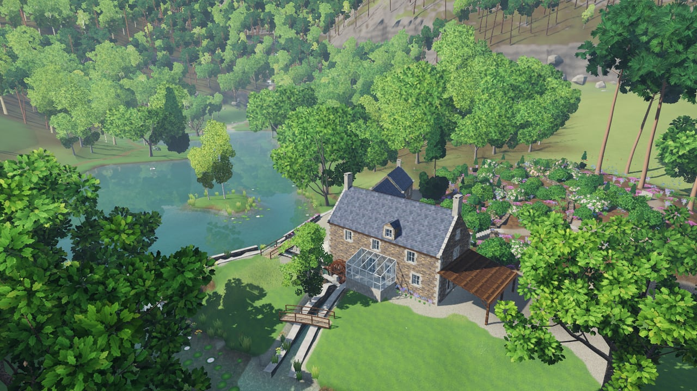
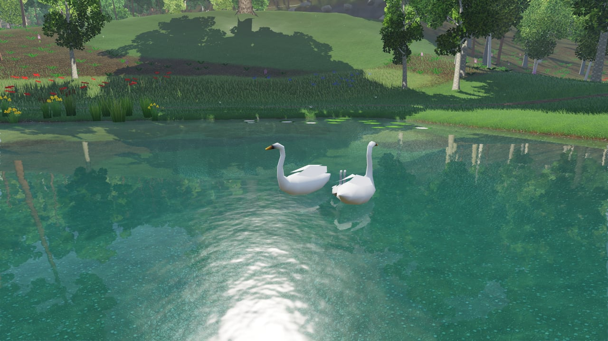
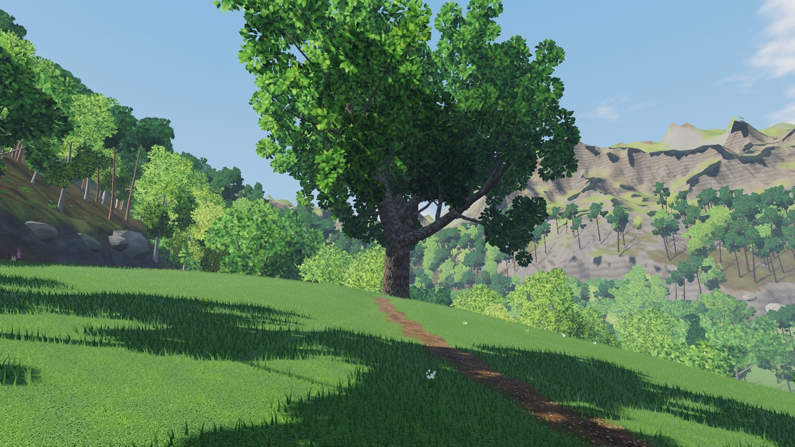
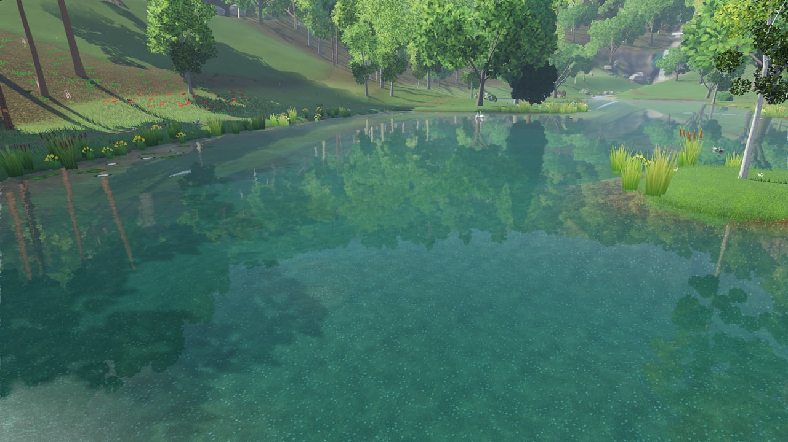
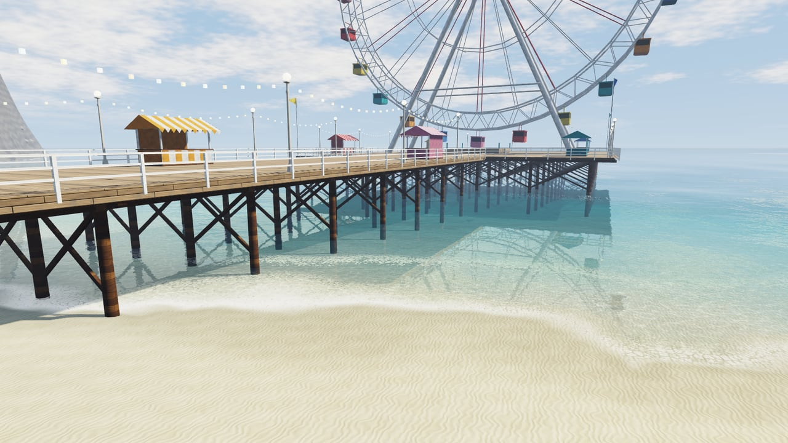
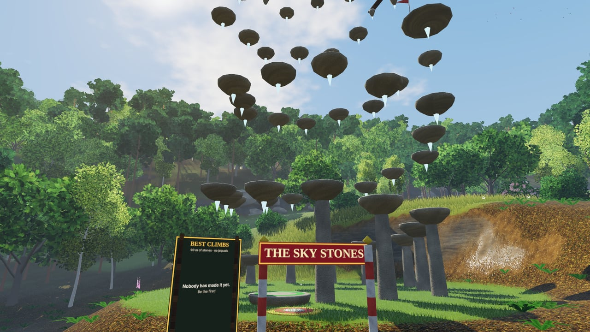
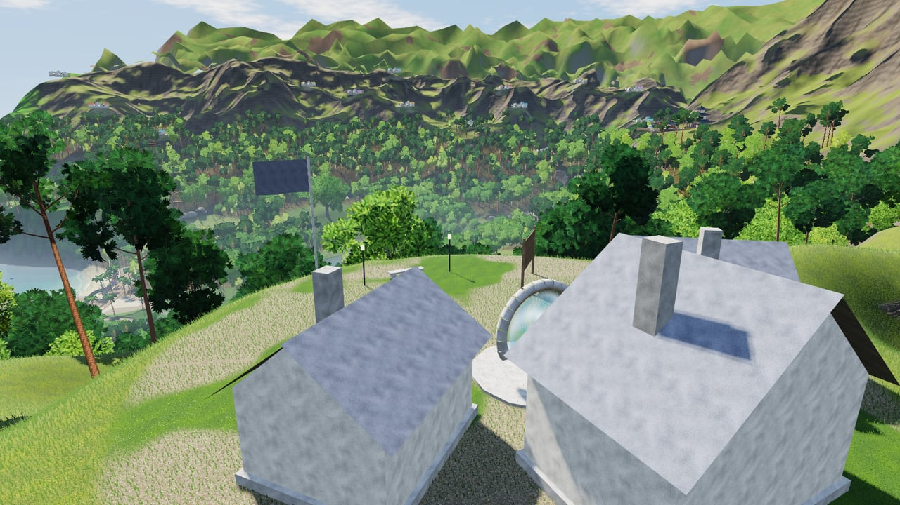
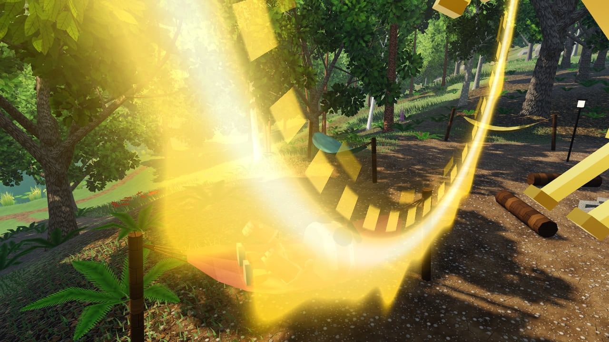
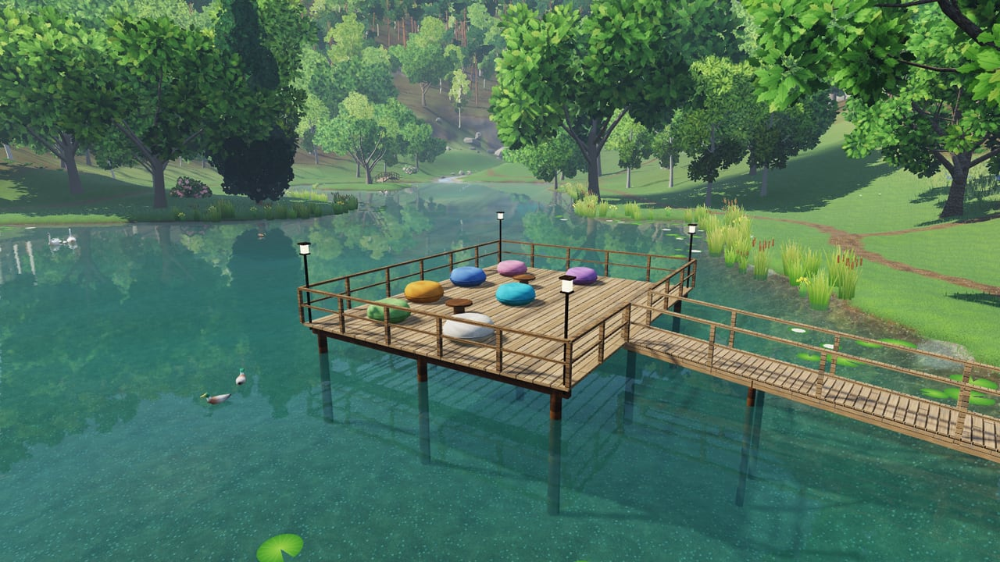
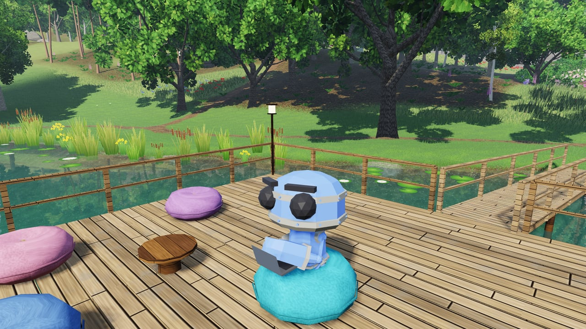

# Magic Mill Fair

A 3D world to explore in the browser: an old mill with its ponds, its mill race and its water wheel, in a
valley closed by mountains — and, a short walk down the valley, a cove with a promenade, a grand pier and
its big wheel. Around it: a stairway cut in the rock up to a temple lost on its mountain, terraces and pools
above the great waterfall, caves (one of them behind the fall), sea cliffs with a fall that drops straight
into the sea, a secret cove, an island with a boulder rolling down its path, a camp with hammocks, beanbag
chairs to work from, and thirty little villages perched on the peaks. The first game of the fair is open —
the Sky Stones, ninety metres of floating stones to climb against the clock. Stylised realism, a cosy
adventure-game mood, playable with a keyboard, a gamepad or a finger, alone or together — with a chat,
emotes that summon animals of light, hats, a jetpack, and a few ways to end up WASTED.


| | |
|---|---|
|  |  |
|  |  |
|  |  |
|  |  |
|  |  |
|  |  |
|  |  |
|  |  |
|  |  |
|  |  |
|  |  |
|  |  |
|  |  |
|  |  |
|  |  |
|  |  |

## Getting started

Node.js 22 or newer.

```bash
npm install
```

```bash
npm run dev
```

Open `http://localhost:5173`. This command starts the site **and** the multiplayer relay: open the address
in two tabs (or on a phone on the same network, with the "Network" address that is printed) to see each other.

### Putting it online with Cloudflare (automatic)

Everything is described in the repository (`wrangler.jsonc`): there is nothing to configure.

1. In the Cloudflare dashboard, open **Workers & Pages**, create an application by **importing a Git
   repository**, authorise GitHub and pick this repository.
2. Keep the proposed name, `magicmillfair` (it is the one written in `wrangler.jsonc`: both must be the
   same), the proposed production branch (the default branch of the repository) and the default deploy
   command, `npx wrangler deploy`. The build command can stay empty.
3. Confirm. Cloudflare installs the dependencies, builds the site, then publishes the site, the Worker and the
   multiplayer rooms. The address looks like `https://magicmillfair.<your-account>.workers.dev`; a domain
   name can be attached afterwards from the dashboard.

From then on, every `git push` to the production branch of the repository redeploys by itself: a couple of
minutes later a new line appears in the **Deployments** tab of the Worker. To know which version is online,
look at the bottom of the welcome screen or of the settings: it shows the commit the site was built from and
when (`Version 1a2b3c4 · built 2026-11-20 19:43 UTC`).

**If pushes do not show up there** (Cloudflare's push trigger does not always fire, and reconnecting the
repository does not always cure it), the repository carries its own trigger: `.github/workflows/deploy.yml`
asks Cloudflare to build after every push to the production branch. It needs one secret, once:

1. Cloudflare dashboard → the Worker → **Settings** → **Builds** → **Deploy Hooks**: create a hook for the
   production branch and copy its address.
2. GitHub → the repository → **Settings** → **Secrets and variables** → **Actions** → **New repository
   secret**: name `CLOUDFLARE_DEPLOY_HOOK`, value: the address.

From then on each push starts the workflow (GitHub, **Actions** tab), which starts the build at Cloudflare.
The same tab has a **Run workflow** button to deploy the current state without pushing. The address is a
password of sorts — anyone who has it can start builds: keep it in the secret, never in a file.

What runs at Cloudflare: the files of the site are served directly; `cloudflare/worker.js` only answers the
multiplayer and the small API of the game. Each room is a *Durable Object* running exactly the same relay as
the Node server (`server/protocol.js`), and it **goes to sleep as soon as nobody moves**: visitors stay
connected, but the room no longer consumes anything. One more object of the same kind is the game's
notebook: it keeps the leaderboards and how many days in a row each device has come back — all this game
stores — and needs no database to be created: the storage comes with the object.

**Secrets of the Worker** (dashboard → the Worker → **Settings** → **Variables and Secrets** → **Add** →
type *Secret*; or `npx wrangler secret put NAME`). Never write one of them in a file. After adding a
secret, deploy once more (the dashboard offers it). `https://<your site>/api/status` then says what the
Worker sees — `"npc": true`, `"admin": true` — without showing any of it.

| Secret | What it does |
|---|---|
| `ANTHROPIC_API_KEY` | **Billy's brain.** The alligator on the pond deck is a life coach: he answers with a handful of lines of his own until the Worker has this key — then through the Claude API. The model is `claude-opus-5-5` unless a variable `NPC_MODEL` names another (a smaller model costs much less per line). |
| `ADMIN_KEY` | **The administrator's key**: any long password of your own invention. In the game, type `/admin <the key>` in the chat (it is checked by the server and sent to nobody) — or open the site once with `#admin=<the key>` at the end of the address. Without this secret, nobody is the administrator. |
| `SCORE_SECRET` | Optional: signs the notes of the game runs (see "Cheating"). The notebook draws one by itself otherwise. |

Billy only answers questions (a question mark is required: anything else gets a line of his own, without
asking the model), is sent that one question and nothing else, and what comes back is cut down to a single
plain sentence. Each address may ask ten questions a minute, and everyone together 3,000 a day: a ceiling
on what the key can spend.

Costs: the rooms are SQLite-backed Durable Objects, the only kind the free Cloudflare plan accepts — up to
100,000 requests and 13,000 GB-seconds a day when this was written, after which the rooms stop answering
until the next day (UTC). Quotas and prices change: check the
[Workers](https://developers.cloudflare.com/workers/platform/pricing/) and
[Durable Objects](https://developers.cloudflare.com/durable-objects/platform/pricing/) pages. If your plan
refused Durable Objects, remove the `durable_objects` and `migrations` blocks from `wrangler.jsonc`: the
site still deploys, without multiplayer between devices.

Without Git, from a computer (this asks you to sign in to your Cloudflare account):

```bash
npx wrangler login
```

```bash
npm run deploy
```

To try the Cloudflare version locally, in the same runtime: `npm run cf:dev`.

### Putting it online elsewhere (Node)

```bash
npm run build
```

```bash
npm start
```

`npm start` serves the `dist/` folder, the multiplayer presence (WebSocket on `/ws`) and the API of the game
from **a single process**, on port `PORT` (8787 by default). Behind a proxy (nginx, Caddy, a PaaS…), it is
enough to let the WebSocket upgrade through. Useful variables: `PORT`, `HOST`, `TICK_HZ` (12), `MAX_PLAYERS`
(48 per room), `ALLOWED_ORIGINS` (origins allowed to open the multiplayer socket; empty = the site itself),
`SCORES_FILE` (where the leaderboards and the visits are kept: `data/scores.json` by default),
`ANTHROPIC_API_KEY` and `NPC_MODEL` (Billy), `ADMIN_KEY` and `SCORE_SECRET` (see the table above).
On a server, `npm ci --omit=dev --omit=optional` is enough (the baking tools are not needed).

Fully static hosting (GitHub Pages, Netlify, a plain folder): `dist/` works as it is from any sub-path.
Without a server, only the tabs of one browser see each other, the best scores and the days in a row are
kept in each visitor's own browser, and Billy keeps to his own lines. To plug in a relay hosted
elsewhere: build with `VITE_WS_URL=wss://example.org/ws`, or add `?ws=wss://example.org/ws` to the address,
and declare the origin of the site in `ALLOWED_ORIGINS` on the relay.

People who open **the same address** share the same room, up to 48 of them; the next ones are put together
in a second room, then a third, and so on (see "How many visitors at once?"). `?room=name` makes a private
room; `?village=name` arrives straight in a sky village.

## Controls

| | Keyboard / mouse | Touch | Gamepad |
|---|---|---|---|
| Move | WASD, ZQSD or arrows (by the place of the keys) | virtual stick on the left | left stick |
| Look around | drag the mouse; double-click to capture the pointer | drag on the right | right stick |
| Run / jump | Shift / Space (Settings → *Run by default* turns Shift into "walk") | buttons on the right | trigger, A button |
| Zoom | wheel | pinch | |
| Flying camera | F (Space / C to go up and down, Shift to go faster) | drone button | |
| Map | M, or click the minimap (click again or Escape to close) | tap the minimap | |
| Jetpack | Space again while in the air: a second and a half of thrust | jump button again | A again |
| Sit, lie down, board, pick a flower, talk, travel, get up | E when the action is offered (walking away or jumping gets up too) | tap the action shown above the jump button | |
| Open or close the laptop; second action | L | tap the second action | |
| Put the bouquet down | B | Emotes → Put the bouquet down | |
| Hat | Settings → Hat | Settings → Hat | |
| Chat | Enter, type, Enter (Escape to cancel) | speech-bubble button | |
| Emotes | T; 1 to 6 for the gestures, 7 to 0 to cheer, clap, jump for joy, rage; or by name in the chat: `/wave`, `/cheer`, `/bow`… | smiley button | |
| Stuck somewhere | `/kill` in the chat: WASTED, then back at the mill | the same | |
| Performance figures | P | Settings → Performance figures | |
| Back to the mill | R | | |

The character walks, runs, jumps, and walks on the bridges, the steps and the pier. It swims in the ponds
and in the sea (Shift for a sprint), sits on benches, logs, chairs and beanbags, lies in hammocks, and rides
the big wheel: stand on the platform under it, board a car when one comes by, ask to get off and you are
put down at the bottom.

**Chat**: what you say appears in a log and in a bubble over your head, for those who are in the room at
that moment. Nothing of it is stored anywhere: no history — a line is relayed and forgotten (200 characters
at most, five in a row then one every two seconds). What the game keeps is on your own device: your name,
your colour, your hat, the quality tier. What the server keeps: the boards of the games (a name and a score) and, for
a random number drawn by each browser, the days in a row it has visited.

Letter shortcuts (M, F, T, P, R, B…) go by the letter printed on the key, whatever the keyboard; walking goes
by the place of the keys. Settings also offers *The camera turns with the character*.

**Commands** are typed in the chat and sent to nobody: `/kill`, the emotes by name — and a few secret words
that do silly things. They are written nowhere: the game only knows their fingerprints (see `main.js`).
Some of them disqualify a run in a game.

**Animals of light**: a sun-coloured ring opens above you and a mechanical animal appears in it for five to
six seconds. Everybody around sees them. Ten of them, earned by coming back day after day: a goldfish that
blows bubbles (2 days in a row), a squirrel that nibbles a nut (3), a carp that leaps as up a waterfall (5),
a stag that rears (10), an eagle that spreads its wings (15), a panda that munches bamboo (20), a wolf that
howls (25), a tiger that leaps through the ring (30), an elephant that trumpets (35) and a dragon that coils
round the ring (50). The emote panel shows where you stand; the administrator has them all.

## Things to do

- **Mostly Up** (south of the beach, through the striped gate): 162 floating stones and planks spiral
  up to a platform 90 m above the lawn. Step on the start plate, and the clock starts when you leave it;
  it stops on the summit. Easy at the foot — wide stones, short jumps — and merciless near the top, where
  the stones are a metre across and the take-off must be within half a metre of the edge. No jetpack, no
  quad there; falling costs nothing but the climb. The best times of the day, the week, the month and of
  all time are on the board by the gate, under the panel of the game's sponsor ("your brand here" until
  someone takes it). The course was checked by a bot that makes every jump: a perfect climb takes about two
  and a half minutes.
- **The Grandstand**: the striped tower behind the lawn. Its stair winds round it for twelve turns, with a
  landing on each that faces the climb, up to a deck 84 m above the lawn: the place to watch friends climb
  and cheer them on (Cheer, Clap, Jump for joy, Go! Go!). Nobody gets from the tower into the game.
- **The boulder of the island**: every 52 seconds a boulder rolls down the whole path of the island. The top
  of the screen says how far above you it is: step into one of the hollows cut in the rock, or out onto one
  of the timber walkways over the drop, and let it pass. Stay on the path and you are flattened.
- **Ways to end up WASTED**: the boulder; a pond of acid hidden in the woods of the north-west (nobody will
  tell you where); the shark, for those who swim out to where the sea ends; the red mushrooms at the foot of
  the trees (pick one and eat it: a bad idea); `/kill`. A few seconds later you are back on your feet.
- **A swan dive**: fall more than ten metres towards water deep enough to swim in, and the robot tips over,
  arms spread, then joined, and goes in head first.
- **Hats**: none, cap, straw hat, beanie, top hat, cowboy hat, crown, wizard hat (Settings → Hat). Everybody
  sees yours.
- **Jetpack**: press jump again in the air. A second and a half of thrust, refilled on landing; it does not
  work in caves, on the island, around Mostly Up or on its tower.
- **Flowers**: walk up to a flower and pick it (E): a bouquet grows in your hand, flower by flower. B puts
  it down; swimming loses it.
- **Billy**: an alligator lounges in a beanbag chair on the deck of the great pond. He is a life coach: ask
  him a question (E, then type — with a question mark, he only does questions) and he answers in one
  sentence that sails past the point and lands on it. What you ask him goes to nobody else.
- **The sky villages**: step up to the Sky Gate — the stone ring on the lawn between the arrival and the
  mill — and choose one of thirty villages perched on the mountains: you are carried there, facing the
  valley. The ring of each village leads back, or on to another village.
- **Listening**: every place has its sound — the surf on the beach and the water lapping under the pier, the
  wind in the leaves round the mill and the ponds, the roar of the waterfall, brooks, birds, a colder wind up
  in the mountains, drips in the caves — and its music: a fairground waltz on the pier, something quiet
  everywhere else, something epic that builds as one climbs Mostly Up. Nothing of it is a recording: it is
  all synthesised in the browser (`src/audio/`), so there is nothing to download. Settings → Sound sets the
  two volumes (zero switches a family off altogether).
- **Places to sit**: benches along the promenade, cushions and benches all over the temple, logs, chairs…
- And the rest: the big wheel, the hammocks, the beanbags and their laptops, the caves, the animals of light.

Hats and the jetpack are free for now. Whether a visitor has one is asked in a single place
(`owns()` in `src/player/Cosmetics.js`): that is where a shop would plug in. A sky village is given to a
company by editing its line in `src/world/layout/sponsors.js` (name, motto, colours, web address); its
visitors can be sent straight there with `?village=its-name`.

## The world

The valley floor is about 530 m by 360 m, the cove included — some 15 hectares (the terrain itself is
1 km², most of it mountains that are only scenery). A few places are reached from it: up the western
mountain, under the rock, out at sea.

- **The mill**: the house, its outbuilding, the courtyard, the rock garden in terraces with its steps, the
  head race, the wheel in its pit, the tail race, the dam with its sluice and its spillway, and footbridges
  over each of them.
- **Water**: the great pond with its two islands, the mill pool, the iris pond, the stepped cascade between
  them, the brook down to the beach, and a mountain torrent that drops over the crags as a waterfall.
- **Around**: wheat fields, a lookout hill, the old tree alone in its clearing, woods and meadows, hedges,
  paths linking everything (the entrance of the pier is about 130 m from the mill: half a minute's walk).
- **The seafront**: the beach of the cove, the promenade with its palms and beach huts, the grand pier on
  piles with its kiosks and the big wheel.
- **The stairway and the temple**: at the far end of the great pond, some 450 steps cut in the rock climb
  the western mountain in five flights, with a landing at each turn, to a shelf 85 m above the valley. A red
  gate stands at the top; behind it, a court with a lotus pond and stone lanterns, a pagoda of three roofs
  with a golden figure in its niche, pavilions, a great bell, a white stupa, a row of prayer wheels, and
  strings of prayer flags from the spire to everything around. A lookout with benches takes in the whole
  valley, down to the pier and the island.
- **Above the great waterfall**: rock steps climb beside the fall to three terraces, one above the other,
  each with a pool of the torrent and its own fall. Wade in the pools, sit on the bench of the top one —
  or walk off the brink of the lowest and drop into the pool of the great fall.
- **Caves**: the waterfall shoots clear of the rock — walk through its pool, behind the falling water, into
  a grotto lit by crystals; a narrow passage leads on to a second, hidden room. Two more caves open at the
  foot of the northern mountains (behind the fields) and of the southern ones (near the old tree). All have
  chairs and a table; they are otherwise empty, ready to receive things.
- **Sea cliffs**: where the capes close the cove, the land stands fifty metres and more above the water:
  fluted green faces, a stream that leaves its hanging valley and falls straight into the sea on the
  northern cape.
- **The secret cove**: it is not named on the map. Swim round the southern cape, along the foot of the
  cliffs: a pocket of sand shut in by rock, palms, a boat pulled up, a fire, a hammock, a chest.
- **The island**: a rock 35 m high, about 80 m off the beach (swim across from the north end of the cove).
  A path winds two and a quarter times round it up to a flat top with a ring of standing stones. Along the
  way: nine hollows cut in the rock on the inner side and, on the outer side, eight timber walkways out over
  the drop (two arms joined by a third along the cliff with a rope rail, or one arm out to a round crow's
  nest) — the places to be when the boulder comes down.
- **The sky villages**: thirty hamlets on shoulders and tops of the mountains all around, 77 to 233 m up,
  each with three houses, a sign, a flag, a bench that looks down on the valley and a ring to go back
  through. They are reached from the Sky Gate only. Their sites are chosen by the world baker (places that
  see the valley); they are not on the map.
- **Places to rest**: a camp in the woods north of the great pond (six hammocks, logs round a fire, two
  tents); beanbags of all colours under a sail at the north end of the beach, and on a deck on stilts over
  the great pond. Sitting on a beanbag brings a laptop onto your knees.
- **The edges**: mountains on three sides (crags, wooded slopes, rocky peaks) that cannot be climbed except
  by the stairways — ground steeper than about 53° is not walked up, and anything steeper than 60° is slid
  down — and the sea on the fourth, patrolled by the shark. The lane ends at the estate gate.
- **Life**: swans with cygnets, geese, mallards with ducklings, a cormorant that dives and another drying its
  wings, herons fishing in the shallows; gulls over the cove, swifts over the valley, buzzards above the
  mountains. Water birds swim away when you come close.

## Quality and performance

Four tiers (**Light**, **Balanced**, **High**, **Ultra**), chosen automatically from the device and
changeable in the settings (or `?q=low|medium|high|ultra`).

- **Computers** start on Balanced or High according to their graphics card.
- **Phones start on Ultra**, in a phone-sized form: every effect stays on (shadows, reflections, long views),
  but textures and the shadow map are half-size, the resolution is capped, detail distances are shorter and
  the real-time shadow pass is kept for what moves (everything else is in the shadow map baked at load).
- On every device the game **adapts by itself** while you play: when frames take too long it first lowers the
  resolution, then the detail (how far trees, grass and flowers are drawn in full, how often shadows and
  reflections are refreshed), and gives both back when there is room again. It starts doing so within the
  first second, drops faster when the frame rate is very low, and ignores isolated pauses that drawing less
  would not shorten. A tier is a starting point.

Techniques:

- **Terrain**: a single instanced mesh (CDLOD), continuous levels of detail without seams — the detail of a
  vertex depends on its distance alone, so that neighbouring pieces always meet, even on a sea cliff; steep
  ground turns to rock textured from the side, or to hanging greenery on the sea cliffs.
- **Avatars**: each visitor is one skinned mesh — one draw call, whatever it wears.
- **Trees**: about 2,400 trees and shrubs in three levels of detail (full mesh, simplified mesh, impostors
  relit from atlases baked at load), all instanced, cross-faded. The old tree keeps its detail three times
  further.
- **Grass and flowers**: placed on the graphics card, generated by tiles around the player.
- **Shadows**: a static shadow map of the valley baked once (the sun is fixed) and a dynamic cascade around
  the camera.
- **Water**: a planar reflection at reduced resolution, rendered only when water is in view, in which trees
  are drawn as impostors.
- **Scenery**: meshes merged per material, small things hidden with distance, boulders instanced and culled
  by map square. All the birds are one draw call.

### Measurements

Automatic tour through the whole world — the island, the stairway, the temple, the terraces, the Sky Stones,
the secret cove and the sea cliffs included (`?bench=1`):

| Tier | Draw calls (avg / max) | Triangles (avg / max) | Script time per frame |
|---|---|---|---|
| Light | 89 / 151 | 292,000 / 463,000 | 3.3 ms |
| Balanced | 129 / 238 | 535,000 / 823,000 | 6.0 ms |
| High | 160 / 253 | 720,000 / 987,000 | 5.5 ms |
| Ultra | 171 / 269 | 909,000 / 1,266,000 | 5.8 ms |
| **Ultra on a phone** | 99 / 146 | 442,000 / 630,000 | 4.2 ms |
| Light on a phone | 79 / 141 | 251,000 / 383,000 | 3.4 ms |

(Computer rows at 1280×720, phone rows at 844×390.) Everything added since the first version — places,
games, the thirty villages — costs some 25 draw calls on average: each place is merged into one mesh per
material and hidden with distance; a cave is three draw calls, an animal of light two, all the rings on the
water one, the 162 Sky Stones five, the thirty villages three per sixth of the horizon in view.

**These are not frames per second.** The development environment had no graphics card: rendering is computed
in software there, which says nothing about real frame rates. Draw calls and triangles are exact; script time
is an order of magnitude (out of a budget of 16.7 ms per frame at 60 frames per second) and varies from run
to run. To know the frame rate on a device:

- open the site with `?bench=1`: the tour takes about 40 seconds and shows the average, the slowest 1 % of
  frames, draw calls and triangles;
- or show the live figures (P key).

## How the project is organised

```
index.html                 the page and its loading screen
src/
  main.js                  start-up, game loop, modes (welcome, walking, free camera, benchmark), cheat codes
  core/                    engine (rendering, adaptive resolution and detail), quality tiers, input, loading
  render/                  shared uniforms and lighting, sky and haze, shadows, surface material
  world/
    layout/layout.js       THE plan of the world: water levels, ponds, streams, paths, buildings, pier, bounds…
    layout/sponsors.js     who lives in each sky village (name, motto, colours, web address)
    World.js               assembles the systems, collisions, shadow bake
    Collision.js  Areas.js heightfield, obstacles, platforms; places added to the playable area (corridors, polygons)
    WorldData.js           baked maps (height, water, normals, ground cover) read on the CPU and the GPU
    terrain/  water/  vegetation/        terrain (and the openings of the caves), water, waterfalls and
                           ripples, forest, grass, small plants
    wildlife/Birds.js      every bird
    props/                 geometry builder, materials, walls, bridges, stairs, rocks, merging and culling
    zones/mill/            the house, the outbuilding, the races, the wheel, the garden, the bridges
    zones/pier/            the promenade, the pier, the big wheel and its cars
    zones/places/          stairways, the temple (Temple.js), the terraces, the island, the camp, the beanbags,
                           the secret cove, the fall into the sea; Caves.js builds a cave
    zones/games/           the Sky Stones (course.js works out the stones), the boulder, the acid pond, the shark
    zones/sky/             the thirty sky villages and the Sky Gate
  player/                  animated avatar and its poses, controller (walk, swim, jump, sit, fly, die), cameras,
                           Interact.js (what can be done here), RankEmotes.js (the animals of light),
                           Cosmetics.js (hats, jetpack, bouquet, quad — and who owns what)
  audio/                   the sound: Soundscape (what the game calls), Ambience (the places), Music and tunes
                           (three musics, written as notes), Effects (the one-shots), SoundMap (what the baked
                           maps say of each spot), synth (shared parts) — all of it synthesised
  npc/Npc.js               the characters one can talk to (Billy the alligator): their own lines, or the server's
  net/                     multiplayer presence and chat (WebSocket or between-tabs transport, interpolation),
                           Scores.js (the leaderboards)
  ui/                      welcome screen, minimap and large map, chat, action prompts, settings, touch controls
  app/Benchmark.js         benchmark tour
server/index.js            Node production server: static files + presence relay + API
server/protocol.js         the relay itself (protocol, validation, batching), shared by both hostings
server/api.js  scores.js  npc.js   the API of the game, shared by both hostings: rate limits, leaderboards,
                           the alligator's answers through the Claude API
cloudflare/worker.js       Cloudflare version: Worker + one Durable Object per room, one for the leaderboards
wrangler.jsonc             Cloudflare deployment settings (build included)
.github/workflows/deploy.yml   asks Cloudflare to build after every push (see "Putting it online with Cloudflare")
tools/                     world and texture bakers, tests, measurements (see below)
public/assets/             world maps, textures, avatar model
```

### The world is baked ahead of time

`src/world/layout/layout.js` describes the world (in metres, in a local frame). `npm run bake:world` turns
it into the 1024 × 1024 m maps the game reads: relief, water levels, normals, ground cover, tree positions,
and the map shown in the game. `npm run bake:textures` generates every texture (ground, stone, bark,
foliage, flowers): there is not a single photograph in the project, everything is procedural.

To change the world: edit `layout.js`, run `npm run bake:world` again, reload the page.

### Adding a zone or a game

1. Describe its footprint in `layout.js` (level areas in `PADS`, paths in `PATHS`, an entry in `ZONES`;
   widen `BOUNDS` if it lies outside the playable area) and bake again.
2. Create `src/world/zones/<name>/<Name>Zone.js` on the model of `PierZone.js`: build the geometry with
   `Parts` / `MeshBuilder`, expose `group`, `colliders`, `update(dt, time, camera)`.
3. Register it in `World.load()` and its obstacles in `World.buildCollision()`.

Repeated stalls are best instanced (`THREE.InstancedMesh`, like the gondolas of the big wheel), fixed
scenery merged (`mergeStatic`) and small things hidden far away (`distanceCuller`).

Building blocks added with the places and the games (`zones/places/PlacesZone.js` and
`zones/games/GamesZone.js` show each in use):

- **A seat**: `world.seats.push(seatAt(x, y, z, yaw, { pose, label, work }))` — `ANIM.sit`, `ANIM.lie` or
  `ANIM.work` (laptop). A seat that moves has an `at(out)` function instead of a fixed place (the cars of
  the wheel, in `PierZone.js`).
- **A walkable place outside the valley floor**: `areas.push(new Corridor(nodes))` or `new Polygon(points)`.
- **A cave**: one entry in `CAVES` (`layout.js`): the line of its galleries and chambers, its lights, chairs
  and table; mouth, walls, lighting, collision and the opening in the terrain follow.
- **Things on the island**: `islandPath(u)` gives the position, height and directions of the path at a
  fraction `u` of the way up; `ISLAND.alcoves` and `ISLAND.beams` are the hollows and walkways already there.
- **A stairway**: one more `{ width, landing, points }` (see `STAIRWAY`, `FALLS.stairs`): the baker cuts the
  rock to it, `PlacesZone._stairs()` builds the steps and makes them walkable.
- **Something to stand on in the air**: a platform with `thick` (a disc or a slab, see `GamesZone._climb()`)
  is solid: one lands on it, and cannot walk or jump into its side.
- **Something that kills**: `player.die(cause, [x, z, facing])` shows the WASTED screen with `cause` and puts
  the visitor back on their feet there a few seconds later.
- **Something to do on the spot**: `world.actionSources.push((player) => near ? { label, run } : null)`
  offers an action (E, or L for a second one); `hud.choose(title, lead, items)` asks to pick from a list.
- **A game with a leaderboard**: add its id to `BOARDS` in `server/scores.js`, then `new Scores(id)` in the
  game: `top()` and `submit(name, ms)`.

### Multiplayer

The server decides nothing: each visitor sends the state of their avatar (position, heading, animation —
which includes sitting, lying and working — and what it wears) ten to twelve times a second, the relay hands
it on per room, and each client rebuilds a smooth motion by interpolation. Emotes and chat lines are relayed
as they come; a line said "to those nearby" only goes to the visitors within twenty metres (the relay does
the sorting: nobody further away receives it). The relay keeps the last state of those who are connected,
in memory, and forgets them when they leave (on Cloudflare, a room that everybody has left is deleted).
Without a reachable relay, the same interface works between the tabs of one browser. The protocol is
described at the top of `server/protocol.js`, the client interface in `src/net/Presence.js`. The same relay
runs under Node (`server/index.js`) and on Cloudflare (`cloudflare/worker.js`).

**What is stored**: the leaderboards (for each board, a name, a score and a date, in four lists), for each
device — a random number drawn by the browser — the days in a row it has come back, and the administrator's
list of who is kept out. No accounts, no positions, no chat. Under Node these are a JSON file; on
Cloudflare, the storage of one Durable Object.

**The administrator** is whoever knows `ADMIN_KEY` (`/admin <key>` in the chat). Clicking the head count
(top left) lists who is in the room — for everybody, the names; for the administrator, also the address,
the browser and the device of each, with buttons to put a visitor out (*Kick*: they can come back) or to
keep them out (*Ban*, for an hour, a day or for good: by address and by device; the list of bans is at the
bottom of the same panel, with a button to lift each). The address is what the host sees (`CF-Connecting-IP`
on Cloudflare): a ban by address also keeps out whoever shares it — a school, a mobile operator.

**Cheating.** Everything a visitor does runs in their own browser, so nothing here can be made cheat-proof;
what is done is to make cheating pointless or tedious:
- a score only counts with the note of its run: a token signed by the server when the run starts (`POST
  /api/run`), which says when. A climb announced as 150 seconds must arrive at least 130 seconds after its
  note; a 45-second game cannot be over in 10; a note counts once. Posting a made-up score therefore takes
  as long as playing, and cannot be hurried;
- what is believed is bounded per game (`BOARDS` in `server/scores.js`: nobody climbs in under 100 seconds),
  and posts are rate-limited per address;
- the game's own secret codes disqualify a run in the browser itself;
- the administrator can take any line off a board (`DELETE /api/scores?board=…&name=…` with the key) and
  ban whoever posted it.
A cheater who writes a program that plays the whole run at human speed still gets on the board; what stops
that is the last point. Going further means a referee: the server replaying the run from the inputs.

### How many visitors at once?

- **A room holds 250 visitors** (`MAX_PLAYERS`; 48 until this version). The old limit came from the fact
  that everybody was told about everybody ten times a second: what each visitor received, and what the
  relay sent, grew with the square of the crowd. Now, beyond forty visitors, each one is told in detail
  about the **forty nearest** (within 220 m) and only roughly — a dot on the map, every two seconds — about
  the others. Whatever the crowd, a visitor receives about 14 KB a second and draws at most forty avatars.
- **On each visitor's screen**: each avatar is one draw call (one more in the real-time shadow pass) and a
  name tag in HTML. The fourteen nearest are drawn in full; the others lose their real-time shadow and
  their reflection and are animated every other frame; those out of view are not drawn at all. A crowd of
  forty-seven standing round one visitor was measured on the Balanced tier: about 85 more draw calls and
  170,000 more triangles than alone, some 4 ms more script time per frame on the development machine.
- **On the relay** (measured in memory on the development machine, every visitor moving): 300 visitors cost
  3.6 ms of work per tick of 100 ms (4 % of one processor), 1,000 visitors 13 ms (13 %), 2,000 visitors
  37 ms. A visitor nobody is near is told so and sends their state twice a second instead of twelve times.
- **Beyond 250**, newcomers are put together in the next room — `main`, then `main-2`, `main-3`… up to
  sixteen of them, 4,000 visitors — without anyone noticing. People who want to be sure to meet use a room
  of their own (`?room=name`).
- **Why not thousands in one room?** A room is one object, on one processor, through which every message of
  every visitor passes: a thousand visitors are ten thousand incoming messages a second. The relay's own
  work would allow it (see above); the host is the limit. Under Node, raise `MAX_PLAYERS` and measure. On
  Cloudflare a Durable Object is advised to stay around a thousand requests a second, and every incoming
  message is billed (twenty for one request): 250 is a cautious ceiling, not a measured one. A world where
  thousands share one place needs the map cut into regions, each with its relay, and visitors handed from
  one to the next: not done here.
- **What it costs on Cloudflare**: on the free plan (100,000 requests a day, incoming WebSocket messages
  counted twenty for one, and 13,000 GB-seconds of running time a day when this was written) roughly 55
  visitor-hours a day: enough to show the game, not to open it to a crowd. Hundreds of visitors need the paid
  plan, billed by use — by the prices known when this was written, a few cents an hour per hundred visitors
  present. Check the pricing pages linked above before counting on any of these figures.
- None of this has been tried with a real crowd: the tests run rooms of a few clients, and the figures above
  come from a simulation of the relay alone.

## Tools

| Command | What it does |
|---|---|
| `npm run bake` | bakes the world and the textures again |
| `npm test` | 117 checks of the Node server, the protocol (chat included), the interpolation, full rooms and the API (leaderboards, limits) |
| `npm run test:cf` | the same protocol and API checks against the Cloudflare version (in its local runtime), plus its own: files and headers, rooms going to sleep, ghost connections (74 in all) |
| `npm run test:smoke` | drives the real site: welcome screen, walking, free camera, settings, large map (`-- --mobile` for the touch layout) |
| `npm run test:audio` | Listens to the sound engine without ears: in headless Chromium it renders a dozen listener scenarios (beach, cliffs, pier, woods, mill, waterfall, cave, sky village, the climb…) and every one-shot effect through an offline audio context, measures level, spectrum, how the loudness moves and how tonal it is, fails on silence or clipping, and times `update()` (about 0.01 ms a frame) |
| `npm run test:walk` | 31 checks in the real game: pier and railing, footbridge, garden steps, mountains, swimming, a flight of the stairway, the temple (gate, lookout wall, steps of the hall), the terraces above the falls and the leap from the lowest, the swim to the secret cove, the Sky Gate and a sky village, the island (wall, walkway and rope, boulder), beanbag and laptop, hammock, big wheel, a cave and its walls, through the waterfall into the grotto, chat, an animal emote, the Sky Stones (a bot makes every jump; clock; board), the acid pond, the shark, change of tier |
| `npm run test:duo` | two visitors on the production server: they must see each other move, wave, summon an animal, chat and sit down (`-- --cloudflare` for the Cloudflare version) |
| `npm run bench` | benchmark tour for each tier (`-- --mobile` for the phone profile) |
| `npm run profile` | cost of each system (script, draw calls, triangles) at seven viewpoints |
| `npm run shots -- name=x,y,z,heading,pitch` | screenshots from a viewpoint |
| `node tools/docs.mjs` | renders the screenshots of this page again |
| `node tools/make-icons.mjs` | renders the bitmap icons of the site from `public/favicon.svg` |

From `test:smoke` on, they drive Chromium with Playwright, which is not installed by default:

```bash
npm install --no-save playwright
```

```bash
npx playwright install chromium
```

## Known limits

Likeness to the place

- **Relief**: it comes from an open terrain model of about 25 to 30 m resolution, not from a survey at one
  metre (the finer source could not be reached from the working environment). The valley floor around the
  mill follows that data; banks, terraces and channels are drawn by hand on top.
- **The surroundings are invented**, as asked: the mountains, the cove, the beach, the pier and the big wheel
  do not exist, and the estate has been set lower than it really is so that the valley reaches the sea.
- **A likeness, not a copy**: layout, volumes, materials and the big trees follow the photographs and the
  aerial view; exact dimensions of the buildings, the detail of the garden and the position of each tree are
  estimated. Interiors are not modelled.

Performance

- **No frame rate was measured on a real graphics card**, nor on a real phone (see "Measurements"). Phones
  start on Ultra as requested and the game adapts downwards by itself, but how far it has to adapt on a given
  phone is unknown until it is tried there. If a phone struggles, the settings offer the lighter tiers.
- Tested in Chromium only (desktop and a simulated phone screen). Firefox and Safari have not been tried.
- The world is loaded in one go at start-up: about 10 MB on a phone and on the Light and Balanced tiers,
  15.5 MB on High and Ultra on a computer (plus 1 MB of code). Textures are not in a GPU-compressed format. On an
  entry-level phone, loading time and memory may be tight.
- Changing tier reloads the page (at the same spot).

Rendering

- One reflection plane at a time: when two bodies of water at different heights are in view, the second
  one reflects the sky only. No underwater view: the camera stays above the surface.
- No post-processing (bloom, depth of field). The sun is fixed: no weather, no day-night cycle, as planned
  for this version.
- Sea cliffs are the terrain itself, one metre per cell: seen from very close they are smooth and their
  greenery is paint, not plants. Prayer flags and village flags do not move in the wind.
- Some level-of-detail transitions remain visible on nearby trees, mostly on the Light tier and on phones
  (where trees are drawn in full less far).
- Birds are low-polygon models with simple motion (no walking, no take-off).
- No sound.

Game and multiplayer

- The avatar is a free-licence robot, until a made-to-measure character exists. Its sitting pose comes from
  its own animations; lying down and typing are that pose and its idle one tilted and bent by hand, and the
  swimming stroke is its running cycle laid flat with the arms brought round: readable, not refined.
- Collisions are simple (cylinders, boxes, platforms, and corridors for the caves). In a cave the camera
  stays inside the gallery, so it comes close in narrow passages. Nothing stops the head: one can jump up
  through nothing, but a stone of the Sky Stones cannot be entered from the side or from below.
- Caves are lit by colours painted in their walls, not by real lamps: the avatar is simply dimmed inside,
  and casts no shadow there. Their mouths are plain arches of rock. From some angles outside, the edge of the
  cut in the rock face can be seen next to the porch.
- The island and the secret cove are reached by swimming: no boat yet.
- **The Sky Stones**: the course is fixed (the same stones for everyone, every time). A bot proves that
  every jump can be made; whether people find the top as hard as intended — or too hard — is unknown until
  they try. Times are measured by each player's own browser and sent as they are: a cheater can post any
  time the server finds believable. The cheat codes of the game itself disqualify a run; nothing more.
- **The boulder, the shark** follow each visitor's own clock: two visitors standing side by side see the
  boulder in the same place only as far as their devices agree on the time (usually within a second).
- **Hats and jetpack are free**: "paid later" is only prepared (one function decides who owns what); there
  is no shop, no payment, no account to attach a purchase to.
- **Sky villages**: all thirty are built and reachable; they carry made-up names until `sponsors.js` is
  edited. A village is a sign, a flag and roofs in the company's colours — no logo image yet, and the houses
  are the same thirty times. They are small white dots from the valley.
- **The alligator** speaks from a short list of lines until the host is given an API key. With a key, what
  visitors type to him is sent to the model's provider (Anthropic) to get the answer; the game keeps none of
  it. That path was written from the official SDK's documentation but **has not been run against the real
  API** (no key was available here): the first conversation with a key is its first test.
- The temple's buildings cannot be entered. On the big wheel one cannot stand up or walk in the car.
- Seats are taken on a first-come basis decided by each client: two people pressing at the same instant can
  end up on the same seat.
- Multiplayer: presence, emotes and chat. The chat is not moderated (no filter, no mute, no report) and not
  stored; there are no accounts and no anti-cheat. 48 visitors per room, more rooms as needed. Not tested
  with real latency, nor with a real crowd.
- Cloudflare: the Cloudflare version is tested in the official runtime locally (protocol, rooms going to
  sleep, leaderboards, two browsers) and deployed by the workflow on every push — but **multiplayer and the
  leaderboard on Cloudflare's real network have not been observed from here**. Cloudflare's own push trigger
  never fired for this repository: deployment relies on the workflow and its Deploy Hook (see "Putting it
  online with Cloudflare").
- The fair itself has one game so far (the Sky Stones); stalls and other games are still to be built.

Privacy

- The repository contains no place name, no geographic coordinates and no image metadata: everything is
  expressed in a local frame, with relative heights. The relief of the valley floor and the map of its trees
  are nevertheless derived from real data: in theory, someone very determined could match them against
  public data. If that risk matters, the map can be mirrored or warped before baking.

## Credits

- [three.js](https://threejs.org) (MIT licence).
- Avatar: "RobotExpressive" by Tomás Laulhé, modified by Don McCurdy, public domain (CC0), from the three.js
  examples.
- Everything else (reworked relief, textures, buildings, vegetation, water, birds) is generated by the code of
  this project.
