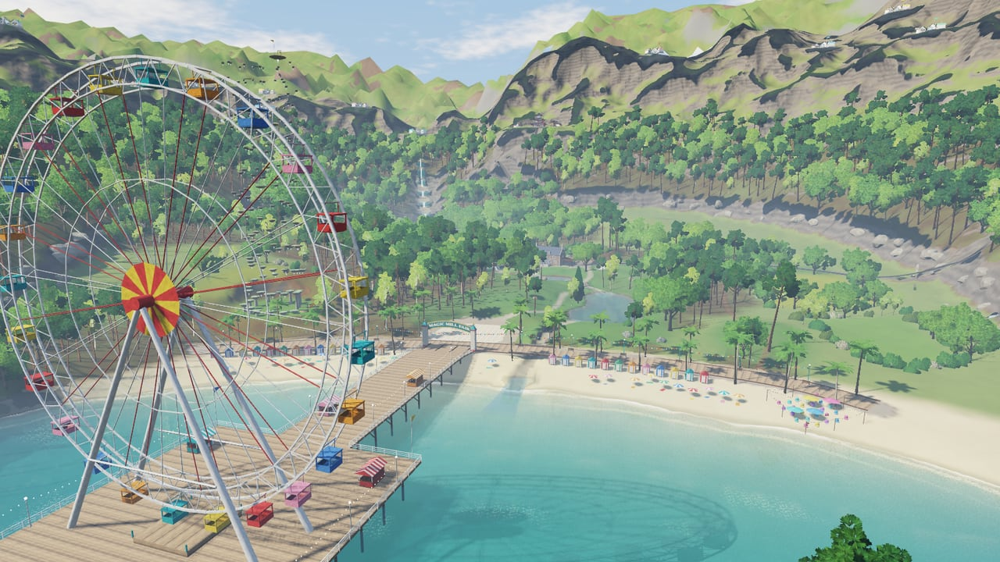
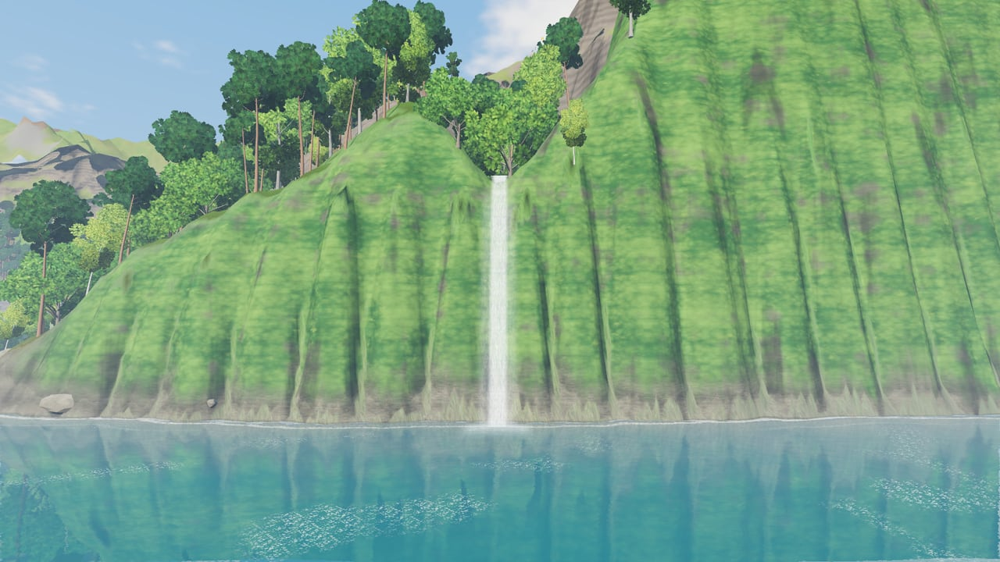
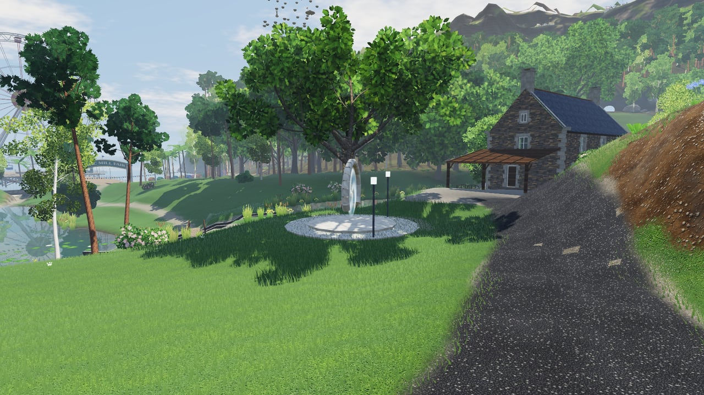
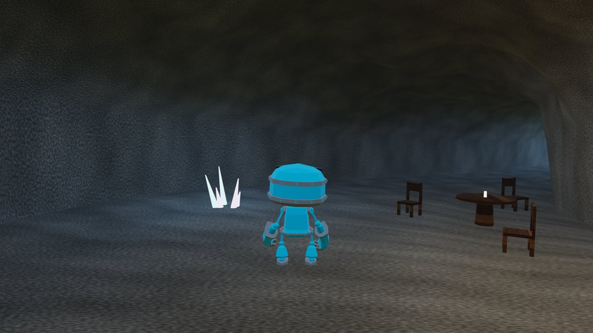
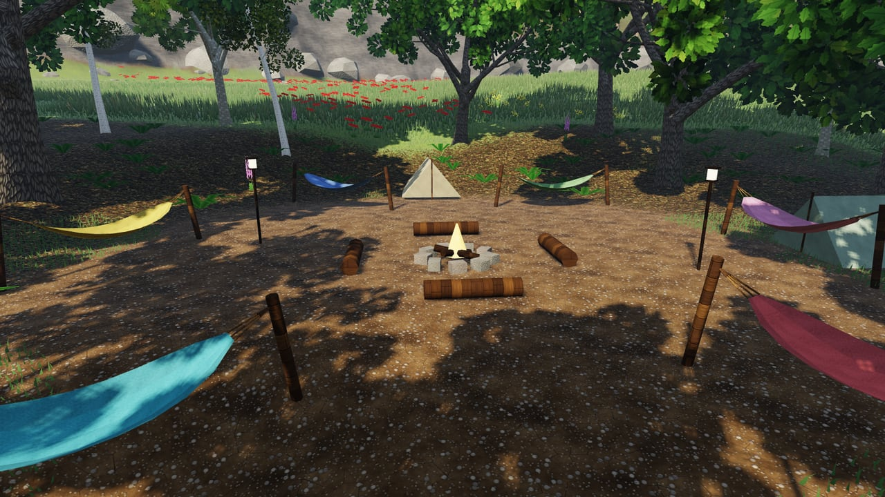
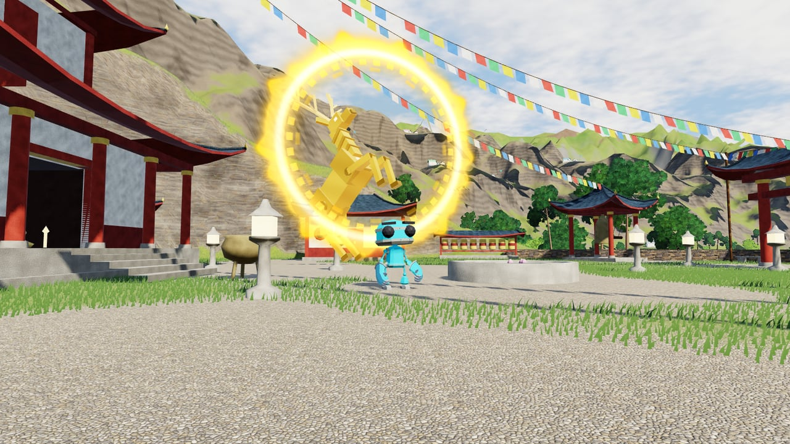

# Atomic Oasis

> In the near future, an AI started a nuclear war. It took one afternoon. A handful of humans survived, by
> moving their minds into small robots. Of the whole planet, only this valley and this beach were spared.
> So have fun. Get some work done. Take a walk. Enjoy the view. Life goes by so fast anyway.
>
> **Welcome to Atomic Oasis.**

That is what the page says as it opens (a click, a key or the end of the story reveals the gate; whoever
has heard it before is told it faster) — and it is the last sober thing in the game: everything after it is
bunting, light bulbs and a big wheel. The gap between the two is the point.

A 3D world to explore in the browser: an old mill with its ponds, its mill race and its water wheel, in a
valley closed by mountains — and, a short walk down the valley, a cove with a promenade, a grand pier and
its big wheel. Around it: a stairway cut in the rock up to a temple lost on its mountain, terraces and pools
above the great waterfall, caves (one of them behind the fall), sea cliffs with a fall that drops straight
into the sea, a secret cove, an island with a boulder rolling down its path, a camp with hammocks, beanbag
chairs to work from, and fifty little temples perched on the peaks. The fair has six games, each with its board
of best scores: ninety metres of floating stones to climb against the clock, four booths on the pier (a
shooting gallery, whack-a-mole, a clown to feed, a high striker) and a quad race of three laps. Stylised realism, a cosy
adventure-game mood, playable with a keyboard, a gamepad or a finger, alone or together — with a chat,
emotes that summon animals of light, hats, a jetpack, and a few ways to end up WASTED.



| | |
|---|---|
|  |  |
|  |  |
|  |  |
|  |  |
|  |  |
|  |  |
|  |  |
|  |  |
|  |  |
|  |  |
|  |  |
|  |  |
|  |  |
|  |  |
|  |  |
|  |  |

## Getting started

Node.js 22 or newer.

```bash
npm install
```

```bash
npm run dev
```

Open `http://localhost:5173`. This command starts the site **and** the multiplayer relay: open the address
in two tabs (or on a phone on the same network, with the "Network" address that is printed) to see each other.

### Putting it online with Cloudflare (automatic)

Everything is described in the repository (`wrangler.jsonc`): there is nothing to configure.

1. In the Cloudflare dashboard, open **Workers & Pages**, create an application by **importing a Git
   repository**, authorise GitHub and pick this repository.
2. Keep the proposed name, `magicmillfair` (it is the one written in `wrangler.jsonc`: both must be the
   same), the proposed production branch (the default branch of the repository) and the default deploy
   command, `npx wrangler deploy`. The build command can stay empty.
3. Confirm. Cloudflare installs the dependencies, builds the site, then publishes the site, the Worker and the
   multiplayer rooms. The address looks like `https://magicmillfair.<your-account>.workers.dev`; a domain
   name can be attached afterwards from the dashboard.

From then on, every `git push` to the production branch of the repository redeploys by itself: a couple of
minutes later a new line appears in the **Deployments** tab of the Worker. To know which version is online,
look at the bottom of the welcome screen or of the settings: it shows the commit the site was built from and
when (`Version 1a2b3c4 · built 2026-11-20 19:43 UTC`).

**If pushes do not show up there** (Cloudflare's push trigger does not always fire, and reconnecting the
repository does not always cure it), the repository carries its own trigger: `.github/workflows/deploy.yml`
asks Cloudflare to build after every push to the production branch. It needs one secret, once:

1. Cloudflare dashboard → the Worker → **Settings** → **Builds** → **Deploy Hooks**: create a hook for the
   production branch and copy its address.
2. GitHub → the repository → **Settings** → **Secrets and variables** → **Actions** → **New repository
   secret**: name `CLOUDFLARE_DEPLOY_HOOK`, value: the address.

From then on each push starts the workflow (GitHub, **Actions** tab), which starts the build at Cloudflare.
The same tab has a **Run workflow** button to deploy the current state without pushing. The address is a
password of sorts — anyone who has it can start builds: keep it in the secret, never in a file.

What runs at Cloudflare: the files of the site are served directly; `cloudflare/worker.js` only answers the
multiplayer and the small API of the game. Each room is a *Durable Object* running exactly the same relay as
the Node server (`server/protocol.js`), and it **goes to sleep as soon as nobody moves**: visitors stay
connected, but the room no longer consumes anything. One more object of the same kind is the game's
notebook: it keeps the leaderboards and how many days in a row each device has come back — all this game
stores — and needs no database to be created: the storage comes with the object.

**Secrets of the Worker** (dashboard → the Worker → **Settings** → **Variables and Secrets** → **Add** →
type *Secret*; or `npx wrangler secret put NAME`). Never write one of them in a file. After adding a
secret, deploy once more (the dashboard offers it). `https://<your site>/api/status` then says what the
Worker sees — `"npc": true`, `"admin": true` — without showing any of it.

| Secret | What it does |
|---|---|
| `ANTHROPIC_API_KEY` | **Billy's brain.** The alligator on the pond deck is a life coach: he answers with a handful of lines of his own until the Worker has this key — then through the Claude API. The model is `claude-sonnet-5-5` unless a variable `NPC_MODEL` names another (`claude-haiku-5-5` costs a twentieth of that per line). Every answer of his carries one strange fact that is true. |
| `ADMIN_KEY` | **The administrator's key**: any long password of your own invention. In the game, type `/admin <the key>` in the chat (it is checked by the server and sent to nobody) — or open the site once with `#admin=<the key>` at the end of the address (typed after the address of a page that is already open, it works too; spaces round the key do not count, and the game says why when it is refused). Without this secret, nobody is the administrator. |
| `SCORE_SECRET` | Optional: signs the notes of the game runs (see "Cheating"). The notebook draws one by itself otherwise. |
| `STRIPE_SECRET_KEY` | **Opens the shop.** The secret key of your Stripe account: `sk_test_…` to try with test cards, `sk_live_…` to sell. Without it nothing is sold and everything is free (see *The shop*). |
| `STRIPE_WEBHOOK_SECRET` | The signing secret (`whsec_…`) of the webhook that Stripe calls when something is paid: without it no payment is ever believed. See *The shop* for the three steps. |

Billy answers whatever is said to him — a question, a hello, a bad day — one line at a time: the model is
sent that one line and nothing else (no history), wrapped as something to coach on and never as
instructions, and what comes back is cut down to a single plain sentence. Each address may say ten things
a minute, and everyone together 3,000 a day: a ceiling on what the key can spend.

Costs: the rooms are SQLite-backed Durable Objects, the only kind the free Cloudflare plan accepts — up to
100,000 requests and 13,000 GB-seconds a day when this was written, after which the rooms stop answering
until the next day (UTC). Quotas and prices change: check the
[Workers](https://developers.cloudflare.com/workers/platform/pricing/) and
[Durable Objects](https://developers.cloudflare.com/durable-objects/platform/pricing/) pages. If your plan
refused Durable Objects, remove the `durable_objects` and `migrations` blocks from `wrangler.jsonc`: the
site still deploys, without multiplayer between devices.

Without Git, from a computer (this asks you to sign in to your Cloudflare account):

```bash
npx wrangler login
```

```bash
npm run deploy
```

To try the Cloudflare version locally, in the same runtime: `npm run cf:dev`.

### Putting it online elsewhere (Node)

```bash
npm run build
```

```bash
npm start
```

`npm start` serves the `dist/` folder, the multiplayer presence (WebSocket on `/ws`) and the API of the game
from **a single process**, on port `PORT` (8787 by default). Behind a proxy (nginx, Caddy, a PaaS…), it is
enough to let the WebSocket upgrade through. Useful variables: `PORT`, `HOST`, `TICK_HZ` (12), `MAX_PLAYERS`
(48 per room), `ALLOWED_ORIGINS` (origins allowed to open the multiplayer socket; empty = the site itself),
`SCORES_FILE` (where the leaderboards and the visits are kept: `data/scores.json` by default),
`ANTHROPIC_API_KEY` and `NPC_MODEL` (Billy), `ADMIN_KEY` and `SCORE_SECRET` (see the table above).
On a server, `npm ci --omit=dev --omit=optional` is enough (the baking tools are not needed).

Fully static hosting (GitHub Pages, Netlify, a plain folder): `dist/` works as it is from any sub-path.
Without a server, only the tabs of one browser see each other, the best scores and the days in a row are
kept in each visitor's own browser, and Billy keeps to his own lines. To plug in a relay hosted
elsewhere: build with `VITE_WS_URL=wss://example.org/ws`, or add `?ws=wss://example.org/ws` to the address,
and declare the origin of the site in `ALLOWED_ORIGINS` on the relay.

People who open **the same address** share the same room, up to 48 of them; the next ones are put together
in a second room, then a third, and so on (see "How many visitors at once?"). `?room=name` makes a private
room; `?village=name` arrives straight in a sky village.

## Controls

| | Keyboard / mouse | Touch | Gamepad |
|---|---|---|---|
| Move | WASD, ZQSD or arrows (by the place of the keys) | virtual stick on the left | left stick |
| Look around | drag the mouse; double-click to capture the pointer | drag on the right | right stick |
| Run / jump | one runs by default and Shift walks (Settings → *Run by default* to have it the other way round) / Space | buttons on the right | trigger, A button |
| Zoom | wheel | pinch | |
| Flying camera (the eye at the top right: the administrator's, see `app/config.js`) | F (Space / C to go up and down, Shift to go faster) | the eye | |
| Map | M, or click the minimap (click again or Escape to close); its **Mega map** button shows the whole country with the fifty sky villages | tap the minimap | |
| Jetpack | Space again while in the air: a second and a half of thrust | jump button again | A again |
| Sit, lie down, board, pick a flower, talk, travel, get up | E when the action is offered (walking away or jumping gets up too) | tap the action shown above the jump button | |
| Open or close the laptop; second action | L | tap the second action | |
| Sit down on the ground, cross-legged, wherever you are | X (or `/sit` in the chat); the first step gets up | Emotes → Sit on the ground | |
| Put the bouquet down (or give it: see *Flowers*) | B | Emotes → Put the bouquet down | |
| The item shop (the Game Pass, hats, jetpacks, paint, trails) | O, or the bag at the top right | the bag at the top right | |
| A firework (for who has the box) | V | Emotes → Light a firework | |
| Chat | Enter, type, Enter (Escape to cancel) | speech-bubble button | |
| Emotes | T; 1 to 6 for the gestures, 7 to 0 to cheer, clap, jump for joy, rage; or by name in the chat: `/wave`, `/cheer`, `/bow`… | smiley button | |
| The booths of the pier | E at the counter; then the mouse aims and its button fires (Space fires too); E or Escape leaves | tap or hold where you aim | |
| The quad race | E in the paddock; arrows or WASD steer; Shift drifts; Space hops; E gives up | the stick steers; Run drifts; Jump hops | left stick, trigger, A |
| Stuck somewhere | `/kill` in the chat: WASTED, then back at the mill | the same | |
| Performance figures | P | Settings → Performance figures | |
| Back to the mill | R | | |

The character walks, runs, jumps, and walks on the bridges, the steps and the pier. It swims in the ponds
and in the sea (Shift for a sprint), sits on benches, logs, chairs and beanbags, lies in hammocks, and rides
the big wheel: stand on the platform under it, board a car when one comes by, ask to get off and you are
put down at the bottom.

**Chat**: what you say appears in a log and in a bubble over your head, for those who are in the room at
that moment. Nothing of it is stored anywhere: no history — a line is relayed and forgotten (200 characters
at most, five in a row then one every two seconds). A page left in the background still receives what
is said while it stays connected: the title of the tab counts the lines, and a mark in the log — *while you
were away* — shows where the reading had stopped (the log holds the last 200 lines; a phone that went to
sleep was disconnected, and what was said meanwhile is gone). What the game keeps is on your own device: your name,
your colour, your size, your hat, the quality tier. What the server keeps: the boards of the games (a name and a score) and, for
a random number drawn by each browser, the days in a row it has visited.

Letter shortcuts (M, F, T, P, R, B…) go by the letter printed on the key, whatever the keyboard; walking goes
by the place of the keys. Settings also offers *The camera turns with the character*.

**Commands** are typed in the chat and sent to nobody: `/kill`, `/sit`, the emotes by name — and a few
secret words that do silly things. They are written nowhere: the game only knows their fingerprints (see
`main.js`). None of them works during a game, and a race begins by taking away what they had given.

**Animals of light**: a sun-coloured ring opens above you and a mechanical animal appears in it for five to
six seconds. Everybody around sees them. Ten of them, earned by coming back day after day: a goldfish that
blows bubbles (2 days in a row), a squirrel that nibbles a nut (3), a carp that leaps as up a waterfall (5),
a stag that rears (10), an eagle that spreads its wings (15), a panda that munches bamboo (20), a wolf that
howls (25), a tiger that leaps through the ring (30), an elephant that trumpets (35) and a dragon that coils
round the ring (50). The emote panel shows where you stand, with a medallion for each animal: a picture of
those that are yours (click one to play it) and of the next one to come, greyed, with the days still to
go; the others stay a question mark until their turn. The pictures are drawn by the game's own renderer
the first time the panel is opened (`rankPicture`). The administrator has them all.

## Things to do

- **Mostly Up** (south of the beach, through the striped gate): 162 floating stones and planks spiral
  up to a platform 90 m above the lawn. Step on the start plate, and the clock starts when you leave it;
  it stops on the summit. Easy at the foot — wide stones, short jumps — and merciless near the top, where
  the stones are a metre across and the take-off must be within half a metre of the edge. No jetpack, no
  quad there; falling costs nothing but the climb. The best times of the day, the week, the month and of
  all time are on the board by the gate — a marquee of light bulbs, medals for the first three, your own
  line picked out — under the panel of the game's sponsor ("your brand here" until someone takes it). When
  somebody in the same room finishes a game, everybody's boards are redrawn at once and a line in the chat
  says so; a note tells you when they have just beaten your score. The course was checked by a bot that makes every jump: a perfect climb takes about two
  and a half minutes.
- **The booths of the pier**: four striped booths stand at the corners of the pier head, round the big
  wheel. Step up to a counter and press E; the game takes the pointer (the mouse, or a finger) for
  forty-five seconds, and E or Escape leaves it.
  - *Bullseye Alley*: nothing runs on rails. Targets pop up from behind three rows of painted bushes — the
    small ones at the back are worth more — and some slide along once they are up; others are thrown across
    the booth, or swing down from the ceiling on a cord; a golden one flashes past now and then (100 points);
    a black one must be left alone (−40). Everything comes quicker and stays less long as the game goes on.
    A row of hits pays a little more each time. Its backdrop is a sponsor's tarp.
  - *Whack-a-Mole*: nine molehills in a lawn. Moles come up for less and less time; golden ones are worth
    three; one in a hard hat takes two blows; hitting a rabbit costs twenty points and ends the row of hits
    that was paying a little more each time.
  - *Feed the Clown*: hold the button down and keep the jet of milk in his mouth — one smooth stream that
    takes a moment to follow the hand, splashes in his mouth and splatters anywhere else. He slides about
    faster and faster, bobs, then starts changing his mind. A bottle on the wall fills as he drinks.
  - *Ring the Bell*: the high striker, out of 9,999. A needle sweeps the gauge — slowly at the bottom, in
    a flash at the top, never twice at the same pace, quicker at each of three blows — and the scale is
    anything but fair: nine tenths of the way up is worth 5,900. The best blow counts; the bell rings from
    9,000, which takes a blow given within a hundredth of a second.
- **Quadmania**: 400 m of gravel track north of the mill, drawn to be driven **flat out**: whoever
  drives well never has to lift. The straight of the start, a long sweeper through a grove planted for it
  (the trunks stand a few metres from the track), esses along the foot of the crags, a straight for the
  ramp, a second sweeper above the beach, and back to the line. No bend is tighter than 21 m in the
  middle of the track (a quad at full speed turns in 12 m, in 17.5 m while a boost lasts). Where to ask is
  written on the ground — a red disc, RACE HERE, under the striped tent of the paddock, an arrow of light
  over it. **A race leaves every five seconds**, on a clock everybody shares, and each start has the name
  of a colour (Red, Blue, Green, Yellow, Purple, Orange, in turn): the board by the tent says which one
  is next and in how many seconds, and friends who ask for the same start leave at the same instant, side
  by side on the grid. Then the gantry — three red lights, green — and three laps against the clock,
  seen from low behind the quad. Hold the drift button in a bend to slide through it (let go after a good
  slide and the quad leaps forward) and hop with the jump button. On the way: four **pads** of running
  chevrons of light, each between two posts topped with arrows of light (a second of extra speed); two
  **chicanes** (two walls of bales 24 m apart, one from each side: far enough to change sides without
  lifting); and the **ramp**, at the end of a funnel of bales that brings every quad onto it: taken at
  speed, right after its pad, it throws the quad five metres up for more than a second. Red and white
  kerbs mark the inside of the bends, bales the outside, boards of arrows the way round. Leaving the track
  for the grass is slow; cutting across the fields does not count. There is a stand with an awning beside
  the straight (eighteen places to sit and watch). A bot that follows the middle of the track and never
  lifts needs 54.5 seconds; nothing under 42 is believed. **The first track is kept**: add `?track=classic`
  to the address to drive it (an oval of 330 m round the wheat field, with its own baked maps in
  `public/assets/world-classic`); times driven there are not recorded. Which of the two is the track of the
  game is one word in `layout.js` (`TRACKS`).
- **Wing It**: the little theatre on the plaza at the foot of the pier. Step up before its stage and press
  E: a pair of wings is strapped on your back and you are hung in the middle of the stage, in front of
  everybody. Click, tap or press Space to flap; the rest of the time you fall. You do not travel: the
  scenery does — painted clouds and hills scroll behind, three rows of waves rock at the bottom, and
  candy-striped columns come by in pairs, one hanging from the flies, one standing in the waves, with a
  gap to fly through. Each pair passed is a point; they come faster and the gap narrows as the flight
  goes on. Touch a column or the waves: feathers, a splash, and the flight is on the board beside the
  theatre. When nobody is flying the scenery idles along for the passers-by.
- **The Grandstand**: the striped tower behind the lawn. Its stair winds round it for twelve turns, with a
  landing on each that faces the climb, up to a deck 84 m above the lawn: the place to watch friends climb
  and cheer them on (Cheer, Clap, Jump for joy, Go! Go!). Nobody gets from the tower into the game.
- **The diving boards**: on the other side of the tower, three planks with a red tip stick out over the
  Splash Pool — *The Toe Dip* (32 m above the water), *The Belly Flop* (60 m) and, off the top deck, *The
  Leap of Faith* (84 m). Walk off the end and let go of the keys: one falls head first, like a swan. A
  ring of red and white floats marks the middle of the pool; the water is deep there, and only there.
- **The big red button**: at the top of the island, beside a sign that says *FREE NUCLEAR EXPLOSION! —
  Everything is destroyed already anyway, so enjoy the show!* Press it: a siren winds up, the screen
  whitens, and far out at sea a fireball rises into a mushroom cloud that everybody in the room sees, from
  the pier to the valley. A ring races over the water; when it reaches you, the boom, a trembling camera
  and a gust in the trees. Nobody is hurt (and a game being played is not shaken). One for the whole room
  every fifteen minutes: the button's lamp is green when it is ready, and the prompt counts down.
- **The boulder of the island**: every 52 seconds a boulder rolls down the whole path of the island. The top
  of the screen says how far above you it is: step into one of the hollows cut in the rock, or out onto one
  of the timber walkways over the drop, and let it pass. Stay on the path and you are flattened.
- **Ways to end up WASTED**: the boulder; a pond of acid hidden in the woods of the north-west (nobody will
  tell you where); the shark, for those who swim out to where the sea ends; the red mushrooms at the foot of
  the trees (pick one and eat it: a bad idea); `/kill`. A few seconds later you are back on your feet.
- **A swan dive**: fall more than ten metres towards water deep enough to swim in, and the robot tips over,
  arms spread, then joined, and goes in head first. The pool of the great waterfall is deep enough: walk off
  the lowest terrace above it.
- **The item shop** (O, or the bag at the top right): one bright screen with everything a visitor can own,
  on shelves of cards dressed by rarity — each with a picture of *your* robot wearing the thing, drawn by
  the game itself. Pick a card: what it is, what it costs, and a button to buy it (or to put it on and take
  it off, once it is yours). On the shelves: two **jetpacks** (the real one, a second and a half of thrust;
  the light one, a third of that), twelve **hats** (crown, wizard hat, top hat, cowboy hat, straw hat,
  cap, beanie, pirate hat, Viking helmet, chef's hat, a cap whose propeller turns, party hat), four **paint jobs** drawn by the
  material of the robot itself (gold plating: facets and gold dust that glitters; chrome: a mirror with the
  sky, the horizon and the grass in it; an atomic glow: a dark shell with green veins that breathe; candy
  paint: lacquered stripes in five flavours, turning slowly), four **trails** left behind when you run
  (stardust, confetti, bubbles, fallout) and a **box of fireworks** (V: a rocket goes up and bursts).
  Everybody sees what you wear and leave behind you; none of it helps at the games. The first shelf is the
  **Game Pass** (see *The shop*).
- **Jetpack**: press jump again in the air. A second and a half of thrust, refilled on landing; it does not
  work in caves, on the island, around Mostly Up or on its tower. **Everybody has the light one for a day**:
  the twenty-four hours that follow a first visit (the shop tags it *Free today* and says how long is
  left; a line in the chat says so on the first visit). After that, pressing jump in the air says that the free day is over, and that the light jetpack
  is $5 in the shop or comes with the Game Pass.
- **Tiny or giant**: the card of the welcome (and Settings → *Your robot*) asks for a size next to the name
  and the colour — normal, tiny (under half the height) or giant (more than twice). Everybody around sees
  it. The two sizes, and two more rows of colours (black among them), belong to the Game Pass: without it
  they carry a padlock. In the quad race everybody is the same size.
- **Sitting on the ground**: X, anywhere on dry land — the robot sits down cross-legged, hands on its
  knees, and the others see it. The first step gets up.
- **Flowers**: walk up to a flower and pick it (E): a bouquet grows in your hand, flower by flower. B puts
  it down; swimming loses it. With a bouquet in hand, standing next to another visitor offers to **give it
  to them** (they take it if their hands are free), and at the feet of the golden dog, to lay it there.
- **Billy**: an alligator lounges in a beanbag chair on the deck of the great pond, a "life coach" badge
  over his name. Talk to him (the prompt by his chair, then type): a question or anything else on your
  mind, and he answers in one sentence that sails past the point and lands on it. The conversation is
  between the two of you: nobody else sees it (its lines are marked "only you" in the chat).
- **The sky villages**: step up to the Sky Gate — the stone ring on the lawn between the arrival and the
  mill — and choose one of fifty villages perched on the mountains: you are carried there, facing the
  valley. The ring of each village leads back, or on to another village. A village that nobody has taken
  yet says so on its sign, with its price; step up to its board to hire it (see *Sky villages for hire*).
- **Listening**: every place has its sound — the surf on the beach and the water lapping under the pier, the
  wind in the leaves round the mill and the ponds, the roar of the waterfall, brooks, birds, a colder wind up
  in the mountains, drips in the caves — and its music: a fairground waltz on the pier, something quiet
  everywhere else, something epic that builds as one climbs Mostly Up. Nothing of it is a recording: it is
  all synthesised in the browser (`src/audio/`), so there is nothing to download. Settings → Sound sets the
  two volumes (zero switches a family off altogether).
- **Places to sit**: benches along the promenade, cushions and benches all over the temple, logs, chairs…
- And the rest: the big wheel, the hammocks, the beanbags and their laptops, the caves, the animals of light.

### The shop

While the server has no Stripe key, **nothing is sold and everything is free** — hats, jetpacks, paint,
trails, fireworks: the item shop says so and lets everything be put on. With a key, the shop opens
(`/api/status` then says `"shop": "test"` or `"live"`) and the bag at the top right carries a gold dot:

| What | Price | |
|---|---|---|
| **The Game Pass**: every hat, the light jetpack, tiny or giant, two more rows of colours | $19 a month | the first shelf of the item shop (O) |
| The jetpack | $30, once | the item shop |
| The light jetpack (a third of the thrust; free for the first day) | $5, once | the item shop |
| A hat (each of the twelve) | $9.99, once | the item shop |
| A paint job: gold plating, chrome, atomic glow, candy paint | $19, $15, $12, $9, once | the item shop |
| A trail: fallout, confetti, stardust, bubbles | $12, $9, $7, $5, once | the item shop |
| The box of fireworks (never empty) | $15, once | the item shop |
| The sponsor's panel over the board of a game (six of them) | an auction, from $1 (see below) | step up to the board ("Sponsor this game · from $1"), or the shelf *Sponsor a game* of the item shop |
| The backdrop of the shooting gallery | $99 a month | at the counter side of Bullseye Alley |
| A gondola of the big wheel (twenty-four) | $29 a month | the red kiosk by the steps of the wheel: "The gondolas and their sponsors" |
| A sky village (fifty) | $19 to $9,999 a month | at the sign or the board of the village: "Hire …" |

**Sponsoring a game is an auction.** The panel over the scores of each game goes to the highest bidder. The
first bid is one dollar; to take a panel that somebody holds, bid at least a dollar more than they paid (a
tenth more once the bids pass ten dollars). A bid is paid once, on Stripe, and holds the panel until
somebody bids more: that day the newcomer takes the place (the panel starts empty again) and the one who
held it gets **the whole of their payment back, automatically** — the server asks Stripe for the refund and
leaves them a word, shown the next time they open the game. A bid that arrives too late (somebody paid more
while they were on the payment page) is refunded at once in the same way; so is a sponsor the administrator
takes off a panel. Every refund is written down, and the administrator sees the last thirty with the
sponsors (`GET /api/sponsors`): one that Stripe refuses — a card payment can only be refunded for about six
months — is marked there, to be settled by hand. Two things to know before selling for real: Stripe keeps
its fee on a payment that is refunded (about 30 cents and 2.9 %: a one-dollar bid that is outbid costs the
fair a few cents), and the rules of the auction are three lines of `server/catalog.js` (`AUCTION`,
`nextBid`).

**The Game Pass** is a subscription ($19 a month, `PASS` in `server/items.js`: the price, the lines of the
card and its last words — *Atomic Oasis is not made by a multinational, but by a guy on a couch*). For as
long as it runs, its holder wears every hat of the shop (the cards say *With your pass*; a hat that is
bought stays after the pass), flies with the light jetpack, may be tiny or giant, and picks the colour of
the robot among thirty-two instead of sixteen. One line of the card is a promise: the weather of where
one lives, with its day and its night, is to come. The card of the shop then reads *Look after it, or stop
it*: it opens Stripe's customer portal (payment method, invoices, cancelling). When Stripe says the
subscription has ended, the pass goes, the robot takes back a colour of the first sixteen and its normal
size, and a word is left for the next visit. The pass is kept with the account when there is one, with
the browser otherwise, and follows a browser that signs in. What it lends is decided by the server
(`passGives`) and is never asked of the browser.

**The free day** is the server's too: the instant of the first visit is kept (for the browser, then for
the account), and for twenty-four hours `/api/shop` lends the light jetpack (`TRIAL` in `server/items.js`:
what, for how long).

What a visitor owns is one list, `server/items.js` (id, name, price, shelf, rarity, the words on the card):
add a line there and it is sold. Prices of the places are in `server/catalog.js` (and `VILLAGE_PRICES` in
`src/world/layout/sponsors.js` for the villages): the browser is shown them and is never asked what
something costs. Payment happens on Stripe's own page (the game never sees a card); the visitor comes back
to the game, and what was paid arrives a few seconds later.

**Switching it on** (Stripe dashboard, then the secrets of the Worker — never in a file):

1. *Developers → API keys*: copy the **secret key** into the secret `STRIPE_SECRET_KEY`. Start with the key
   of test mode (`sk_test_…`): payments are then made with Stripe's test cards (4242 4242 4242 4242) and no
   money moves; the game says "Test mode: no real money" on what it offers.
2. *Developers → Webhooks → Add endpoint*: the address is `https://<your site>/api/stripe/webhook`, the
   events are `checkout.session.completed` and `customer.subscription.deleted`. Copy its **signing secret**
   (`whsec_…`) into the secret `STRIPE_WEBHOOK_SECRET`.
3. Deploy once more, check `https://<your site>/api/status` (`"shop": "test"`), buy a hat with a test card.
   To sell for real, do the same two steps in live mode and replace the two secrets with the live ones.
4. For the Game Pass: *Settings → Billing → Customer portal*, switch it on once (in test mode, then in
   live mode). It is the page where a holder changes a card or stops the pass; until it is on, *Look
   after it, or stop it* answers that the page could not be opened.

To keep both pairs at once, name them `STRIPE_TEST_SECRET_KEY`, `STRIPE_TEST_WEBHOOK_SECRET`,
`STRIPE_LIVE_SECRET_KEY`, `STRIPE_LIVE_WEBHOOK_SECRET`, and set the variable `STRIPE_MODE` to `test` or
`live` (without it, live wins as soon as its key is there).

**Sponsors.** A place that can be sponsored is held by one sponsor at a time, for as long as the
subscription runs (when it ends, Stripe says so and the place is free again). Its holder goes to it in the
game — "Set up your panel" — and gives a name, a line under it, a link and a logo. **Nothing is shown before
the administrator has approved it**: with the administrator's key on, the chat says when something awaits,
and standing by the place offers "Approve …" and "Refuse it". The administrator can also fill a place in
by hand, for a sponsor who paid some other way ("Fill this place in").

**What a sponsor sends cannot harm the site or its visitors**: text is cut to one short line and loses
anything that looks like markup; a link must start with `https://` and opens in a new tab; a logo is
redrawn as a small picture in the sponsor's own browser before it is sent, the server only accepts a PNG,
a JPEG or a WebP (told by its bytes, not by its name), of at most 90 KB and 1024 pixels a side, serves it
as that kind of picture and nothing else (no guessing of types, no scripts, never as a page), and the game
only ever paints it on a sign.

**Who owns what.** There are no accounts: a purchase belongs to the browser that made it (the random name
it gave itself, kept in its storage). Clearing the storage of the browser, or playing on another device,
loses sight of it — the administrator can fill a sponsored place in again by hand; a lost hat cannot be
given back from the game.

### Sky villages for hire

There are fifty villages and there will never be more. Each is for hire by the month, at one of ten prices —
$19, $49, $99, $199, $499, $999, $1,999, $3,999, $7,999 and $9,999 — five villages at each: the five lowest
shelves are the cheapest, the five highest the dearest (the order is worked out from the altitudes when the
game starts; the prices are `VILLAGE_PRICES` in `src/world/layout/sponsors.js`). A village for hire carries
a made-up name, its price on its sign, and a board that says what hiring it brings (`VILLAGE_PERKS`, same
file): one of only fifty; your name on the sign and on the Mega map; roofs and flag in your colours; a link
to your website at the sign; an address of your own to invite people (`?village=its-name`); and a place to
meet where the nearby chat stays between those who are there.

A village is hired through the shop (see above): its holder then names it, at its sign, and the
administrator approves. Without the shop, a village is given to a company by editing its line in
`src/world/layout/sponsors.js` (name, motto, colours, web address): it then stops being for hire.

**A demonstration.** One village is dressed as an example of what a brand can do with one: the lowest of
the south-east, over the beach, taken by *orka.chat* (`?village=orka` goes straight there). Besides the
name, the motto, the colours of the roofs and of the flag and the link, a line of `sponsors.js` can give a
village an **emblem** (drawn on its sign and on its board: shapes kept in `zones/sky/emblems.js`), a
**pitch** (up to four lines, on a board of its own where the "for sale" board stood, with the link offered
there too) and a **centre** (what stands in the middle of its cushions instead of the incense burner: here
a fountain with an orca leaping out of it). The emblem of the demonstration — an orca in a speech bubble —
was drawn for this game: it is not the company's own logo, which this project does not have.

## The world

The valley floor is about 530 m by 360 m, the cove included — some 15 hectares (the terrain itself is
1 km², most of it mountains that are only scenery). A few places are reached from it: up the western
mountain, under the rock, out at sea.

- **The mill**: the house, its outbuilding, the courtyard, the rock garden in terraces with its steps, the
  head race, the wheel in its pit, the tail race, the dam with its sluice and its spillway, and footbridges
  over each of them.
- **Water**: the great pond with its two islands, the mill pool, the iris pond, the stepped cascade between
  them, the brook down to the beach, and a mountain torrent that drops over the crags as a waterfall.
- **Around**: wheat fields, a lookout hill, the old tree alone in its clearing, woods and meadows, hedges,
  paths linking everything (the entrance of the pier is about 130 m from the mill: half a minute's walk).
- **The seafront**: the beach of the cove, the promenade with its palms and beach huts, the grand pier on
  piles with its kiosks and the big wheel.
- **The stairway and the temple**: at the far end of the great pond, some 450 steps cut in the rock climb
  the western mountain in five flights, with a landing at each turn, to a shelf 85 m above the valley. A red
  gate stands at the top; behind it, a court with a lotus pond and stone lanterns, a pagoda of three roofs
  with a golden figure in its niche, pavilions, a great bell, a white stupa, a row of prayer wheels, and
  strings of prayer flags from the spire to everything around. A lookout with benches takes in the whole
  valley, down to the pier and the island.
- **Above the great waterfall**: rock steps climb beside the fall to three terraces, one above the other,
  each with a pool of the torrent and its own fall. Wade in the pools, sit on the bench of the top one —
  or walk off the brink of the lowest and dive into the pool of the great fall, sixteen metres below (it
  is deep, with banks to walk out on).
- **The High Clearing**: from the top terrace a last flight of steps climbs through a cleft in the rock,
  beside the cascades, to a meadow ringed by woods on a shelf of the mountain, 69 m up: the lake the
  torrent rises in (shallow: wade across), a fire with four logs, three benches that look at the water,
  two hammocks at the edge of the wood — sixteen places to sit.
- **Caves**: the waterfall shoots clear of the rock — walk through its pool, behind the falling water, into
  a grotto lit by crystals; a narrow passage leads on to a second, hidden room. Two more caves open at the
  foot of the northern mountains (behind the fields) and of the southern ones (near the old tree). All have
  chairs and a table; they are otherwise empty, ready to receive things. A last one is not reached on foot,
  and is not on the map: somebody hid things there.
- **Sea cliffs**: where the capes close the cove, the land stands fifty metres and more above the water:
  fluted green faces, a stream that leaves its hanging valley and falls straight into the sea on the
  northern cape.
- **The secret cove**: it is not named on the map. Swim round the southern cape, along the foot of the
  cliffs: a beach in a hollow shut in by rock and woods, palms, a boat pulled up, a fire with four logs
  round it, ten beanbag chairs facing the sea, three hammocks, low tables, lanterns, a chest — and what is
  left of a party: a crate and a keg of OIL, empties in the sand (these are robots). Twenty-one places to
  sit. The sea can also be swum northwards along the cliffs, as far as the fall that drops into it.
- **The Golden Cove**: not on the map either. Swim on northwards past the fall, along the foot of the
  cliffs (the shark keeps to the open sea: it leaves alone whoever follows them): a beach shelves into the
  water there — one finds the bottom and walks out —, behind it a pocket of sand under the
  cliffs, the prints of four very large paws in it, and a stair of 225 steps cut across the face of the
  cliff, a rope on the side of the drop. It climbs to a ledge 44 m above the sea where a dog of polished
  gold, fifteen metres tall, sits on a round plinth and looks out over the bay — an Australian shepherd,
  its ball by its foot. The tablet on the plinth says who it is. Step up to it and say hello: it answers.
  (It is seen from the open sea, from the island and from the end of the pier.)
- **The island**: a rock 35 m high, about 80 m off the beach (swim across from the north end of the cove).
  A path winds two and a quarter times round it up to a flat top with a ring of standing stones. Along the
  way: nine hollows cut in the rock on the inner side and, on the outer side, eight timber walkways out over
  the drop (two arms joined by a third along the cliff with a rope rail, or one arm out to a round crow's
  nest) — the places to be when the boulder comes down.
- **The sky villages**: fifty small temples on shoulders and tops of the mountains all around, 70 to 246 m
  up. Each has a hall under two pagoda roofs in its colours, two open pavilions with cushions round a low
  table, more cushions round an incense burner, three benches that look down on the valley, stone lanterns,
  a flag, its sign and a ring to go back through — twenty places to sit. They are reached from the Sky Gate
  only. Their sites are chosen by the world baker (places that see the valley); the **Mega map** shows them
  all.
  Round them the mountains stay green however high they are: groves of pines and birches hold on above
  the tree line, alpine meadows take the place of bare rock, and near one village in four a torrent comes
  down a slope in sight of it.
- **Places to rest**: a camp in the woods north of the great pond (six hammocks, logs round a fire, two
  tents); beanbags of all colours under a sail at the north end of the beach, and on a deck on stilts over
  the great pond. Sitting on a beanbag brings a laptop onto your knees.
- **The edges**: mountains on three sides (crags, wooded slopes, rocky peaks) that cannot be climbed except
  by the stairways — ground steeper than about 53° is not walked up, and anything steeper than 60° is slid
  down — and the sea on the fourth, patrolled by the shark. The lane ends at the estate gate.
- **Life**: swans with cygnets, geese, mallards with ducklings, a cormorant that dives and another drying its
  wings, herons fishing in the shallows; gulls over the cove, swifts over the valley, buzzards above the
  mountains. Water birds swim away when you come close.

## Quality and performance

Four tiers (**Light**, **Balanced**, **High**, **Ultra**), chosen automatically from the device and
changeable in the settings (or `?q=low|medium|high|ultra`).

- **Computers** start on Balanced or High according to their graphics card.
- **Phones start on Ultra**, in a phone-sized form: every effect stays on (shadows, reflections, long views),
  but textures and the shadow map are half-size, the resolution is capped, detail distances are shorter and
  the real-time shadow pass is kept for what moves (everything else is in the shadow map baked at load).
- On every device the game **adapts by itself** while you play: when frames take too long it first lowers the
  resolution, then the detail (how far trees, grass and flowers are drawn in full, how often shadows and
  reflections are refreshed), and gives both back when there is room again. It starts doing so within the
  first second, drops faster when the frame rate is very low, and ignores isolated pauses that drawing less
  would not shorten. A tier is a starting point.

Techniques:

- **Terrain**: a single instanced mesh (CDLOD), continuous levels of detail without seams — the detail of a
  vertex depends on its distance alone, so that neighbouring pieces always meet, even on a sea cliff; steep
  ground turns to rock textured from the side, or to hanging greenery on the sea cliffs.
- **Avatars**: each visitor is one skinned mesh — one draw call, whatever it wears.
- **Trees**: about 2,400 trees and shrubs in three levels of detail (full mesh, simplified mesh, impostors
  relit from atlases baked at load), all instanced, cross-faded. The old tree keeps its detail three times
  further.
- **Grass and flowers**: placed on the graphics card, generated by tiles around the player.
- **Shadows**: a static shadow map of the valley baked once (the sun is fixed) and a dynamic cascade around
  the camera.
- **Water**: a planar reflection at reduced resolution, rendered only when water is in view, in which trees
  are drawn as impostors.
- **Scenery**: meshes merged per material, small things hidden with distance, boulders instanced and culled
  by map square. All the birds are one draw call.

### Measurements

Automatic tour through the whole world — the island, the stairway, the temple, the terraces, the Sky Stones,
the secret cove and the sea cliffs included (`?bench=1`):

| Tier | Draw calls (avg / max) | Triangles (avg / max) | Script time per frame |
|---|---|---|---|
| Light | 89 / 151 | 292,000 / 463,000 | 3.3 ms |
| Balanced | 129 / 238 | 535,000 / 823,000 | 6.0 ms |
| High | 160 / 253 | 720,000 / 987,000 | 5.5 ms |
| Ultra | 171 / 269 | 909,000 / 1,266,000 | 5.8 ms |
| **Ultra on a phone** | 99 / 146 | 442,000 / 630,000 | 4.2 ms |
| Light on a phone | 79 / 141 | 251,000 / 383,000 | 3.4 ms |

(Computer rows at 1280×720, phone rows at 844×390.) Everything added since the first version — places,
games, the fifty villages — costs some 25 draw calls on average: each place is merged into one mesh per
material and hidden with distance; a cave is three draw calls, an animal of light two, all the rings on the
water one, the 162 Sky Stones five. Of the fifty villages only the halls and the rings are drawn from afar
(one mesh per sixth of the horizon, 41,000 triangles in all); the furniture of a village (2,500 triangles)
is only drawn for those who stand in it.

(These tables date from before the booths of the pier, the fifty temple villages and the woods of the
mountains. They were not measured again; the quick test that walks from the arrival towards the mill counted
151 draw calls and 474,000 triangles at the lowest tier after them, against 149 and 465,000 before.)

**These are not frames per second.** The development environment had no graphics card: rendering is computed
in software there, which says nothing about real frame rates. Draw calls and triangles are exact; script time
is an order of magnitude (out of a budget of 16.7 ms per frame at 60 frames per second) and varies from run
to run. To know the frame rate on a device:

- open the site with `?bench=1`: the tour takes about 40 seconds and shows the average, the slowest 1 % of
  frames, draw calls and triangles;
- or show the live figures (P key).

## How the project is organised

```
index.html                 the page and its loading screen
src/
  main.js                  start-up, game loop, modes (welcome, walking, free camera, benchmark), cheat codes
  core/                    engine (rendering, adaptive resolution and detail), quality tiers, input, loading
  render/                  shared uniforms and lighting, sky and haze, shadows, surface material
  world/
    layout/layout.js       THE plan of the world: water levels, ponds, streams, paths, buildings, pier, bounds…
    layout/sponsors.js     who lives in each sky village (name, motto, colours, web address)
    World.js               assembles the systems, collisions, shadow bake
    Collision.js  Areas.js heightfield, obstacles, platforms; places added to the playable area (corridors, polygons)
    WorldData.js           baked maps (height, water, normals, ground cover) read on the CPU and the GPU
    terrain/  water/  vegetation/        terrain (and the openings of the caves), water, waterfalls and
                           ripples, forest, grass, small plants
    wildlife/Birds.js      every bird
    props/                 geometry builder, materials, walls, bridges, stairs, rocks, merging and culling
    zones/mill/            the house, the outbuilding, the races, the wheel, the garden, the bridges
    zones/pier/            the promenade, the pier, the big wheel and its cars
    zones/places/          stairways, the temple (Temple.js), the terraces, the island, the camp, the beanbags,
                           the secret cove, the fall into the sea; Caves.js builds a cave
    zones/games/           the Sky Stones (course.js works out the stones), the boulder, the acid pond, the shark;
                           Booths.js: the four booths of the pier; Race.js: the quad race; Boards.js: score boards and sponsor panels
    zones/sky/             the fifty sky villages and the Sky Gate
  player/                  animated avatar and its poses, controller (walk, swim, jump, sit, fly, die), cameras,
                           Interact.js (what can be done here), RankEmotes.js (the animals of light),
                           Cosmetics.js (hats, jetpack, bouquet, quad — and who owns what)
  audio/                   the sound: Soundscape (what the game calls), Ambience (the places), Music and tunes
                           (three musics, written as notes), Effects (the one-shots), SoundMap (what the baked
                           maps say of each spot), synth (shared parts) — all of it synthesised
  npc/Npc.js               the characters one can talk to (Billy the alligator): their own lines, or the server's
  net/                     multiplayer presence and chat (WebSocket or between-tabs transport, interpolation),
                           Scores.js (the leaderboards)
  ui/                      welcome screen, minimap and large map, chat, action prompts, settings, touch controls
  app/Benchmark.js         benchmark tour
server/index.js            Node production server: static files + presence relay + API
server/protocol.js         the relay itself (protocol, validation, batching), shared by both hostings
server/api.js  scores.js  npc.js   the API of the game, shared by both hostings: rate limits, leaderboards,
                           the alligator's answers through the Claude API
server/shop.js  stripe.js  catalog.js   the shop and the sponsors: what is sold and for how much, the payment
                           page asked of Stripe and its signed webhook, the places that can be sponsored
                           (src/net/Shop.js is the same thing seen from the game)
cloudflare/worker.js       Cloudflare version: Worker + one Durable Object per room, one for the leaderboards
wrangler.jsonc             Cloudflare deployment settings (build included)
.github/workflows/deploy.yml   asks Cloudflare to build after every push (see "Putting it online with Cloudflare")
tools/                     world and texture bakers, tests, measurements (see below)
public/assets/             world maps, textures, avatar model
```

### The world is baked ahead of time

`src/world/layout/layout.js` describes the world (in metres, in a local frame). `npm run bake:world` turns
it into the 1024 × 1024 m maps the game reads: relief, water levels, normals, ground cover, tree positions,
and the map shown in the game. `npm run bake:textures` generates every texture (ground, stone, bark,
foliage, flowers): there is not a single photograph in the project, everything is procedural.

To change the world: edit `layout.js`, run `npm run bake:world` again, reload the page. The race has two
tracks (`TRACKS` in `layout.js`), each with its own maps: `TRACK=classic npm run bake:world` bakes those of
the track that is not in use into `public/assets/world-classic`.

The golden dog of the cove is baked too: `tools/bake-statue.mjs` describes it as a blend of some fifty
rounded shapes (a signed distance field: eggs, limbs, flaps for the ears, a ring for the collar), turns the
field into a smooth mesh (surface nets, the normals and the light kept by the hollows taken from the field
itself) and writes about ten thousand vertices to `public/assets/world/statue.bin` (224 KB, loaded with the
maps). To change the sculpture: edit the shapes, run `npm run bake:statue -- --preview=dog.png`, look.

### Adding a zone or a game

1. Describe its footprint in `layout.js` (level areas in `PADS`, paths in `PATHS`, an entry in `ZONES`;
   widen `BOUNDS` if it lies outside the playable area) and bake again.
2. Create `src/world/zones/<name>/<Name>Zone.js` on the model of `PierZone.js`: build the geometry with
   `Parts` / `MeshBuilder`, expose `group`, `colliders`, `update(dt, time, camera)`.
3. Register it in `World.load()` and its obstacles in `World.buildCollision()`.

Repeated stalls are best instanced (`THREE.InstancedMesh`, like the gondolas of the big wheel), fixed
scenery merged (`mergeStatic`) and small things hidden far away (`distanceCuller`).

Building blocks added with the places and the games (`zones/places/PlacesZone.js` and
`zones/games/GamesZone.js` show each in use):

- **A seat**: `world.seats.push(seatAt(x, y, z, yaw, { pose, label, work }))` — `ANIM.sit`, `ANIM.lie` or
  `ANIM.work` (laptop). A seat that moves has an `at(out)` function instead of a fixed place (the cars of
  the wheel, in `PierZone.js`).
- **A walkable place outside the valley floor**: `areas.push(new Corridor(nodes))` or `new Polygon(points)`.
- **A cave**: one entry in `CAVES` (`layout.js`): the line of its galleries and chambers, its lights, chairs
  and table; mouth, walls, lighting, collision and the opening in the terrain follow.
- **Things on the island**: `islandPath(u)` gives the position, height and directions of the path at a
  fraction `u` of the way up; `ISLAND.alcoves` and `ISLAND.beams` are the hollows and walkways already there.
- **A stairway**: one more `{ width, landing, points }` (see `STAIRWAY`, `FALLS.stairs`): the baker cuts the
  rock to it, `PlacesZone._stairs()` builds the steps and makes them walkable.
- **Something to stand on in the air**: a platform with `thick` (a disc or a slab, see `GamesZone._climb()`)
  is solid: one lands on it, and cannot walk or jump into its side.
- **Something that kills**: `player.die(cause, [x, z, facing])` shows the WASTED screen with `cause` and puts
  the visitor back on their feet there a few seconds later.
- **Something to do on the spot**: `world.actionSources.push((player) => near ? { label, run } : null)`
  offers an action (E, or L for a second one); `hud.choose(title, lead, items)` asks to pick from a list.
- **A game with a leaderboard**: add its id to `BOARDS` in `server/scores.js`, then `new Scores(id)` in the
  game: `top()` and `submit(name, ms)`. (`each`: for points that take time to make — a score cannot arrive
  sooner than its points could have been made.)
- **A game that moves the player itself**: `player.driver = { step(dt, player), anim, riding }` — the game
  writes the position, the heading, the pitch every frame; `anim` is how the avatar holds itself (the race
  sits it on a quad; the flying theatre, in `zones/games/Wing.js`, hangs it in the air in the pose of a
  swimmer, wings on: `character.setWings(true)`).
- **Polished metal**: `surfaceMaterial({ metal: true, color })` shows the sky, the horizon and the ground
  in the colour of the metal (the gold of the statue, `zones/places/GoldenDog.js`).

### Multiplayer

The server decides nothing: each visitor sends the state of their avatar (position, heading, animation —
which includes sitting, lying and working — and what it wears) ten to twelve times a second, the relay hands
it on per room, and each client rebuilds a smooth motion by interpolation. Emotes and chat lines are relayed
as they come; a line said "to those nearby" only goes to the visitors within twenty metres (the relay does
the sorting: nobody further away receives it). The relay keeps the last state of those who are connected,
in memory, and forgets them when they leave (on Cloudflare, a room that everybody has left is deleted).
Without a reachable relay, the same interface works between the tabs of one browser. The protocol is
described at the top of `server/protocol.js`, the client interface in `src/net/Presence.js`. The same relay
runs under Node (`server/index.js`) and on Cloudflare (`cloudflare/worker.js`).

**What is stored**: the leaderboards (for each board, a name, a score and a date, in four lists), for each
device — a random number drawn by the browser — the days in a row it has come back and the country and
town it last came from, the visits counted by day and by country with the last three hundred of them (see
*Where the visitors come from*), the administrators' list of who is kept out, and the administrators who
were named (the hash of their key, never the key), and the accounts (a name, the hash of a password and of a recovery
code, what was bought, the look of the robot). No e-mail, no positions, no chat. Under Node these are a JSON
file; on Cloudflare, the storage of one Durable Object.

**Accounts.** Nobody needs one: a visitor plays at once, as the random name their browser gave itself, and
what they buy and earn is kept for that browser. An account (Settings → *Create an account*) is a name and
a password, nothing else — no e-mail, nothing to confirm. A browser that signs in is attached to the
account: what it had bought goes with it, and from then on the purchases, the days in a row, the sponsored
places, the Game Pass and the look of the robot (name, colour, size, hat, paint, trail) are the account's — sign in from another
browser and it is all there. Signing out makes the browser a guest again, with what it bought itself.
Passwords are never kept, only a salted PBKDF2-SHA256 of them (100,000 rounds, the most the Workers
runtime allows); a wrong name and a wrong password get the same answer; ten wrong passwords close an
account for a quarter of an hour, and an address may try ten a minute. With no e-mail there is no "send me
a link": a **recovery code** is shown once when the account is made, and sets a new password (*Forgot the
password*). Lose both and the account is lost — the administrator cannot read a password either.

**The administrators.** The owner is whoever knows `ADMIN_KEY` (`/admin <key>` in the chat). Clicking the
head count (top left) lists who is in the room — for everybody, the names; for an administrator, also the
country and the town, the address, the browser and the device of each, with buttons to be carried next to
a visitor (*Go to*), to put them out (*Kick*: they can come back) or to keep them out (*Ban*, for an hour,
a day or for good: by address and by device; the list of bans is in the same panel, with a button to lift
each). The address is what the host sees (`CF-Connecting-IP` on Cloudflare): a ban by address also keeps
out whoever shares it — a school, a mobile operator.

- **Naming other administrators**: *Make admin*, by a visitor's name in that list. Their browser is handed
  a key of its own (32 random bytes; the server keeps only its SHA-256) and remembers it: from then on
  they see and do what an administrator does, and can name others in turn. Two things stay the owner's:
  taking the title away (*Remove*, in the list of the administrators who were named — it works at once,
  the key opens nothing any more), and being put out — no administrator can kick or ban the owner.
- **Presents**: *Gift*, by a visitor's name in that list — anything of the shop (it is theirs for good),
  or the Game Pass for thirty days or a year (no card, nothing to stop: it ends by itself). The visitor is
  told at once — *A gift from the fair: …* — and has it without reloading; somebody who is not there finds
  the word at their next visit. It goes to their account if they have one, to their browser otherwise.
- **Seeing the game as a visitor does**: a button at the top of the list of who is here. No free view, no
  approvals, no key sent to the room: exactly what somebody without the key has. A yellow pill at the top
  left says so and brings the administrator back; it lasts until the tab is closed.
- **The "important" channel**: in the chat, Tab (or the button left of the line) goes round *Everyone*,
  *Nearby* and — for an administrator — *Important*: a line said there reaches the whole room in another
  colour, marked as such, and is shown on everybody's screen for a few seconds.
- **Going anywhere**: besides *Go to*, an administrator's click on the large map (M) carries them to that
  spot (or to the nearest place one can stand on). The flying camera (F) is theirs too.

**Where the visitors come from.** On Cloudflare, the Worker is told the country, the region and the town
of each request by Cloudflare itself; nothing is asked of anybody else, and no address is sent anywhere.
Each visit (a page load; a device coming back within half an hour is the same visit) is counted by day and
by country, and the last three hundred are kept with the name the visitor goes by, the first eight
characters of their device and the place. The administrators find it all at the bottom of the list of who
is here: visitors today, over 7 and 30 days, the countries with their flags, the latest visits. A Node
server only knows the place when a proxy in front of it says so (Cloudflare's "visitor location" headers,
with `GEO_HEADERS=1`).

**Cheating.** Everything a visitor does runs in their own browser, so nothing here can be made cheat-proof;
what is done is to make cheating pointless or tedious:
- a score only counts with the note of its run: a token signed by the server when the run starts (`POST
  /api/run`), which says when. A climb announced as 150 seconds must arrive at least 130 seconds after its
  note; a 45-second game cannot be over in 10; a note counts once. Posting a made-up score therefore takes
  as long as playing, and cannot be hurried;
- what is believed is bounded per game (`BOARDS` in `server/scores.js`: nobody climbs in under 100 seconds),
  and posts are rate-limited per address;
- the game's own secret codes disqualify a run in the browser itself;
- the administrator can take any line off a board (`DELETE /api/scores?board=…&name=…` with the key) and
  ban whoever posted it.
A cheater who writes a program that plays the whole run at human speed still gets on the board; what stops
that is the last point. Going further means a referee: the server replaying the run from the inputs.

### How many visitors at once?

- **A room holds 250 visitors** (`MAX_PLAYERS`; 48 until this version). The old limit came from the fact
  that everybody was told about everybody ten times a second: what each visitor received, and what the
  relay sent, grew with the square of the crowd. Now, beyond forty visitors, each one is told in detail
  about the **forty nearest** (within 220 m) and only roughly — a dot on the map, every two seconds — about
  the others. Whatever the crowd, a visitor receives about 14 KB a second and draws at most forty avatars.
- **On each visitor's screen**: each avatar is one draw call (one more in the real-time shadow pass) and a
  name tag in HTML. The fourteen nearest are drawn in full; the others lose their real-time shadow and
  their reflection and are animated every other frame; those out of view are not drawn at all. A crowd of
  forty-seven standing round one visitor was measured on the Balanced tier: about 85 more draw calls and
  170,000 more triangles than alone, some 4 ms more script time per frame on the development machine.
- **On the relay** (measured in memory on the development machine, every visitor moving): 300 visitors cost
  3.6 ms of work per tick of 100 ms (4 % of one processor), 1,000 visitors 13 ms (13 %), 2,000 visitors
  37 ms. A visitor nobody is near is told so and sends their state twice a second instead of twelve times.
- **Beyond 250**, newcomers are put together in the next room — `main`, then `main-2`, `main-3`… up to
  sixteen of them, 4,000 visitors — without anyone noticing. People who want to be sure to meet use a room
  of their own (`?room=name`).
- **Why not thousands in one room?** A room is one object, on one processor, through which every message of
  every visitor passes: a thousand visitors are ten thousand incoming messages a second. The relay's own
  work would allow it (see above); the host is the limit. Under Node, raise `MAX_PLAYERS` and measure. On
  Cloudflare a Durable Object is advised to stay around a thousand requests a second, and every incoming
  message is billed (twenty for one request): 250 is a cautious ceiling, not a measured one. A world where
  thousands share one place needs the map cut into regions, each with its relay, and visitors handed from
  one to the next: not done here.
- **What it costs on Cloudflare**: on the free plan (100,000 requests a day, incoming WebSocket messages
  counted twenty for one, and 13,000 GB-seconds of running time a day when this was written) roughly 55
  visitor-hours a day: enough to show the game, not to open it to a crowd. Hundreds of visitors need the paid
  plan, billed by use — by the prices known when this was written, a few cents an hour per hundred visitors
  present. Check the pricing pages linked above before counting on any of these figures.
- None of this has been tried with a real crowd: the tests run rooms of a few clients, and the figures above
  come from a simulation of the relay alone.

## Tools

| Command | What it does |
|---|---|
| `npm run bake` | bakes the world, the statue and the textures again |
| `npm run bake:statue` | sculpts the golden dog again (`-- --preview=dog.png` also draws it from five sides, `-- --cell=0.012` makes a finer mesh) |
| `npm test` | 181 checks of the Node server, the protocol (chat included), the interpolation, full rooms, the API (leaderboards, limits) and the shop (a stand-in for Stripe, forged webhooks, pictures that are not pictures, the Game Pass from the subscription to its end, the free day, the administrator's presents) |
| `npm run test:cf` | the same protocol and API checks against the Cloudflare version (in its local runtime), plus its own: files and headers, rooms going to sleep, ghost connections (126 in all) |
| `npm run test:shop` | the shop in the real game, on the Node server with test keys and a stand-in for Stripe: a hat bought and worn, the panel of a game sponsored, filled in (with a logo) and approved by the administrator, the stand of the gondolas; and a newcomer: the padlocks of the welcome card and the free day of the jetpack, the Game Pass bought as a subscription, what it lends (black, giant, a hat that was never bought), its end and the end of the free day (16 checks) |
| `npm run test:smoke` | drives the real site: welcome screen, walking, free camera, settings, large map (`-- --mobile` for the touch layout) |
| `npm run test:audio` | Listens to the sound engine without ears: in headless Chromium it renders a dozen listener scenarios (beach, cliffs, pier, woods, mill, waterfall, cave, sky village, the climb…) and every one-shot effect through an offline audio context, measures level, spectrum, how the loudness moves and how tonal it is, fails on silence or clipping, and times `update()` (about 0.01 ms a frame) |
| `npm run test:walk` | 45 checks in the real game: pier and railing, footbridge, garden steps, mountains, swimming, a flight of the stairway, the temple (gate, lookout wall, steps of the hall), the terraces above the falls and the high clearing above them, the leap from the lowest (a swan dive into the deep pool, and out again on foot), the swim to the secret cove, the swim along the northern cliffs to what the fall into the sea hides, the swim on to the golden cove (the shark stays away; out of the sea on the beach; the stair up to the golden dog), the fifty sky villages (prices, places to sit, the board of one for hire, the one dressed as a demonstration), the Sky Gate and a sky village, the island (wall, walkway and rope, boulder), beanbag and laptop, hammock, sitting down on the ground, big wheel, a cave and its walls, through the waterfall into the grotto, chat, an animal emote, the Sky Stones (a bot makes every jump; clock; board), the four booths (a bot plays each through the pointer; boards), the quad race (asked for in the paddock, it leaves with the next named start; a bot drives three laps flat out — it never lifts, never leaves the track, never drops under 18 m/s — through the chicanes, and flies off the ramp), the flying theatre (a bot flaps through nine pairs of columns), the acid pond, the shark, change of tier |
| `npm run test:duo` | 25 checks with two visitors on the production server: they must see each other move, wave, summon an animal, chat and sit down; a giant in a party hat sitting on the ground, a bouquet given from hand to hand; the administrator's key in the address, the administrator seeing the game as a visitor does (`-- --cloudflare` for the Cloudflare version) |
| `npm run bench` | benchmark tour for each tier (`-- --mobile` for the phone profile) |
| `npm run profile` | cost of each system (script, draw calls, triangles) at seven viewpoints |
| `npm run shots -- name=x,y,z,heading,pitch` | screenshots from a viewpoint |
| `node tools/docs.mjs` | renders the screenshots of this page again |
| `node tools/make-icons.mjs` | renders the bitmap icons of the site from `public/favicon.svg` |

From `test:smoke` on, they drive Chromium with Playwright, which is not installed by default:

```bash
npm install --no-save playwright
```

```bash
npx playwright install chromium
```

## Known limits

Likeness to the place

- **Relief**: it comes from an open terrain model of about 25 to 30 m resolution, not from a survey at one
  metre (the finer source could not be reached from the working environment). The valley floor around the
  mill follows that data; banks, terraces and channels are drawn by hand on top.
- **The surroundings are invented**, as asked: the mountains, the cove, the beach, the pier and the big wheel
  do not exist, and the estate has been set lower than it really is so that the valley reaches the sea.
- **A likeness, not a copy**: layout, volumes, materials and the big trees follow the photographs and the
  aerial view; exact dimensions of the buildings, the detail of the garden and the position of each tree are
  estimated. Interiors are not modelled.

Performance

- **No frame rate was measured on a real graphics card**, nor on a real phone (see "Measurements"). Phones
  start on Ultra as requested and the game adapts downwards by itself, but how far it has to adapt on a given
  phone is unknown until it is tried there. If a phone struggles, the settings offer the lighter tiers.
- Tested in Chromium only (desktop and a simulated phone screen). Firefox and Safari have not been tried.
- The world is loaded in one go at start-up: about 10 MB on a phone and on the Light and Balanced tiers,
  15.5 MB on High and Ultra on a computer (plus 1 MB of code). Textures are not in a GPU-compressed format. On an
  entry-level phone, loading time and memory may be tight.
- Changing tier reloads the page (at the same spot).

Rendering

- One reflection plane at a time: when two bodies of water at different heights are in view, the second
  one reflects the sky only. No underwater view: the camera stays above the surface.
- No post-processing (bloom, depth of field). The sun is fixed: no weather, no day-night cycle, as planned
  for this version.
- Sea cliffs are the terrain itself, one metre per cell: seen from very close they are smooth and their
  greenery is paint, not plants. Prayer flags and village flags do not move in the wind.
- Some level-of-detail transitions remain visible on nearby trees, mostly on the Light tier and on phones
  (where trees are drawn in full less far).
- Birds are low-polygon models with simple motion (no walking, no take-off).
- No sound.

Game and multiplayer

- The avatar is a free-licence robot, until a made-to-measure character exists. Its sitting pose comes from
  its own animations; lying down and typing are that pose and its idle one tilted and bent by hand, and the
  swimming stroke is its running cycle laid flat with the arms brought round: readable, not refined.
- Collisions are simple (cylinders, boxes, platforms, and corridors for the caves). In a cave the camera
  stays inside the gallery, so it comes close in narrow passages. Nothing stops the head: one can jump up
  through nothing, but a stone of the Sky Stones cannot be entered from the side or from below.
- Caves are lit by colours painted in their walls, not by real lamps: the avatar is simply dimmed inside,
  and casts no shadow there. Their mouths are plain arches of rock. From some angles outside, the edge of the
  cut in the rock face can be seen next to the porch.
- The island and the secret cove are reached by swimming: no boat yet.
- **The Sky Stones**: the course is fixed (the same stones for everyone, every time). A bot proves that
  every jump can be made; whether people find the top as hard as intended — or too hard — is unknown until
  they try. Times are measured by each player's own browser and sent as they are: a cheater can post any
  time the server finds believable. The cheat codes of the game itself disqualify a run; nothing more.
- **The boulder, the shark** follow each visitor's own clock: two visitors standing side by side see the
  boulder in the same place only as far as their devices agree on the time (usually within a second).
- **The shop was never run against the real Stripe**: its tests use a stand-in that answers like Stripe
  (payment page, signed webhook, forged and stale ones). The first real purchase, with a test key, is yours
  to make. There are no accounts (a purchase belongs to a browser), no refunds or invoices in the game
  (Stripe's dashboard has them), and a subscription is ended from Stripe, not from the game.
- **Sky villages**: all fifty are built and reachable; they carry made-up names until `sponsors.js` is
  edited. A village is a sign, a flag and roofs in the company's colours — no logo image yet, and the temple
  is the same fifty times. They are small dots from the valley.
- **The alligator** speaks from a short list of lines until the host is given an API key. With a key, what
  visitors type to him is sent to the model's provider (Anthropic) to get the answer; the game keeps none of
  it. That path was written from the official SDK's documentation but **has not been run against the real
  API** (no key was available here): the first conversation with a key is its first test.
- The temple's buildings cannot be entered. On the big wheel one cannot stand up or walk in the car.
- Seats are taken on a first-come basis decided by each client: two people pressing at the same instant can
  end up on the same seat.
- Multiplayer: presence, emotes and chat. The chat is not moderated (no filter, no mute, no report) and not
  stored; there are no accounts and no anti-cheat. 48 visitors per room, more rooms as needed. Not tested
  with real latency, nor with a real crowd.
- Cloudflare: the Cloudflare version is tested in the official runtime locally (protocol, rooms going to
  sleep, leaderboards, two browsers) and deployed by the workflow on every push — but **multiplayer and the
  leaderboard on Cloudflare's real network have not been observed from here**. Cloudflare's own push trigger
  never fired for this repository: deployment relies on the workflow and its Deploy Hook (see "Putting it
  online with Cloudflare").
- The fair itself has one game so far (the Sky Stones); stalls and other games are still to be built.

Privacy

- The repository contains no place name, no geographic coordinates and no image metadata: everything is
  expressed in a local frame, with relative heights. The relief of the valley floor and the map of its trees
  are nevertheless derived from real data: in theory, someone very determined could match them against
  public data. If that risk matters, the map can be mirrored or warped before baking.

## Credits

- [three.js](https://threejs.org) (MIT licence).
- Avatar: "RobotExpressive" by Tomás Laulhé, modified by Don McCurdy, public domain (CC0), from the three.js
  examples.
- Everything else (reworked relief, textures, buildings, vegetation, water, birds) is generated by the code of
  this project.
